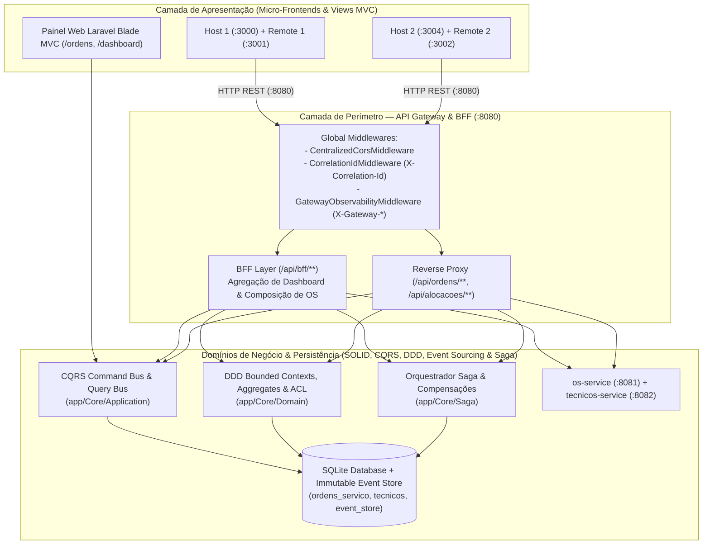

# NEXORA — Field Service ERP (Cloud Architecture, Microsserviços, MFE, Laravel MVC, API Gateway/BFF, SOLID/CQRS & DDD/Saga)

Ecossistema corporativo **NEXORA** para Gestão de Serviços de Campo (*Field Service Management*), desenvolvido para a disciplina de **Arquitetura de Soluções em Nuvem**. O repositório consolida de ponta a ponta cinco marcos arquiteturais (**Atividades Formativas 13, 14, 15, 16 e 17**), combinando **Micro-Frontends em React 18 / Webpack 5 Module Federation**, **Microsserviços (`os-service` e `tecnicos-service`) com Database-per-Service**, e a evolução em **PHP 8.3 / Laravel 11** estruturada com **MVC, SOLID, CQRS, API Gateway & BFF, DDD, Event Sourcing e Saga Pattern**.

---

## 👥 Integrantes do Grupo (`GRUPO.md`)

- **Éden Samuel**
- **Fernando Lopes**
- **Felipe Carneiro**
- **Henrique Ricardo**
- **Hugo Takeda**

---

## 📚 Índice de Entregas Acadêmicas (Formativas 13, 14, 15, 16 e 17)

| Atividade | Tema Central | Documentação Detalhada | Principais Artefatos de Código |
| :--- | :--- | :--- | :--- |
| **Formativa 13** | Micro-Frontends (2 Pares Host/Remote) no Azure | Seção 2 deste `README.md` | `host/`, `remote/`, `host-dashboard/`, `remote-dashboard/` |
| **Formativa 14** | Microsserviços (`os-service` e `tecnicos-service`) com Database-per-Service e Swagger | Seção 4 deste `README.md` | `os-service/`, `tecnicos-service/`, `scripts/test-crud.js` |
| **Formativa 15** | MVC (PHP/Laravel), SOLID, CQRS, CORS & Code Review *FinPay Core* | [`docs/FORMATIVA_15_SOLID_FINPAY_NEXORA.md`](docs/FORMATIVA_15_SOLID_FINPAY_NEXORA.md) | `app/Core/Application/`, `app/Http/Controllers/`, `resources/views/` |
| **Formativa 16** | API Gateway, BFF, Observabilidade, CORS & Azure CI/CD | [`docs/FORMATIVA_16_GATEWAY_BFF_AZURE.md`](docs/FORMATIVA_16_GATEWAY_BFF_AZURE.md) | `app/Gateway/`, `routes/api.php`, `config/gateway.php`, `.github/workflows/azure-gateway.yml` |
| **Formativa 17** | EDA, Event Sourcing, Event Catalog, DDD & Saga Pattern | [`docs/FORMATIVA_17_EDA_EVENT_SOURCING_DDD_SAGA.md`](docs/FORMATIVA_17_EDA_EVENT_SOURCING_DDD_SAGA.md) | `app/Core/Domain/`, `app/Core/Infrastructure/EventStore/`, `app/Core/Saga/` |

---

## 🌐 Links Públicos Oficiais de Produção no Azure (`rg-nexora-ca`)

| Tipo | Aplicação | Link de Produção | Descrição / Interface |
| :--- | :--- | :--- | :--- |
| 🛡️ **API Gateway & BFF** | `nexora-gateway-api` (`:8080`) | [https://nexora-gateway-api.azurewebsites.net](https://nexora-gateway-api.azurewebsites.net) | Ponto Único de Entrada (Fase 2), Reverse Proxy, Agregação BFF (`/api/bff/status`, `/api/bff/dashboard`, `/api/bff/ordens/{id}`), Painel MVC Blade e Orquestrador Saga |
| 🟢 **Frontend MFE 1** | Host Gestão de OS (`:3000`) | [https://nexora-host-fernando.azurewebsites.net](https://nexora-host-fernando.azurewebsites.net) | Shell Integrado + Remote MFE de Abertura e Gestão de Ordens de Serviço |
| 🔵 **Frontend MFE 2** | Host Dashboard BI (`:3004`) | [https://nexora-host-dashboard-fernando.azurewebsites.net](https://nexora-host-dashboard-fernando.azurewebsites.net) | Shell Executivo de BI + Remote MFE com KPIs analíticos operacionais |
| ⚡ **Microsserviço 1 / Remote 1** | `os-service` (`:8081` / `:3001`) | [https://nexora-remote-fernando.azurewebsites.net](https://nexora-remote-fernando.azurewebsites.net) | CRUD de Ordens de Serviço, ciclo de vida, Swagger UI interativo (`/api-docs`) e Health Check (`/health`) |
| ⚡ **Microsserviço 2 / Remote 2** | `tecnicos-service` (`:8082` / `:3002`) | [https://nexora-remote-dashboard-fernando.azurewebsites.net](https://nexora-remote-dashboard-fernando.azurewebsites.net) | CRUD de Técnicos de Campo, disponibilidade, Swagger UI interativo (`/api-docs`) e Health Check (`/health`) |

---

## 🏗️ Evolução Arquitetural: Fase 1 vs Fase 2 (API Gateway & BFF)



| Critério | Fase 1 — Acesso Direto (Microsserviços Isolados) | Fase 2 — API Gateway & BFF Centralizado (`:8080`) |
| :--- | :--- | :--- |
| **Ponto de Acesso do Frontend** | Múltiplos (`:8081`, `:8082`) | **Único (`http://localhost:8080`)** |
| **Política de CORS** | Espalhada em múltiplos serviços | **Centralizada no `CentralizedCorsMiddleware` e `config/cors.php` do Gateway** |
| **Impacto de Mudança de Portas** | Quebra o código do Frontend | **Transparente (altera apenas no Gateway)** |
| **Composição de Telas Complexas** | Múltiplos *requests* pelo browser (*Chatty I/O*) | **1 chamada agregada ao BFF (`/api/bff/dashboard` e `/api/bff/ordens/{id}`)** |
| **Observabilidade e Rastreabilidade** | Logs isolados sem correlação | **Headers `X-Correlation-Id`, `X-Gateway-Processed-By`, `X-Gateway-Route`, `X-Gateway-Execution-Time-Ms`** |

---

## 📁 Estrutura de Diretórios do Projeto

```text
NEXORA-Arquitetura-Claud/
├── app/
│   ├── Core/
│   │   ├── Application/          # Formativa 15: CQRS (CommandBus, QueryBus, Commands, Queries, Handlers, Strategies)
│   │   ├── Domain/               # Formativa 17: DDD (OrdemServicoAggregate, ValueObjects, DomainEvents, ACL)
│   │   ├── Infrastructure/       # Formativa 15 & 17: EloquentRepository, SqliteEventStore
│   │   └── Saga/                 # Formativa 17: OrquestradorSagaAberturaOS, Steps & Rollback Compensatório
│   ├── Gateway/                  # Formativa 16: API Gateway & BFF Layer
│   │   ├── Controllers/          # BffController, GatewayProxyController
│   │   ├── Middleware/           # CorrelationIdMiddleware, GatewayObservabilityMiddleware, CentralizedCorsMiddleware
│   │   └── Services/             # BffService (Agregação Resiliente & Composição Vertical)
│   ├── Http/Controllers/         # Formativa 15 & 17: OrdemServicoController, DashboardController, SagaAndEventSourcingController
│   └── Models/                   # Eloquent Models (OrdemServico, Tecnico, ItemServico, EventStoreRecord)
├── config/
│   ├── cors.php                  # Configuração de CORS multi-origem
│   └── gateway.php               # Metadados do API Gateway, rotas ativas e upstreams (:8081, :8082)
├── database/
│   ├── migrations/               # Migrations para tecnicos, ordens_servico, itens_servico e event_store
│   └── seeders/                  # Seeders com dataset oficial NEXORA (OS-1001 a OS-1005 e Técnicos)
├── docs/
│   ├── FORMATIVA_15_SOLID_FINPAY_NEXORA.md
│   ├── FORMATIVA_16_GATEWAY_BFF_AZURE.md
│   └── FORMATIVA_17_EDA_EVENT_SOURCING_DDD_SAGA.md
├── os-service/                   # Formativa 14: Microsserviço 1 - CRUD Ordens de Serviço (Porta 8081 + Swagger)
├── tecnicos-service/             # Formativa 14: Microsserviço 2 - CRUD Técnicos de Campo (Porta 8082 + Swagger)
├── host/                         # Formativa 13: Host Shell 1 - Gestão de OS (Porta 3000)
├── remote/                       # Formativa 13: Remote MFE 1 - Formulário de OS (Porta 3001)
├── host-dashboard/               # Formativa 13: Host Shell 2 - Dashboard Shell (Porta 3004)
├── remote-dashboard/             # Formativa 13: Remote MFE 2 - Dashboard & KPIs (Porta 3002)
├── resources/views/              # Formativa 15: Views Blade MVC (Painel de Ordens e Dashboard Executivo)
├── routes/
│   ├── web.php                   # Rotas Web MVC
│   └── api.php                   # Rotas do API Gateway, BFF, Proxy, Saga e Event Store
├── tests/
│   ├── Feature/                  # Testes de Integração (Gateway/BFF, MVC/SOLID/CQRS, Saga/EventSourcing)
│   └── Unit/                     # Testes de Unidade (Value Objects, Aggregates, Pricing Strategies)
├── .github/workflows/            # Pipelines CI/CD para Azure Web Apps (MFEs + Microsserviços + Gateway PHP 8.3)
├── GRUPO.md                      # Identificação dos integrantes do grupo e links Azure
└── README.md                     # Documentação geral do ecossistema NEXORA
```

---

## 🚀 Como Executar e Testar Localmente

### 1. Backend PHP 8.3 / Laravel 11 (MVC, SOLID, CQRS, API Gateway & BFF, DDD, Event Sourcing e Saga)
```bash
# 1. Instalar dependências PHP
composer install

# 2. Preparar banco SQLite e popular dados iniciais (OS-1001 a OS-1005 e Técnicos)
touch database/database.sqlite
php artisan migrate:fresh --seed

# 3. Iniciar o API Gateway & Servidor MVC na porta 8080
php artisan serve --host=127.0.0.1 --port=8080
```

### 2. Executar a Suíte de Testes PHPUnit (Formativas 15, 16 e 17 — 22 testes / 239 asserções)
```bash
./vendor/bin/phpunit --testdox
```

### 3. Testar Endpoints do API Gateway & BFF via `curl`
```bash
# Status da Arquitetura (Fase 2) + Headers de Observabilidade
curl -i http://127.0.0.1:8080/api/bff/status

# Dashboard Consolidado via BFF
curl -s http://127.0.0.1:8080/api/bff/dashboard | jq

# Composição Vertical da Ordem OS-1001 (Ordem + Técnico + SLA + Valorização)
curl -s http://127.0.0.1:8080/api/bff/ordens/OS-1001 | jq

# Execução da Saga de Abertura de OS com Event Sourcing (Formativa 17)
curl -X POST http://127.0.0.1:8080/api/saga/ordens \
  -H "Content-Type: application/json" \
  -H "X-Correlation-Id: trace-nexora-001" \
  -d '{"cliente":"DataCenter Brasil","servico":"Manutenção de No-Break","prioridade":"Urgente","valor_estimado":3200,"tecnico_id":1}'
```

### 4. Executar e Testar os Microsserviços Node/TS (`os-service` e `tecnicos-service` — Formativa 14)
```bash
npm run services:dev
npm run services:test
npm run test:crud
```
