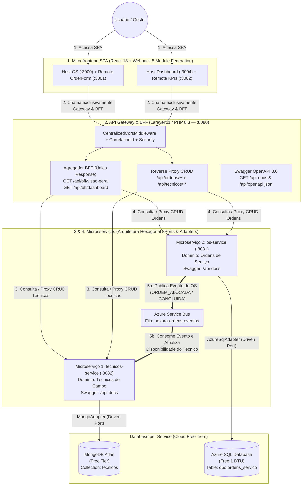

# NEXORA — Projeto Arquitetura Completa na Nuvem Azure (Microfrontends, API Gateway & BFF, Microservices MongoDB Atlas & Azure SQL, Azure Service Bus, Clean/Hexagonal Architecture & SOLID)

Ecossistema corporativo **NEXORA — Field Service Management**, desenvolvido para a disciplina de **Arquitetura de Soluções em Nuvem** (PUCPR). Esta solução distribuída na nuvem da **Microsoft Azure** implementa de ponta a ponta os padrões modernos:

- **Microfrontends (SPA)**: React 18 + Webpack 5 Module Federation (`host/`, `remote/`, `host-dashboard/`, `remote-dashboard/`), consumindo **exclusivamente** o **API Gateway & BFF** (nunca acessam os microsserviços diretamente).
- **API Gateway & BFF (Backend for Frontend)**: PHP 8.3 / Laravel 11 (`app/Gateway/`), responsável por centralização de entrada, roteamento, segurança, CORS centralizado (`CentralizedCorsMiddleware`), proxy de CRUD completo (`/api/ordens/**` e `/api/tecnicos/**`), agregação em único response (`GET /api/bff/visao-geral`, `GET /api/bff/dashboard`, `GET /api/bff/ordens/{id}`) e documentação **Swagger OpenAPI 3.0** (`/api-docs` e `/api/openapi.json`).
- **Microserviço 1 — Técnicos de Campo (`tecnicos-service` — MongoDB Atlas)**: Persistência em **MongoDB Atlas (Free Tier)** via `MongoAdapter`, CRUD completo, consumidor de eventos do **Azure Service Bus** (`ServiceBusConsumer`) e documentação **Swagger OpenAPI 3.0** (`/api-docs`).
- **Microserviço 2 — Ordens de Serviço (`os-service` — Azure SQL Database)**: Persistência em **Azure SQL Database (Free 1 DTU)** via `AzureSqlAdapter` (queries T-SQL parametrizadas `@p1..@pn` e `OUTPUT INSERTED.*`), CRUD completo, publicador de eventos no **Azure Service Bus** (`ServiceBusPublisher`) e documentação **Swagger OpenAPI 3.0** (`/api-docs`).
- **Mensageria Assíncrona (Azure Service Bus)**: Troca de mensagens pela fila `nexora-ordens-eventos` — ao criar, agendar, iniciar execução, concluir ou cancelar uma Ordem de Serviço no `os-service` (Azure SQL), um evento é publicado no **Azure Service Bus** e consumido pelo `tecnicos-service` (MongoDB Atlas), atualizando automaticamente a disponibilidade do Técnico (`Em Atendimento` ou `Disponível`).
- **Arquitetura de Software & Princípios**: **Clean Architecture + Arquitetura Hexagonal (Ports & Adapters)** aliada a **CQRS**, **DDD** e **SOLID**.
- **Testes Automatizados (em todos os 3 projetos)**: Testes Unitários/CRUD/Integração e Testes de Arquitetura (`dependency-cruiser` e `Pest Arch`).

---

## 👥 Integrantes do Grupo (`GRUPO.md`)

- **Éden Samuel**
- **Fernando Lopes**
- **Felipe Carneiro**
- **Henrique Ricardo**
- **Hugo Takeda**

---

## 🎥 Vídeo de Demonstração na Nuvem (YouTube — Não Listado)

> 🔗 **Link do Vídeo (YouTube Não Listado):** `[INSERIR LINK DO YOUTUBE NÃO LISTADO AQUI]`
>
> **Roteiro demonstrado em nuvem (Microsoft Azure) com câmera aberta por todos os integrantes:**
> 1. **Microfrontend em execução na nuvem** (`https://nexora-host-fernando.azurewebsites.net` e `https://nexora-host-dashboard-fernando.azurewebsites.net`).
> 2. **Chamadas passando pelo API Gateway & BFF** (`https://nexora-gateway-api.azurewebsites.net/api/bff/visao-geral`) com inspeção dos headers `X-Gateway-Processed-By`, `X-Gateway-Route`, `X-Correlation-Id` e Swagger UI (`/api-docs`).
> 3. **CRUD Completo com reflexo nos bancos de dados e mensageria no Azure Service Bus**:
>    - Criação/atualização/exclusão de Técnicos no **MongoDB Atlas** via Gateway (`/api/tecnicos`).
>    - Criação/atualização/mudança de status/exclusão de Ordens de Serviço no **Azure SQL Database** via Gateway (`/api/ordens`).
>    - Disparo de mensagem no **Azure Service Bus** (`nexora-ordens-eventos`) sincronizando automaticamente o status do técnico entre `os-service` e `tecnicos-service`.

---

## 📂 Organização dos 3 Repositórios Públicos (GitHub)

A solução está estruturada em **3 projetos independentes** (com pacote documental completo de `README.md` e `ARC42.md` em [`docs/repositorios/`](docs/repositorios/) e script de exportação automatizada em [`scripts/export-3-repos.sh`](scripts/export-3-repos.sh)):

| # | Projeto / Repositório | Diretórios de Código | Documentação Específica (README + Arc42) | Testes Unitários & de Arquitetura |
| :- | :--- | :--- | :--- | :--- |
| **1** | **Frontend (Microfrontend SPA)** | `host/`, `remote/`, `host-dashboard/`, `remote-dashboard/` | [`docs/repositorios/frontend/README.md`](docs/repositorios/frontend/README.md)<br/>[`docs/repositorios/frontend/ARC42.md`](docs/repositorios/frontend/ARC42.md) | `npm run test:frontend` |
| **2** | **Gateway (API Gateway & BFF)** | `app/Gateway/`, `app/Core/`, `routes/`, `config/` | [`docs/repositorios/gateway/README.md`](docs/repositorios/gateway/README.md)<br/>[`docs/repositorios/gateway/ARC42.md`](docs/repositorios/gateway/ARC42.md) | `npm run test:gateway` (`./vendor/bin/pest`) |
| **3** | **Backend (Microserviços Mongo + SQL + Broker)** | `tecnicos-service/`, `os-service/` | [`docs/repositorios/backend/README.md`](docs/repositorios/backend/README.md)<br/>[`docs/repositorios/backend/ARC42.md`](docs/repositorios/backend/ARC42.md) | `npm run test:backend` |

> 📄 **Documentação Arc42 Completa da Solução:** [`docs/ARC42.md`](docs/ARC42.md)

---

## 🔄 Fluxo Completo da Aplicação na Nuvem Azure



### Passo a Passo do Fluxo de Negócio:
1. **Usuário acessa o Microfrontend** (`host` ou `host-dashboard`).
2. **Front chama exclusivamente o API Gateway & BFF** (`GET /api/bff/visao-geral` ou rotas de proxy `/api/ordens` e `/api/tecnicos`).
3. **BFF consulta o Microserviço 1 (`tecnicos-service`)** conectado ao **MongoDB Atlas (Free Tier)**.
4. **BFF consulta o Microserviço 2 (`os-service`)** conectado ao **Azure SQL Database (Free 1 DTU)**.
5. **Microsserviços trocam mensagens pelo Broker (Azure Service Bus)**:
   - Quando uma Ordem de Serviço é criada ou atualizada com técnico atribuído (`Agendada` ou `Em Execução`), o `os-service` publica um evento na fila `nexora-ordens-eventos` do **Azure Service Bus**.
   - O `tecnicos-service` consome a mensagem e altera automaticamente o status do técnico no **MongoDB Atlas** para `"Em Atendimento"`.
   - Quando a Ordem de Serviço é `Concluída` ou `Cancelada`, o `os-service` publica o evento correspondente e o `tecnicos-service` libera o técnico de volta para `"Disponível"`.
6. **BFF agrega tudo e devolve em um único response JSON** para o Microfrontend.

---

## 🏛️ Arquitetura Escolhida: Clean Architecture + Hexagonal (Ports & Adapters) + SOLID

A solução adota **Clean Architecture combinada com Arquitetura Hexagonal (Ports & Adapters)**, garantindo estrita separação em camadas e inversão de dependência (**SOLID**):

1. **No API Gateway & BFF (`app/Core/` e `app/Gateway/`)**:
   - **Domain Layer (`app/Core/Domain/`)**: Entidades, Agregados (`OrdemServicoAggregate`), Value Objects imutáveis (`ValorMonetario`, `PrioridadeOrdem`, `StatusOrdem`), Domain Events e Anti-Corruption Layer (ACL) — 100% livre de dependências de framework.
   - **Application Layer (`app/Core/Application/`)**: CQRS (`CommandBus`, `QueryBus`), Commands, Queries, Handlers e contratos (`OrdemRepositoryInterface`, `PricingStrategyInterface`) aplicando **SRP, OCP, LSP, ISP e DIP**.
   - **Infrastructure & Gateway Layer (`app/Core/Infrastructure/`, `app/Gateway/`)**: Adaptadores Eloquent, Event Store, `BffService`, `GatewayProxyController`, `GatewaySwaggerController` e Middlewares de CORS/Observabilidade.
2. **Nos Microsserviços (`os-service/` e `tecnicos-service/`)**:
   - **Driving Adapters (Primary Ports)**: Rotas (`ordem.routes.ts`, `tecnico.routes.ts`) e Controllers (`ordem.controller.ts`, `tecnico.controller.ts`).
   - **Domain & Application Services**: Modelos (`OrdemServico.ts`, `Tecnico.ts`), Máquina de Estados (`lifecycle.validator.ts`) e Serviços de Mensageria (`serviceBus.publisher.ts`, `serviceBus.consumer.ts`).
   - **Driven Adapters (Secondary Ports)**: Interface `IDatabaseAdapter` implementada por `MongoAdapter` (**MongoDB Atlas** no `tecnicos-service`), `AzureSqlAdapter` (**Azure SQL Database** no `os-service`) e `SqliteAdapter` (fallback local autônomo).

---

## 🌐 Links Públicos de Produção no Azure (`rg-nexora-ca`)

| Componente | Aplicação Azure | URL Pública | Swagger / Health |
| :--- | :--- | :--- | :--- |
| 🛡️ **API Gateway & BFF** | `nexora-gateway-api` (`:8080`) | [https://nexora-gateway-api.azurewebsites.net](https://nexora-gateway-api.azurewebsites.net) | `/api-docs` · `/api/openapi.json` · `/api/bff/visao-geral` |
| 🟢 **Microfrontend 1 (OS)** | `nexora-host-fernando` (`:3000`) | [https://nexora-host-fernando.azurewebsites.net](https://nexora-host-fernando.azurewebsites.net) | Consome BFF |
| 🔵 **Microfrontend 2 (BI)** | `nexora-host-dashboard-fernando` (`:3004`) | [https://nexora-host-dashboard-fernando.azurewebsites.net](https://nexora-host-dashboard-fernando.azurewebsites.net) | Consome BFF |
| 🍃 **Microserviço 1 (MongoDB)** | `tecnicos-service` (`:8082`) | [https://nexora-remote-dashboard-fernando.azurewebsites.net](https://nexora-remote-dashboard-fernando.azurewebsites.net) | `/api-docs` · `/health` · `/api/tecnicos/mensageria/status` |
| 🔷 **Microserviço 2 (Azure SQL)** | `os-service` (`:8081`) | [https://nexora-remote-fernando.azurewebsites.net](https://nexora-remote-fernando.azurewebsites.net) | `/api-docs` · `/health` · `/api/ordens/mensageria/status` |

---

## 🚀 Como Rodar Localmente (Passo a Passo)

### 1. Pré-requisitos e Variáveis de Ambiente
- **Node.js 20+** e **npm**
- **PHP 8.2+** e **Composer**
- Configure as variáveis de nuvem (ou utilize o fallback local automático embutido para desenvolvimento offline):
  - `os-service/.env`: `AZURE_SQL_CONNECTION_STRING` e `AZURE_SERVICE_BUS_CONNECTION_STRING`
  - `tecnicos-service/.env`: `MONGODB_URI`, `MONGODB_DB_NAME=nexora_tecnicos` e `AZURE_SERVICE_BUS_CONNECTION_STRING`

### 2. Subir os Microsserviços Backend (`os-service` na `:8081` e `tecnicos-service` na `:8082`)
```bash
npm --prefix os-service install
npm --prefix tecnicos-service install
npm run services:dev
```
- **Swagger Microserviço 1 (MongoDB — Técnicos):** `http://localhost:8082/api-docs`
- **Swagger Microserviço 2 (Azure SQL — Ordens):** `http://localhost:8081/api-docs`

### 3. Subir o API Gateway & BFF (Porta `8080`)
```bash
composer install
touch database/database.sqlite
php artisan migrate:fresh --seed
php artisan serve --host=127.0.0.1 --port=8080
```
- **Swagger API Gateway & BFF:** `http://127.0.0.1:8080/api-docs`
- **Visão Geral Agregada (Single Response):** `http://127.0.0.1:8080/api/bff/visao-geral`

### 4. Subir os Microfrontends (`host` + `remote` / `host-dashboard` + `remote-dashboard`)
```bash
npm run install:all
npm run dev
```
- **Microfrontend Host (Ordens de Serviço):** `http://localhost:3000`
- **Microfrontend Host Dashboard (KPIs & Técnicos):** `http://localhost:3004`

---

## 🧪 Como Executar Todos os Testes (Unitários e de Arquitetura)

Todos os 3 projetos contam com **Testes Unitários** e **Testes de Arquitetura** automatizados:

```bash
# Executar TUDO (Frontend + Gateway + Backend — Unitários e Arquitetura)
npm run test:complete

# 1. Testes do Frontend (Unitários + Isolamento BFF + Module Federation Dependency Cruiser)
npm run test:frontend

# 2. Testes do API Gateway & BFF (Unitários DDD/SOLID + Feature BFF/Proxy/Swagger + Pest Arch)
npm run test:gateway

# 3. Testes dos Microsserviços Backend (CRUD + AzureSqlAdapter + MongoAdapter + ServiceBus + Dependency Cruiser)
npm run test:backend
```

---

## 📚 Índice Geral de Documentação

- [`docs/ARC42.md`](docs/ARC42.md) — **Documentação Completa de Arquitetura Arc42 (Seções 1 a 12 + Anexo Cloud Azure 3.0)**
- [`docs/repositorios/frontend/README.md`](docs/repositorios/frontend/README.md) & [`docs/repositorios/frontend/ARC42.md`](docs/repositorios/frontend/ARC42.md) — Documentação do Repositório 1 (**Frontend Microfrontend**)
- [`docs/repositorios/gateway/README.md`](docs/repositorios/gateway/README.md) & [`docs/repositorios/gateway/ARC42.md`](docs/repositorios/gateway/ARC42.md) — Documentação do Repositório 2 (**API Gateway & BFF**)
- [`docs/repositorios/backend/README.md`](docs/repositorios/backend/README.md) & [`docs/repositorios/backend/ARC42.md`](docs/repositorios/backend/ARC42.md) — Documentação do Repositório 3 (**Backend Microservices MongoDB Atlas + Azure SQL + Service Bus**)
- [`docs/FORMATIVA_15_SOLID_FINPAY_NEXORA.md`](docs/FORMATIVA_15_SOLID_FINPAY_NEXORA.md) — SOLID, CQRS e MVC
- [`docs/FORMATIVA_16_GATEWAY_BFF_AZURE.md`](docs/FORMATIVA_16_GATEWAY_BFF_AZURE.md) — API Gateway, BFF, CORS e Observabilidade
- [`docs/FORMATIVA_17_EDA_EVENT_SOURCING_DDD_SAGA.md`](docs/FORMATIVA_17_EDA_EVENT_SOURCING_DDD_SAGA.md) — EDA, Event Sourcing, DDD e Saga Pattern
- [`docs/FORMATIVA_19_CONSULTORIA_ATAM_PEER_REVIEW.md`](docs/FORMATIVA_19_CONSULTORIA_ATAM_PEER_REVIEW.md) — Avaliação Arquitetural ATAM
