# NEXORA — Documentação de Arquitetura

**Sistema:** NEXORA — ERP modular com gestão de serviços de campo (Field Service Management)
**Versão do sistema documentada:** NEXORA 2.0 (setembro de 2026)
**Disciplina:** Arquitetura e Soluções Cloud — Engenharia de Software, PUCPR
**Atividades:** Somativa 01 (seções 1 a 4) e TDE2 (seções 5 a 12)
**Template:** arc42, versão 9.0 (julho de 2025) — <https://arc42.org>
**Notação dos diagramas:** C4 Model, níveis 1 a 4, em Mermaid
**Data:** 2026-09-24

---

## Integrantes

| Integrante       |
| ---------------- |
| Éden Samuel      |
| Fernando Lopes   |
| Felipe Carneiro  |
| Henrique Ricardo |
| Hugo Takeda      |

---

## Histórico de revisões

| Versão | Data       | Alteração                                                                                                                                |
| ------ | ---------- | ---------------------------------------------------------------------------------------------------------------------------------------- |
| 1.0    | 2026-09-02 | Seções 1 a 4, entregues na Somativa 01                                                                                                   |
| 2.0    | 2026-09-24 | Seções 5 a 12 (TDE2) e revisão completa das seções 1 a 4 contra a implementação da NEXORA 2.0: TypeScript, Express 5 e MySQL 8 em Docker |

---

## Sumário

- [[#1. Introdução e Objetivos]]
  - [[#1.1 Visão Geral dos Requisitos]]
  - [[#1.2 Metas de Qualidade]]
  - [[#1.3 Stakeholders]]
- [[#2. Restrições de Arquitetura]]
  - [[#2.1 Restrições técnicas]]
  - [[#2.2 Restrições organizacionais]]
  - [[#2.3 Convenções]]
- [[#3. Contexto e Escopo]]
  - [[#3.1 Contexto de Negócio]]
  - [[#3.2 Contexto Técnico]]
  - [[#3.3 Delimitação de escopo]]
- [[#4. Estratégia de Solução]]
  - [[#4.1 Decisões tecnológicas fundamentais]]
  - [[#4.2 Decomposição de alto nível]]
  - [[#4.3 Como a arquitetura atende às metas de qualidade]]
  - [[#4.4 Decisões de organização do trabalho]]
- [[#5. Visão de Blocos de Construção]]
  - [[#5.1 Nível 1 — Caixa-branca do sistema como um todo]]
  - [[#5.2 Nível 2 — Caixa-branca da API NEXORA]]
  - [[#5.3 Nível 3 — Caixa-branca do núcleo de CRUD genérico]]
- [[#6. Visão de Tempo de Execução]]
  - [[#6.1 Cadastro em uma tela CRUD]]
  - [[#6.2 Troca do produto contratado]]
  - [[#6.3 Tentativa de acesso a dado de outra empresa]]
  - [[#6.4 Inicialização e verificação de saúde]]
- [[#7. Visão de Implantação]]
  - [[#7.1 Infraestrutura nível 1 — ambiente atual]]
  - [[#7.2 Infraestrutura nível 1 — implantação alvo em nuvem]]
  - [[#7.3 Infraestrutura nível 2 — detalhamento dos elementos]]
- [[#8. Conceitos Transversais]]
  - [[#8.1 Modelo de dados]]
  - [[#8.2 Reuso por declaração]]
  - [[#8.3 Variabilidade e linha de produtos]]
  - [[#8.4 Multiempresa e isolamento de dados]]
  - [[#8.5 Persistência e acesso a dados]]
  - [[#8.6 Validação e tratamento de erros]]
  - [[#8.7 Situações da ordem de serviço]]
  - [[#8.8 Segurança]]
  - [[#8.9 Configuração]]
  - [[#8.10 Padrões de projeto]]
  - [[#8.11 Interface do usuário]]
  - [[#8.12 Verificação e diagnóstico]]
- [[#9. Decisões de Arquitetura]]
- [[#10. Requisitos de Qualidade]]
  - [[#10.1 Visão geral dos requisitos de qualidade]]
  - [[#10.2 Cenários de qualidade]]
- [[#11. Riscos e Dívidas Técnicas]]
  - [[#11.1 Riscos]]
  - [[#11.2 Dívidas técnicas]]
- [[#12. Glossário]]
- [[#Pontos a confirmar pela equipe]]
- [[#Referências]]

---

# 1. Introdução e Objetivos

_(arc42 — Introduction and Goals)_

## 1.1 Visão Geral dos Requisitos

### Problema

Pequenas e médias empresas prestadoras de serviços com equipe de campo — de 3 a 50 funcionários, com foco inicial em manutenção e climatização (HVAC) — operam com a informação fragmentada entre WhatsApp, planilhas, blocos de anotação e a memória das pessoas.

O trabalho acontece em dois lugares ao mesmo tempo: no escritório, onde se orça, agenda e cobra; e na casa do cliente, onde o serviço é de fato executado. Não existe ligação confiável entre esses dois lugares. Disso nascem estoque incorreto, serviço executado e não faturado, conflito de agenda e decisão do proprietário baseada em percepção.

### Solução

A NEXORA unifica o ciclo do serviço — **cliente → orçamento → ordem de serviço → agendamento → execução → estoque → financeiro** — em uma única plataforma, na qual cada etapa alimenta a seguinte.

O produto é construído como uma **Linha de Produto de Software (LPS)**: um núcleo de ativos reutilizáveis e oito módulos que apenas declaram o que são. Desse mesmo código saem quatro produtos — NEXORA Core, Tech, Maint e Field —, e o que diferencia um do outro é a configuração da empresa, lida em tempo de execução. O sistema é **multiempresa**: várias empresas clientes compartilham a mesma base de dados, com os registros de cada uma isolados das demais.

### Estado atual — NEXORA 2.0

A versão 2.0 entrega oito telas CRUD conectadas a um banco MySQL 8 com onze tabelas, a troca de produto em tempo de execução e o isolamento entre empresas, verificados por um teste automatizado de 66 verificações. A autenticação, a tela do técnico em campo, o portal do cliente e o painel de indicadores fazem parte do produto, mas estão previstos para as próximas evoluções. A coluna _Situação_ da tabela abaixo distingue o que já existe do que ainda é plano.

### Requisitos funcionais essenciais

| ID   | O sistema deve                                                                                                           | Bloco             | Situação na versão 2.0                                                                                  |
| ---- | ------------------------------------------------------------------------------------------------------------------------ | ----------------- | ------------------------------------------------------------------------------------------------------- |
| RF01 | Autenticar usuários cadastrados e encerrar sessões por solicitação ou inatividade                                        | Acesso            | Previsto                                                                                                |
| RF02 | Cadastrar, consultar, editar e inativar usuários da empresa                                                              | Acesso            | Previsto                                                                                                |
| RF03 | Restringir o acesso às funcionalidades conforme o perfil do usuário                                                      | Acesso            | Previsto                                                                                                |
| RF04 | Cadastrar, consultar, editar e inativar clientes                                                                         | Clientes          | Implementado — tela Clientes                                                                            |
| RF05 | Apresentar o histórico consolidado de orçamentos, ordens de serviço e situação financeira de cada cliente                | Clientes          | Parcial — consultas de demonstração com junções; sem tela consolidada                                   |
| RF06 | Cadastrar, consultar, editar e inativar os serviços oferecidos pela empresa                                              | Serviços          | Implementado — tela Serviços                                                                            |
| RF07 | Elaborar orçamentos vinculados a um cliente, com cálculo automático do valor total                                       | Orçamentos        | Parcial — tela Orçamentos com forma de precificação; o cálculo por Strategy existe na camada de domínio |
| RF08 | Registrar a aprovação ou a rejeição do orçamento pelo cliente                                                            | Orçamentos        | Implementado — situações Aprovado e Reprovado                                                           |
| RF09 | Gerar uma ordem de serviço a partir de um orçamento aprovado                                                             | Ordens de serviço | Parcial — a OS é cadastrada na tela; a geração automática está prevista                                 |
| RF10 | Controlar a evolução da ordem de serviço ao longo de estados definidos, registrando cada transição                       | Ordens de serviço | Parcial — cinco situações e regra de técnico obrigatório; controle de transições previsto               |
| RF11 | Agendar ordens de serviço para técnicos em data e horário determinados, sinalizando conflitos                            | Agenda            | Parcial — tela Agenda; detecção de conflito prevista                                                    |
| RF12 | Cadastrar técnicos e apresentar os atendimentos atribuídos a cada um                                                     | Agenda            | Implementado — tela Técnicos                                                                            |
| RF13 | Permitir que o técnico registre, na OS atribuída a ele, o diagnóstico, os materiais utilizados e evidências fotográficas | Campo             | Previsto — tela de campo fora do modelo CRUD                                                            |
| RF14 | Controlar o estoque de materiais, com baixa do consumo em OS e sinalização de itens abaixo do mínimo                     | Estoque           | Parcial — tela Estoque com alerta de mínimo; movimentação ligada à OS                                   |
| RF15 | Gerar o lançamento de cobrança na conclusão da OS e registrar pagamentos e despesas vinculados a ela                     | Financeiro        | Parcial — tela Financeiro ligada à OS, com valor pago e forma de pagamento                              |
| RF16 | Apresentar painel com indicadores consolidados da operação                                                               | Gestão            | Previsto                                                                                                |
| RF17 | Permitir que o cliente acompanhe a situação do seu atendimento e registre uma avaliação                                  | Transparência     | Previsto                                                                                                |

## 1.2 Metas de Qualidade

| #   | Meta de qualidade                | Categoria (ISO/IEC 25010)                       | Motivação                                                                                                                            | Cenário de referência                                                                                                                          |
| --- | -------------------------------- | ----------------------------------------------- | ------------------------------------------------------------------------------------------------------------------------------------ | ---------------------------------------------------------------------------------------------------------------------------------------------- |
| 1   | **Reuso pelo núcleo genérico**   | Manutenibilidade — reusabilidade e modularidade | É o objetivo da Linha de Produto: oito telas não podem significar oito cópias do mesmo código de CRUD.                               | Uma tela nova exige um arquivo de módulo, uma linha de registro e uma tabela — nenhuma alteração no núcleo.                                    |
| 2   | **Isolamento entre empresas**    | Segurança — confidencialidade                   | A mesma base atende várias empresas, muitas concorrentes entre si. Dado de uma empresa visível ou alterável por outra é falha fatal. | Uma instância da Empresa B que tente ler, editar ou excluir um registro da Empresa A pelo identificador recebe 404, e nenhuma linha é afetada. |
| 3   | **Variabilidade sem recompilar** | Manutenibilidade — modificabilidade             | Os quatro produtos precisam sair do mesmo build; derivar um produto deve ser configuração, não código.                               | Trocar o produto de Field para Core retira quatro telas do menu e faz a API responder 403, sem recompilar nem reiniciar a aplicação.           |
| 4   | Integridade dos dados            | Segurança — integridade                         | Ordens de serviço, estoque e financeiro se referenciam; uma exclusão descuidada deixaria registros órfãos.                           | Excluir um cliente que tem OS é bloqueado pelo banco, e a tela explica o motivo com status 409, sem expor detalhe técnico.                     |
| 5   | Reprodutibilidade do ambiente    | Portabilidade — instalabilidade                 | Cinco integrantes, sistemas operacionais diferentes e uma defesa ao vivo exigem o mesmo ambiente em qualquer máquina.                | Um integrante em máquina nova sobe banco e aplicação seguindo o guia de instalação, e restaura os dados de demonstração em segundos.           |

## 1.3 Stakeholders

| Papel                               | Quem é                                                                      | Expectativas em relação à arquitetura                                                                        |
| ----------------------------------- | --------------------------------------------------------------------------- | ------------------------------------------------------------------------------------------------------------ |
| **Proprietário da empresa cliente** | Marcos (persona) — decisor da compra                                        | Pagar apenas pelos módulos que usa; confiar que os dados da empresa não aparecem para outra                  |
| **Gestor operacional**              | Juliana (persona) — coordena a operação diária                              | Agenda, técnicos e ordens de serviço no mesmo lugar, sem redigitação entre telas                             |
| **Assistente administrativo**       | Lucas (persona)                                                             | Telas com o mesmo comportamento, mensagens de erro compreensíveis e cadastro rápido                          |
| **Técnico de campo**                | Carlos (persona) — usuário crítico da próxima evolução                      | Uma tela própria, utilizável no celular, quando o registro em campo entrar no escopo                         |
| **Operador da plataforma**          | Quem configura o produto contratado por cada empresa                        | Trocar o produto e ligar ou desligar módulos sem depender de nova versão do sistema                          |
| **Equipe de desenvolvimento**       | Éden Samuel, Fernando Lopes, Felipe Carneiro, Henrique Ricardo, Hugo Takeda | Código legível, módulos independentes para trabalho em paralelo e ambiente idêntico em todas as máquinas     |
| **Docente avaliador**               | Prof. Ricardo Vieira — Arquitetura e Soluções Cloud                         | Coerência entre requisitos, decisões, diagramas e implantação em nuvem; documentação rastreável e defensável |

---

# 2. Restrições de Arquitetura

_(arc42 — Architecture Constraints)_

Restrições são condições dadas, que limitam a liberdade das decisões. Cada decisão registrada nas seções 4 e 9 respeita as restrições abaixo.

## 2.1 Restrições técnicas

| ID    | Restrição                                                                                                       | Consequência para a arquitetura                                                                                                                 |
| ----- | --------------------------------------------------------------------------------------------------------------- | ----------------------------------------------------------------------------------------------------------------------------------------------- |
| RT-01 | Todo o sistema é escrito em TypeScript, em modo `strict`                                                        | Uma única linguagem e cadeia de build; os padrões de projeto são os mesmos usados pelo sistema web (ADR-01)                                     |
| RT-02 | Execução em Node.js 24 LTS, fixada em `.nvmrc` e no campo `engines` do `package.json`                           | Todos os integrantes e o ambiente em nuvem usam a mesma versão do interpretador                                                                 |
| RT-03 | Banco de dados MySQL 8, executado em contêiner Docker                                                           | O isolamento entre empresas é garantido na aplicação, porque o MySQL não oferece segurança em nível de linha como o PostgreSQL (ADR-04, ADR-05) |
| RT-04 | Sem ORM, sem framework de front-end e sem empacotador                                                           | SQL explícito e ES modules nativos; cada passo do código é visível na leitura (ADR-06)                                                          |
| RT-05 | API construída com Express 5, que também entrega os arquivos da interface                                       | Um único processo Node atende a API e a interface                                                                                               |
| RT-06 | Todo comando SQL é parametrizado; nomes de tabela e coluna vêm das declarações dos módulos, nunca da requisição | Proteção contra injeção de SQL garantida pelo núcleo, e não por disciplina individual                                                           |
| RT-07 | Dependências fixadas por `package-lock.json`, instaladas com `npm ci`                                           | Builds reproduzíveis; `npm audit` sem vulnerabilidades conhecidas na versão 2.0                                                                 |
| RT-08 | Interface executada em navegador moderno com suporte a ES modules                                               | Nenhuma etapa de transpilação do front-end é necessária                                                                                         |

## 2.2 Restrições organizacionais

| ID    | Restrição                                                                                                                                                   | Consequência para a arquitetura                                                                         |
| ----- | ----------------------------------------------------------------------------------------------------------------------------------------------------------- | ------------------------------------------------------------------------------------------------------- |
| RO-01 | Equipe de cinco estudantes, sem dedicação integral ao projeto                                                                                               | Módulos independentes, para que cada integrante trabalhe sem conflito com os demais                     |
| RO-02 | Prazo limitado ao semestre letivo                                                                                                                           | Escopo da versão 2.0 restrito ao que pode ser implementado, testado e demonstrado no período            |
| RO-03 | Orçamento zero: apenas camadas gratuitas ou créditos acadêmicos de provedores de nuvem                                                                      | A implantação alvo em nuvem usa serviços gerenciados de menor porte e pode ser desligada fora de uso    |
| RO-04 | Projeto acadêmico avaliado pela leitura do código e por defesa ao vivo                                                                                      | Clareza tem prioridade sobre sofisticação; o sistema precisa rodar localmente, sem depender de internet |
| RO-05 | A mesma base de código atende três disciplinas: Arquitetura e Soluções Cloud, Desenvolvimento Orientado a Reúso e Medição e Análise de Processos e Produtos | Terminologia e decisões precisam ser coerentes entre os artefatos das três disciplinas                  |
| RO-06 | O enunciado de Reúso exige oito telas CRUD, ao menos três tabelas e um exemplo de variabilidade planejada                                                   | O núcleo genérico de CRUD e a tela Linha de produto existem para atender a essa exigência               |

## 2.3 Convenções

| ID    | Convenção                                                                                                                                                                                                                 |
| ----- | ------------------------------------------------------------------------------------------------------------------------------------------------------------------------------------------------------------------------- |
| RC-01 | A documentação de arquitetura segue o template arc42, versão 9.0                                                                                                                                                          |
| RC-02 | Os diagramas seguem a notação C4 Model, níveis 1 a 4, escritos em Mermaid. A renderização usa `flowchart` com estilos declarados, e não o modo `C4Context` nativo do Mermaid, que ainda é experimental e sobrepõe rótulos |
| RC-03 | Código, comentários, mensagens e commits em português; colunas do banco em `snake_case`, código em `camelCase` e arquivos de módulo em `kebab-case`                                                                       |
| RC-04 | Erros da API seguem o envelope `{ "erro": "mensagem" }`, com 400 para dado inválido, 403 para módulo fora do produto, 404 para registro inexistente e 409 para conflito                                                   |
| RC-05 | Decisões de arquitetura são registradas como ADR, com numeração única compartilhada com o documento de arquitetura do repositório                                                                                         |
| RC-06 | A interface segue o Design System NEXORA: navy `#06265F` na navegação, azul `#0B5FD7` nas ações e tipografia Inter. Os diagramas deste documento usam a mesma paleta                                                      |

---

# 3. Contexto e Escopo

_(arc42 — Context and Scope)_

## 3.1 Contexto de Negócio

O diagrama abaixo corresponde ao **C4 Model — Nível 1 (System Context Diagram)**. Ele trata a NEXORA como uma caixa preta e mostra quem a utiliza e com que sistemas externos ela se relaciona.

**Convenção visual:** azul identifica o sistema em escopo; navy identifica pessoas que usam a versão 2.0; elementos **tracejados** fazem parte do produto, mas estão previstos para as próximas evoluções.

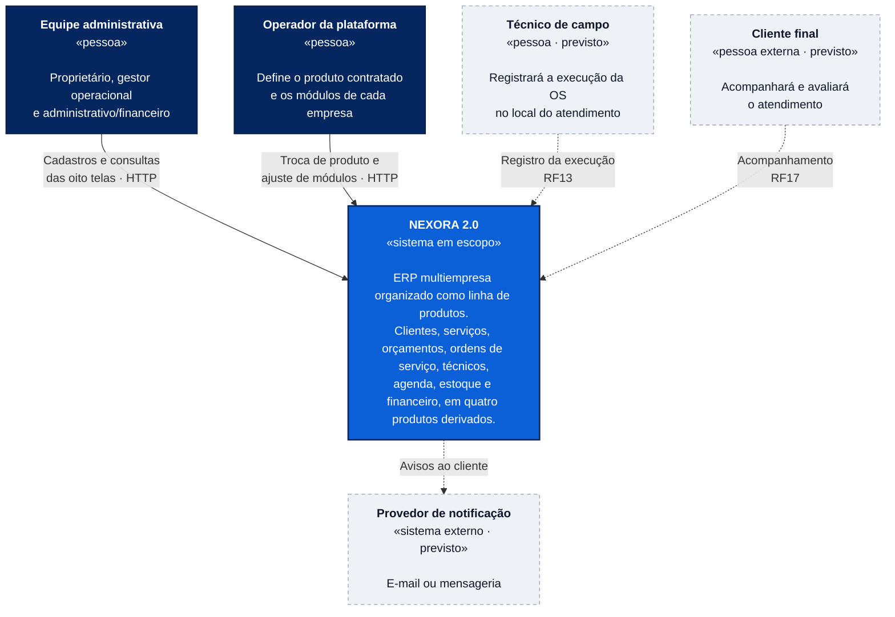

### Parceiros de comunicação

| Parceiro                | Natureza                             | Situação   | Entrada para a NEXORA                                                                                  | Saída da NEXORA                                                                 |
| ----------------------- | ------------------------------------ | ---------- | ------------------------------------------------------------------------------------------------------ | ------------------------------------------------------------------------------- |
| Equipe administrativa   | Usuários internos da empresa cliente | Versão 2.0 | Cadastros de clientes, serviços, técnicos, agenda, orçamentos, ordens de serviço, estoque e financeiro | Listagens, buscas, alertas de estoque abaixo do mínimo e mensagens de validação |
| Operador da plataforma  | Usuário da tela Linha de produto     | Versão 2.0 | Produto contratado e ajustes de módulos opcionais                                                      | Módulos ativos da empresa, refletidos no menu e na API                          |
| Técnico de campo        | Usuário interno                      | Previsto   | Diagnóstico, materiais e evidências da execução                                                        | Ordens de serviço atribuídas                                                    |
| Cliente final           | Ator externo                         | Previsto   | Avaliação do atendimento                                                                               | Situação da ordem de serviço                                                    |
| Provedor de notificação | Sistema externo                      | Previsto   | Confirmação de entrega                                                                                 | Pedido de envio de aviso ao cliente                                             |

## 3.2 Contexto Técnico

| Canal                               | Protocolo e tecnologia                                   | Formato                                               | Porta padrão |
| ----------------------------------- | -------------------------------------------------------- | ----------------------------------------------------- | ------------ |
| Navegador → NEXORA                  | HTTP no ambiente local; HTTPS na implantação em nuvem    | HTML, CSS e ES modules na interface; JSON na API REST | 3000         |
| NEXORA → MySQL                      | Protocolo MySQL sobre TCP, por pool de conexões `mysql2` | SQL parametrizado                                     | 3306         |
| Equipe → Adminer → MySQL            | HTTP até o Adminer; protocolo MySQL até o banco          | Interface web de administração do banco               | 8080         |
| Terminal → demonstração dos padrões | Processo Node.js local                                   | Saída no console                                      | —            |

### Mapeamento entrada/saída por canal

| Informação                   | Origem                                | Canal                                | Destino                                                     |
| ---------------------------- | ------------------------------------- | ------------------------------------ | ----------------------------------------------------------- |
| Registro de uma tela CRUD    | Usuário, no navegador                 | JSON sobre HTTP para `/api/<módulo>` | Tabela do módulo, sempre com o `empresa_id` da instância    |
| Metadados das telas          | Declarações dos módulos               | JSON em `/api/modulos`               | Interface, que monta menu, formulário e tabela              |
| Produto contratado e ajustes | Operador, na tela Linha de produto    | JSON em `/api/variabilidade`         | Tabelas `empresa` e `empresa_feature`                       |
| Consultas de demonstração    | Equipe                                | Adminer                              | Banco MySQL, com as consultas de `banco/consultas-demo.sql` |
| Saúde da aplicação           | Equipe ou orquestrador de contêineres | JSON em `/api/saude`                 | Situação da aplicação e do banco                            |

## 3.3 Delimitação de escopo

**Fora do produto**, por decisão registrada no Documento Mestre:

- emissão de nota fiscal eletrônica e obrigações fiscais acessórias;
- folha de pagamento e rotinas trabalhistas;
- escrituração contábil;
- gestão de frota e rastreamento veicular;
- comércio eletrônico e venda direta ao consumidor final.

**Dentro do produto, mas fora da versão 2.0:** autenticação e perfis de acesso, tela do técnico em campo, portal do cliente, notificações e painel de indicadores. Esses itens estão descritos como evolução nas seções 3.1 e 11.

---

# 4. Estratégia de Solução

_(arc42 — Solution Strategy)_

## 4.1 Decisões tecnológicas fundamentais

Resumo das decisões que moldam a arquitetura. O registro completo, com contexto, alternativas e consequências, está na [[#9. Decisões de Arquitetura]].

| ADR    | Decisão                                                              | Motivação resumida                                                                          |
| ------ | -------------------------------------------------------------------- | ------------------------------------------------------------------------------------------- |
| ADR-01 | Projeto inteiramente em TypeScript                                   | Uma linguagem, uma cadeia de build e um único lugar para cada padrão de projeto             |
| ADR-02 | Uma tela é uma declaração de dados, não código                       | As oito telas compartilham repositório, controlador e interface genéricos                   |
| ADR-03 | Variabilidade resolvida em tempo de execução, com fonte única        | O mesmo build atende os quatro produtos; trocar o produto não exige recompilar              |
| ADR-04 | MySQL 8 em Docker                                                    | Mesma versão e configuração para toda a equipe, com restauração da demonstração em segundos |
| ADR-05 | Isolamento multiempresa no repositório genérico                      | A regra vale para as oito telas de uma vez, porque está no núcleo                           |
| ADR-06 | Sem ORM, sem framework de front-end e sem empacotador                | Código explícito e legível, adequado à avaliação por leitura                                |
| ADR-07 | Empresa da instância definida por configuração (`EMPRESA_ID`)        | Viabiliza o multiempresa antes de existir autenticação                                      |
| ADR-08 | Implantação em nuvem com contêineres e MySQL gerenciado — _proposta_ | A mesma imagem atende qualquer empresa, com configuração por ambiente                       |

### Padrões de projeto que sustentam a solução

| Padrão          | Onde                                                           | Papel na arquitetura                                                                |
| --------------- | -------------------------------------------------------------- | ----------------------------------------------------------------------------------- |
| Singleton       | `ConexaoBanco`, `RegistroFeatures`                             | Um único pool de conexões para todo o sistema e um único registro de features       |
| Template Method | `FinalizacaoOS`, `GeradorRelatorio`, `ImportadorDados`         | Sequência fixa de passos com pontos de extensão (_hooks_) por variante              |
| Strategy        | `CalculoPrecoServico`, `DistribuicaoTecnico`, `FormaPagamento` | Algoritmos intercambiáveis: preço fixo, por hora ou por visita; formas de pagamento |

## 4.2 Decomposição de alto nível

O diagrama abaixo corresponde ao **C4 Model — Nível 2 (Container Diagram)**. Ele abre a caixa preta da seção 3.1 e mostra as unidades executáveis e de armazenamento da NEXORA 2.0, com as tecnologias e os protocolos entre elas.

**Convenção visual:** navy para o contêiner que concentra os ativos reutilizáveis, azul para a interface, cinza para armazenamento e ferramentas de apoio. A moldura tracejada é a fronteira do sistema.

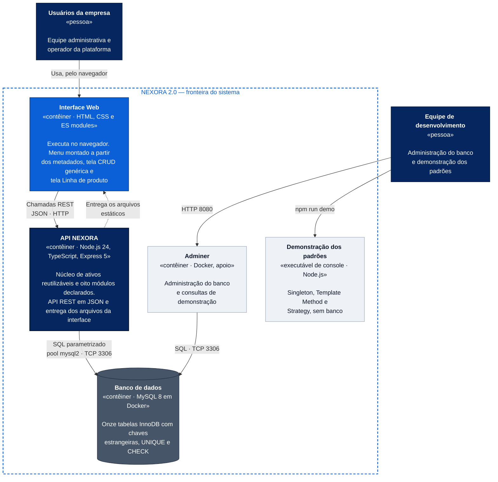

### Contêineres

| Contêiner                | Tecnologia                                           | Responsabilidade                                                                | Localização no repositório                |
| ------------------------ | ---------------------------------------------------- | ------------------------------------------------------------------------------- | ----------------------------------------- |
| Interface Web            | HTML, CSS e ES modules nativos                       | Monta qualquer tela a partir dos metadados de um módulo; tela de variabilidade  | `public/`                                 |
| API NEXORA               | Node.js 24, TypeScript, Express 5, `mysql2`          | Rotas, validação, variabilidade, isolamento, acesso a dados e tradução de erros | `src/api/`, `src/nucleo/`, `src/modulos/` |
| Banco de dados           | MySQL 8 em contêiner, inicializado pelo `schema.sql` | Persistência das onze tabelas e das restrições de integridade                   | `banco/`, `docker-compose.yml`            |
| Adminer                  | Contêiner Docker                                     | Inspeção do banco e execução das consultas de demonstração                      | `docker-compose.yml`                      |
| Demonstração dos padrões | Node.js, executável de console                       | Evidência dos padrões de projeto sem depender do banco                          | `src/dominio/`, `src/padroes/`            |

## 4.3 Como a arquitetura atende às metas de qualidade

| Meta                              | Abordagem arquitetural                                                                                                            | Decisões envolvidas |
| --------------------------------- | --------------------------------------------------------------------------------------------------------------------------------- | ------------------- |
| 1 — Reuso pelo núcleo genérico    | Repositório, controlador, validação, tradução de erros e tela são genéricos; cada módulo apenas declara tabela, campos e regras   | ADR-02, ADR-06      |
| 2 — Isolamento entre empresas     | `empresa_id` em toda tabela operacional; o núcleo aplica o filtro em listar, buscar, editar e excluir; teste automatizado confere | ADR-05, ADR-07      |
| 3 — Variabilidade sem recompilar  | Modelo de features em fonte única; porta de variabilidade no controlador responde 403; menu montado pelos metadados               | ADR-03              |
| 4 — Integridade dos dados         | Chaves estrangeiras, UNIQUE e CHECK no banco; erros traduzidos em mensagens de usuário com 400 ou 409                             | ADR-04, ADR-05      |
| 5 — Reprodutibilidade do ambiente | Docker Compose para o banco; versões fixadas de Node e dependências; banco recriado pelo `schema.sql`                             | ADR-01, ADR-04      |

## 4.4 Decisões de organização do trabalho

- **Um módulo, um arquivo.** Como cada tela é uma declaração isolada em `src/modulos/<nome>/`, integrantes diferentes trabalham em paralelo sem conflito de versionamento.
- **Teste automatizado como rede de segurança.** `npm run testar` executa 66 verificações — CRUD das oito telas, regras de negócio, isolamento entre empresas, troca de produto e bloqueio 403. Nenhuma alteração no núcleo é aceita se o teste falhar.
- **Documentação junto ao código.** `README.md`, `CLAUDE.md`, `docs/ARQUITETURA.md` e `docs/GUIA-DE-INSTALACAO.md` vivem no repositório e evoluem com ele; este documento arc42 consolida a visão arquitetural para a disciplina.

---

# 5. Visão de Blocos de Construção

_(arc42 — Building Block View)_

A decomposição segue três níveis de zoom. Cada nível abre a caixa-branca de um bloco do nível anterior.

| Nível arc42 | Equivalente C4         | O que mostra                                       | Onde está                  |
| ----------- | ---------------------- | -------------------------------------------------- | -------------------------- |
| Nível 1     | C4 Nível 2 — Container | Os cinco contêineres da NEXORA 2.0                 | Seção 5.1, diagrama na 4.2 |
| Nível 2     | C4 Nível 3 — Component | Os componentes internos da API NEXORA              | Seção 5.2                  |
| Nível 3     | C4 Nível 4 — Code      | As classes e interfaces do núcleo de CRUD genérico | Seção 5.3                  |

## 5.1 Nível 1 — Caixa-branca do sistema como um todo

**Motivação.** A decomposição separa o que é executado no navegador, o que é executado no servidor e o que é armazenado. A interface não contém regra de negócio: ela apenas desenha o que a API descreve. Toda regra — validação, variabilidade e isolamento — fica na API, em um único lugar, porque qualquer chamada direta à API precisa passar pelas mesmas verificações que a tela. O diagrama correspondente é o da seção [[#4.2 Decomposição de alto nível]].

### Blocos contidos (caixas-pretas)

| Bloco                    | Responsabilidade                                                                     | Interface oferecida   | Requisitos atendidos                                   |
| ------------------------ | ------------------------------------------------------------------------------------ | --------------------- | ------------------------------------------------------ |
| Interface Web            | Desenhar menu, formulários e tabelas a partir dos metadados; exibir mensagens da API | Páginas no navegador  | RF04, RF06–RF12, RF14, RF15 (nas partes implementadas) |
| API NEXORA               | Validar, aplicar variabilidade e isolamento, persistir e traduzir erros              | API REST em JSON      | Todos os implementados                                 |
| Banco de dados           | Persistir e garantir integridade referencial, unicidade e faixas de valor            | Protocolo MySQL       | Metas 2 e 4                                            |
| Adminer                  | Permitir inspeção e consultas diretas durante o desenvolvimento e a defesa           | Interface web própria | Apoio à equipe                                         |
| Demonstração dos padrões | Executar Singleton, Template Method e Strategy no console                            | Linha de comando      | Entrega de padrões de projeto                          |

### Interfaces importantes

| Rota                         | Métodos          | Finalidade                                                                    | Respostas                    |
| ---------------------------- | ---------------- | ----------------------------------------------------------------------------- | ---------------------------- |
| `/api/<módulo>`              | GET, POST        | Listar, com busca opcional por `?busca=`, e criar registros                   | 200, 201, 400, 403, 409      |
| `/api/<módulo>/:id`          | GET, PUT, DELETE | Buscar, editar e excluir um registro da empresa da instância                  | 200, 204, 400, 403, 404, 409 |
| `/api/modulos`               | GET              | Metadados das telas e indicação de quais estão disponíveis                    | 200                          |
| `/api/variabilidade`         | GET              | Produto atual, produtos existentes, features obrigatórias, opcionais e ativas | 200                          |
| `/api/variabilidade/linha`   | PUT              | Trocar o produto contratado pela empresa                                      | 200, 400                     |
| `/api/variabilidade/feature` | PUT              | Ligar ou desligar uma feature opcional                                        | 200, 400                     |
| `/api/opcoes/:modulo`        | GET              | Opções dos campos de referência entre telas                                   | 200, 400, 404                |
| `/api/saude`                 | GET              | Situação da aplicação e da conexão com o banco                                | 200                          |

`<módulo>` é um dos oito identificadores: `clientes`, `servicos`, `tecnicos`, `agendamentos`, `orcamentos`, `ordens-servico`, `estoque` e `financeiro`.

## 5.2 Nível 2 — Caixa-branca da API NEXORA

O diagrama abaixo corresponde ao **C4 Model — Nível 3 (Component Diagram)**. Ele abre o contêiner _API NEXORA_ e mostra os componentes internos e as dependências entre eles.

**Convenção visual:** navy para os ativos reutilizáveis do núcleo (_core assets_), azul para os módulos declarados, cinza-escuro para o domínio e os padrões, cinza-claro para os elementos fora do contêiner. A seta pontilhada indica que um elemento descreve ou configura o outro, sem chamada em tempo de execução.

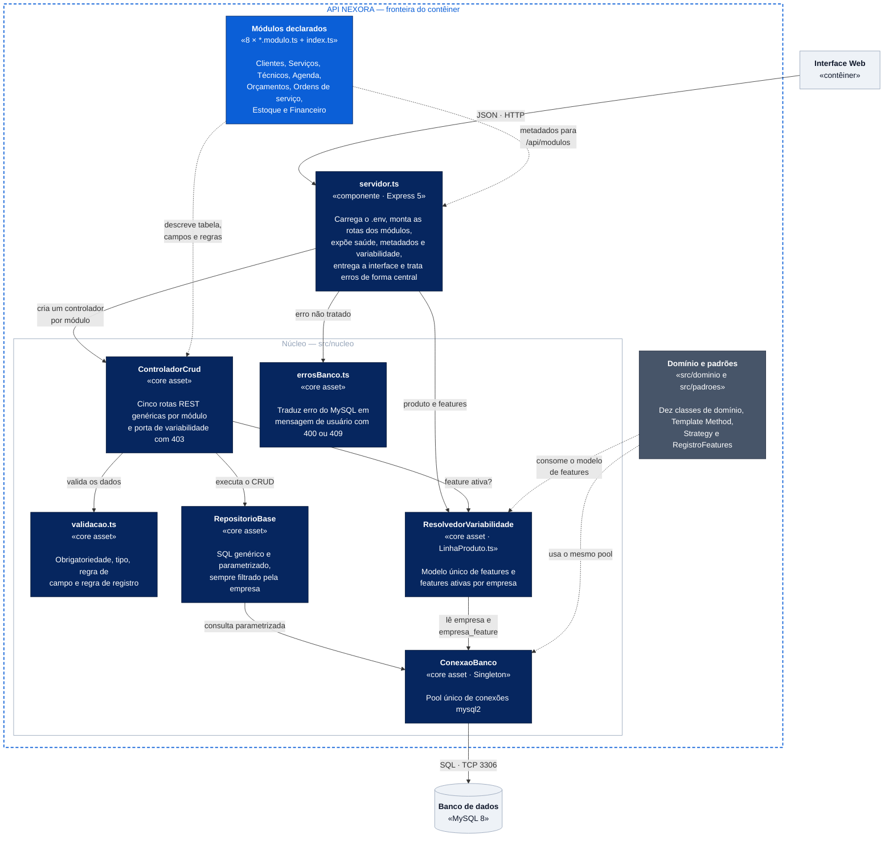

### Componentes

| Componente                | Responsabilidade                                                                 | Localização                     | Por que é separado                                                |
| ------------------------- | -------------------------------------------------------------------------------- | ------------------------------- | ----------------------------------------------------------------- |
| `servidor.ts`             | Ponto de entrada: configuração, rotas transversais e tratamento central de erros | `src/api/servidor.ts`           | Mantém o núcleo livre de detalhes de inicialização e de protocolo |
| `ControladorCrud`         | Rotas REST genéricas e porta de variabilidade                                    | `src/nucleo/ControladorCrud.ts` | Uma única implementação atende as oito telas                      |
| `validacao.ts`            | Validações reutilizáveis e aplicação das regras declaradas                       | `src/nucleo/validacao.ts`       | A regra de validação é a mesma para qualquer módulo               |
| `RepositorioBase`         | Geração do SQL e filtro por empresa                                              | `src/nucleo/RepositorioBase.ts` | É o ponto único que garante o isolamento (meta 2)                 |
| `errosBanco.ts`           | Tradução de erros do banco                                                       | `src/nucleo/errosBanco.ts`      | Evita que detalhes técnicos cheguem ao usuário                    |
| `ResolvedorVariabilidade` | Resolução das features ativas por empresa                                        | `src/nucleo/LinhaProduto.ts`    | Fonte única do modelo de variabilidade (ADR-03)                   |
| `ConexaoBanco`            | Pool de conexões                                                                 | `src/nucleo/ConexaoBanco.ts`    | O Singleton garante um único pool para todo o processo            |
| Módulos declarados        | Descrição de cada tela                                                           | `src/modulos/`                  | Variam por tela; o núcleo nunca importa um módulo específico      |
| Domínio e padrões         | Regras ricas e padrões de projeto                                                | `src/dominio/`, `src/padroes/`  | Comportamento de negócio que não cabe em um CRUD genérico         |

### Os oito módulos declarados

| Módulo            | Tabela                  | Feature          | Tipo de feature | Regra de negócio declarada                                |
| ----------------- | ----------------------- | ---------------- | --------------- | --------------------------------------------------------- |
| Clientes          | `cliente`               | `clientes`       | Obrigatória     | CPF ou CNPJ e e-mail válidos; documento único por empresa |
| Serviços          | `servico`               | `servicos`       | Obrigatória     | Valor da hora coerente com preço e duração                |
| Ordens de serviço | `ordem_servico`         | `ordens-servico` | Obrigatória     | Técnico obrigatório para agendar, executar ou concluir    |
| Financeiro        | `lancamento_financeiro` | `financeiro`     | Obrigatória     | Forma de pagamento obrigatória ao marcar como pago        |
| Orçamentos        | `orcamento`             | `orcamentos`     | Opcional        | Orçamento aprovado precisa de valor maior que zero        |
| Técnicos          | `tecnico`               | `tecnicos`       | Opcional        | Capacidade de atendimento positiva                        |
| Agenda            | `agendamento`           | `agenda`         | Opcional        | Agendamento de no máximo 12 horas                         |
| Estoque           | `item_estoque`          | `estoque`        | Opcional        | Código SKU no formato definido; destaque abaixo do mínimo |

### Caixa-branca da Interface Web

A interface não tem diagrama próprio, porque sua estrutura é linear:

| Arquivo                          | Responsabilidade                                                    |
| -------------------------------- | ------------------------------------------------------------------- |
| `public/index.html`              | Estrutura da página: navegação lateral e área de conteúdo           |
| `public/js/app.js`               | Roteamento por âncora e montagem do menu a partir de `/api/modulos` |
| `public/js/api.js`               | Camada única de acesso à API; toda tela passa por ela               |
| `public/js/telaCrud.js`          | Tela CRUD genérica — _core asset_ do front-end                      |
| `public/js/telaVariabilidade.js` | Tela Linha de produto                                               |
| `public/js/formato.js`           | Moeda, data e escape de texto contra injeção de HTML                |
| `public/css/nexora.css`          | Design System NEXORA                                                |

## 5.3 Nível 3 — Caixa-branca do núcleo de CRUD genérico

O diagrama abaixo corresponde ao **C4 Model — Nível 4 (Code Diagram)**. Ele abre os componentes do núcleo e mostra as classes, interfaces e relações que transformam uma declaração em uma tela funcionando.

Esse recorte foi escolhido porque é o coração da linha de produtos: é aqui que a meta 1 (reuso), a meta 2 (isolamento) e a meta 3 (variabilidade) se materializam em código. As assinaturas foram simplificadas para leitura; os nomes de classes e métodos principais correspondem aos do repositório.

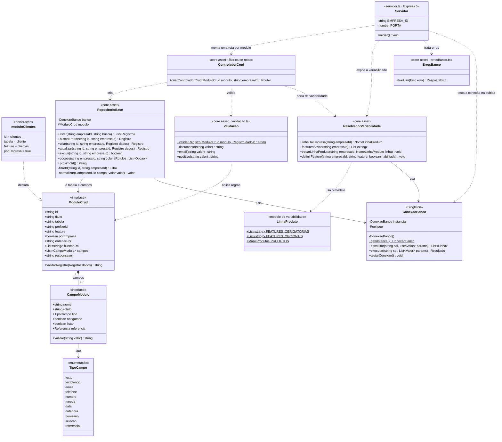

### Decisões visíveis no código

| Decisão                       | Como aparece nas classes                                                                                        | Por quê                                                                                   |
| ----------------------------- | --------------------------------------------------------------------------------------------------------------- | ----------------------------------------------------------------------------------------- |
| Uma tela é uma declaração     | `moduloClientes` é um objeto que realiza `ModuloCrud`; não existe classe de controlador ou repositório por tela | ADR-02: o comportamento é do núcleo, a descrição é do módulo                              |
| Isolamento no núcleo          | `empresaId` em toda operação de `RepositorioBase` e o método privado `filtroId`                                 | ADR-05: a mesma regra vale para as oito telas e nenhum módulo pode esquecê-la             |
| Pool único                    | Construtor privado e `getInstance()` estático em `ConexaoBanco`                                                 | Um segundo pool dividiria as conexões e faria o limite do banco estourar mais cedo        |
| Variabilidade com fonte única | `ResolvedorVariabilidade` consulta `LinhaProduto` e a tabela `empresa_feature`                                  | ADR-03: antes existiam duas listas de features divergentes para o mesmo produto           |
| Tipos de campo fechados       | `TipoCampo` como enumeração                                                                                     | Um tipo novo é uma mudança consciente no núcleo, e não uma exceção escondida em um módulo |
| Controlador como fábrica      | `criarControladorCrud` recebe o módulo e devolve um roteador Express                                            | O mesmo código gera as cinco rotas de qualquer tela                                       |

---

# 6. Visão de Tempo de Execução

_(arc42 — Runtime View)_

Os cenários foram escolhidos por demonstrarem, cada um, uma meta de qualidade da seção 1.2 em funcionamento. São também os caminhos que a equipe precisa saber explicar na defesa.

## 6.1 Cadastro em uma tela CRUD

**Por que este cenário.** É o caminho completo de um clique até o banco, e mostra os ativos reutilizáveis trabalhando em sequência: `telaCrud.js` → `api.js` → `ControladorCrud` → `validacao.ts` → `RepositorioBase` → `ConexaoBanco` → MySQL. Qualquer uma das oito telas percorre exatamente o mesmo caminho.

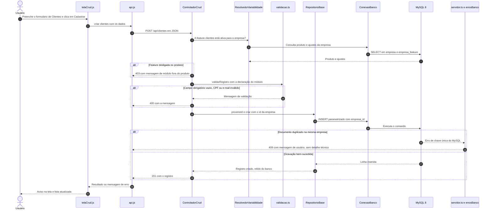

**Aspectos notáveis.** A porta de variabilidade é verificada antes da validação: um módulo fora do produto não chega nem a olhar os dados enviados. O identificador do registro é gerado no servidor, no formato `CLI-0001`, e nunca aceito da tela. O `empresa_id` gravado vem da configuração da instância, não do corpo da requisição — o usuário não tem como escolher em nome de qual empresa grava.

## 6.2 Troca do produto contratado

**Por que este cenário.** É a demonstração da variabilidade em tempo de execução, e o roteiro da defesa: Field → Core → quatro telas somem → `/api/estoque` responde 403 → ligar apenas estoque → a tela volta, sem recompilar.

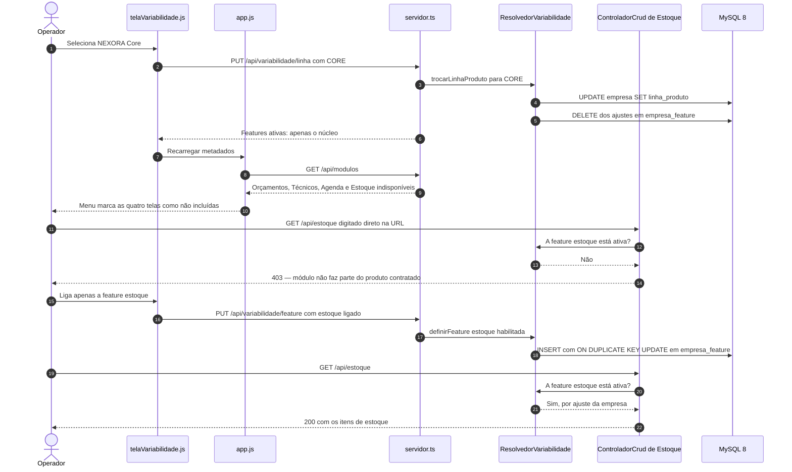

**Aspectos notáveis.** Esconder o item do menu não é o controle — é conveniência. O controle é a porta de variabilidade na API, que responde 403 mesmo para quem digita a rota diretamente. As features obrigatórias do núcleo não podem ser desligadas: a tentativa responde 400 com mensagem explicativa. Trocar o produto apaga os ajustes individuais, para que o novo produto comece a partir da sua definição padrão.

## 6.3 Tentativa de acesso a dado de outra empresa

**Por que este cenário.** É a evidência da meta 2. A instância da Empresa 2 — iniciada com `EMPRESA_ID=EMP-2` — tenta alterar um cliente da Empresa 1 conhecendo o identificador dele.

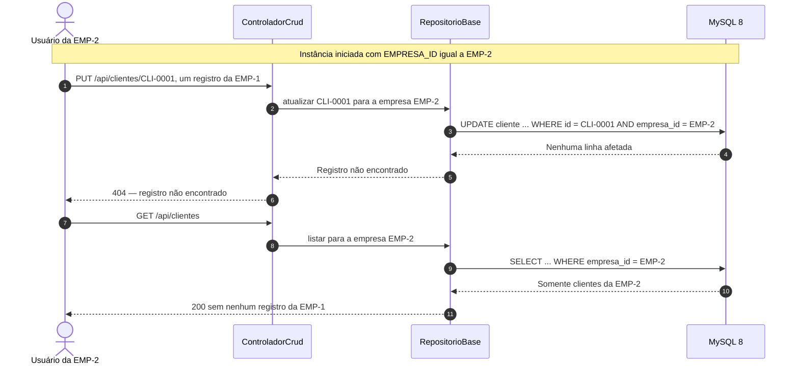

**Aspectos notáveis.** A resposta é 404, e não 403: informar que o registro existe, mas pertence a outra empresa, já seria um vazamento. Na versão 1 o sistema conferia a empresa apenas na listagem, e editar ou excluir pela URL funcionava com o id de outra empresa; a correção foi feita no núcleo (`filtroId`), o que a estendeu às oito telas de uma só vez. O cenário faz parte do `npm run testar`.

## 6.4 Inicialização e verificação de saúde

**Por que este cenário.** Mostra o Singleton da conexão em funcionamento e o comportamento esperado quando o banco não está disponível — o erro mais comum na primeira execução em uma máquina nova.

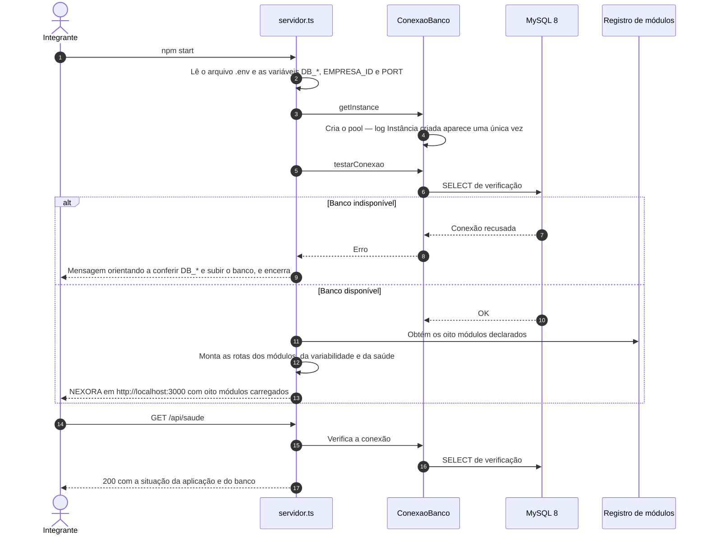

**Aspectos notáveis.** Encerrar o processo quando o banco não responde é intencional: uma aplicação que sobe sem banco aceitaria requisições que só poderiam falhar. A rota `/api/saude` é o mesmo mecanismo que um orquestrador de contêineres usa, na implantação em nuvem, para decidir se uma instância pode receber tráfego — ver [[#7.2 Infraestrutura nível 1 — implantação alvo em nuvem]].

---

# 7. Visão de Implantação

_(arc42 — Deployment View)_

A seção descreve dois ambientes: o **atual**, em que a NEXORA 2.0 roda hoje para desenvolvimento e defesa, e o **alvo em nuvem**, proposto para publicação. Os dois usam o mesmo código e a mesma versão do MySQL; muda apenas onde cada peça é executada.

## 7.1 Infraestrutura nível 1 — ambiente atual

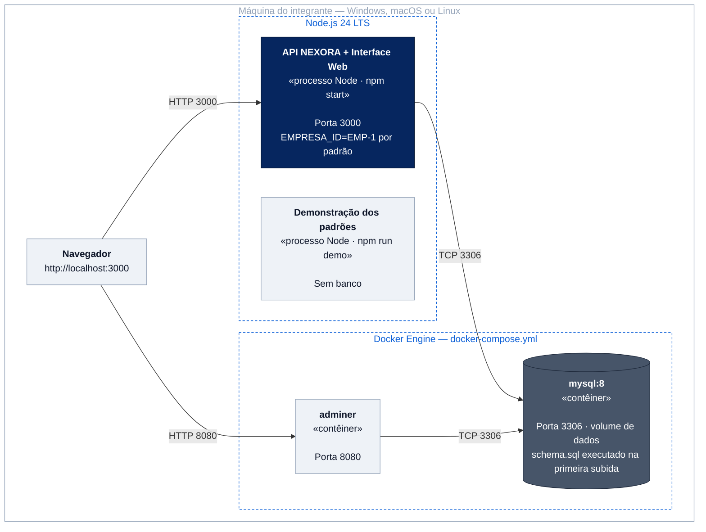

### Motivação

O banco roda em contêiner para que os cinco integrantes tenham exatamente a mesma versão e configuração do MySQL, sem instalá-lo no sistema operacional, e para que `npm run banco:resetar` devolva o estado da demonstração em segundos (ADR-04). A aplicação roda direto no Node.js da máquina, porque durante o desenvolvimento isso encurta o ciclo entre alterar o código e ver o resultado.

### Características de qualidade e desempenho

- **Reprodutibilidade:** o `docker-compose.yml` e o `schema.sql` recriam o banco idêntico em qualquer máquina; `package-lock.json` e `.nvmrc` fixam as dependências e o Node.
- **Independência de rede:** tudo roda localmente, o que protege a defesa ao vivo de falhas de conexão.
- **Plano B:** o guia de instalação documenta o uso do MySQL do XAMPP, caso o Docker não esteja disponível em alguma máquina.

### Mapeamento de blocos de construção para infraestrutura

| Bloco de construção        | Elemento de infraestrutura                              |
| -------------------------- | ------------------------------------------------------- |
| API NEXORA e Interface Web | Processo Node.js iniciado por `npm start`, porta 3000   |
| Demonstração dos padrões   | Processo Node.js iniciado por `npm run demo`            |
| Banco de dados             | Contêiner `mysql:8`, porta 3306, com volume persistente |
| Adminer                    | Contêiner `adminer`, porta 8080                         |

### Comandos do ambiente

| Comando                      | O que faz                                                              |
| ---------------------------- | ---------------------------------------------------------------------- |
| `npm ci`                     | Instala as dependências exatamente como fixadas no `package-lock.json` |
| `npm run banco:subir`        | Sobe MySQL e Adminer e cria as tabelas na primeira execução            |
| `npm run banco:resetar`      | Recria o banco no estado da demonstração                               |
| `npm start`                  | Compila e sobe a API e a interface                                     |
| `EMPRESA_ID=EMP-2 npm start` | Sobe a instância da segunda empresa, com outro produto e outros dados  |

## 7.2 Infraestrutura nível 1 — implantação alvo em nuvem

A implantação em nuvem é uma **proposta** (ADR-08). Ela preserva o que a versão 2.0 já garante — mesma imagem, configuração por variável de ambiente, aplicação sem estado em memória — e substitui cada peça local pelo serviço gerenciado equivalente. O provedor ainda não foi escolhido; por isso a topologia é descrita pelo papel de cada serviço.

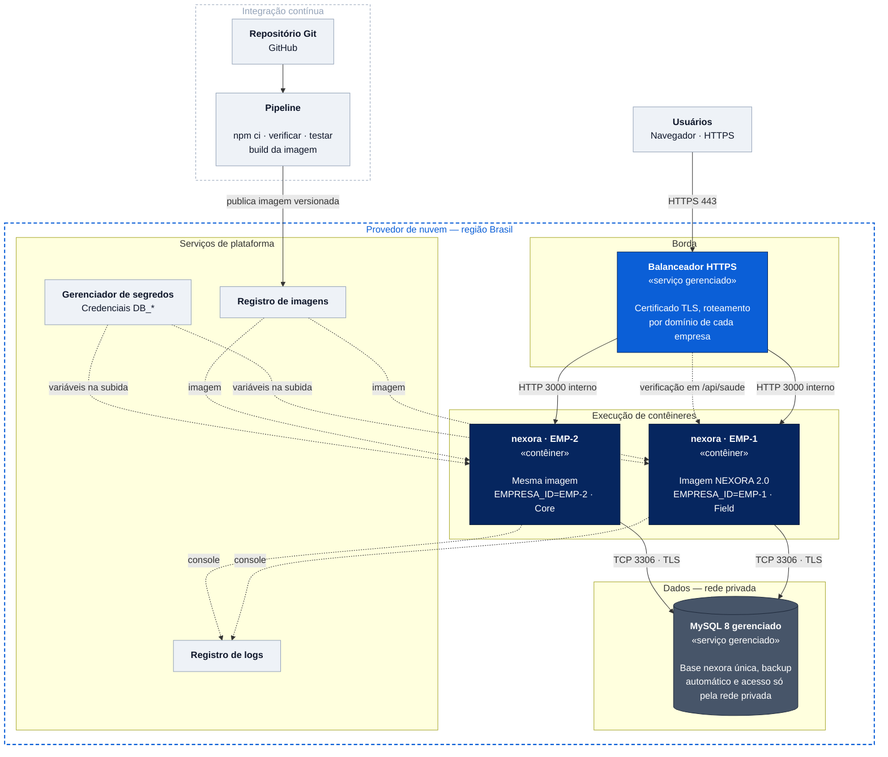

### Motivação

Na versão 2.0, cada instância da aplicação atende uma empresa, definida por `EMPRESA_ID` (ADR-07). A implantação em nuvem respeita esse modelo: **um serviço de contêiner por empresa, todos a partir da mesma imagem**, compartilhando um único MySQL gerenciado, com o isolamento garantido pelo `empresa_id` em cada consulta. A variabilidade continua em tempo de execução — trocar o produto de uma empresa não exige nova imagem nem nova implantação.

### Aderência aos princípios de aplicação nativa de nuvem

| Princípio (_Twelve-Factor App_)          | Como a NEXORA atende                                                                  | Situação                               |
| ---------------------------------------- | ------------------------------------------------------------------------------------- | -------------------------------------- |
| Base de código única                     | Um repositório, uma imagem para todas as empresas                                     | Atendido                               |
| Dependências declaradas                  | `package-lock.json`, `engines` e `.nvmrc`                                             | Atendido                               |
| Configuração no ambiente                 | `DB_*`, `EMPRESA_ID` e `PORT` lidas do ambiente ou do `.env`                          | Atendido                               |
| Serviços de apoio como recursos anexados | O MySQL é trocado de contêiner local para serviço gerenciado apenas mudando `DB_HOST` | Atendido                               |
| Processos sem estado                     | Nenhum dado de sessão em memória; o estado da variabilidade fica no banco             | Atendido                               |
| Descartabilidade                         | Subida rápida e encerramento imediato se o banco não responder                        | Atendido                               |
| Paridade entre ambientes                 | Mesma versão do MySQL local e na nuvem                                                | Atendido                               |
| Logs como fluxo de eventos               | Logs escritos no console, coletados pela plataforma                                   | Parcial — sem formato estruturado      |
| Build, release e execução separados      | Imagem versionada gerada pelo pipeline                                                | Previsto — falta o `Dockerfile` da API |

### Mapeamento de blocos de construção para infraestrutura

| Bloco de construção        | Ambiente atual            | Implantação alvo em nuvem                                 |
| -------------------------- | ------------------------- | --------------------------------------------------------- |
| API NEXORA e Interface Web | Processo Node.js local    | Contêiner em serviço gerenciado, um por empresa           |
| Banco de dados             | Contêiner `mysql:8` local | MySQL 8 gerenciado, em rede privada                       |
| Adminer                    | Contêiner local           | **Não implantado** — ferramenta apenas de desenvolvimento |
| Demonstração dos padrões   | Processo local            | Não implantado                                            |
| Configuração               | Arquivo `.env`            | Gerenciador de segredos e variáveis do serviço            |

## 7.3 Infraestrutura nível 2 — detalhamento dos elementos

### Execução de contêineres

| Característica       | Definição                                                                                                  | Razão                                                                       |
| -------------------- | ---------------------------------------------------------------------------------------------------------- | --------------------------------------------------------------------------- |
| Imagem               | Uma imagem da API NEXORA, construída a partir de `npm ci` e do build TypeScript, com Node.js 24 LTS        | Mesma versão do ambiente atual (RT-02)                                      |
| Configuração         | `DB_HOST`, `DB_PORT`, `DB_USER`, `DB_PASSWORD`, `DB_NAME`, `EMPRESA_ID`, `PORT`, injetadas pela plataforma | Nenhum segredo dentro da imagem ou do repositório                           |
| Réplicas             | Uma por empresa na demonstração; a aplicação sem estado permite mais de uma                                | Custo mínimo dentro dos créditos acadêmicos (RO-03)                         |
| Verificação de saúde | `/api/saude`                                                                                               | A plataforma só envia tráfego para instância que responde e alcança o banco |
| Exposição            | Apenas pelo balanceador HTTPS; a porta 3000 fica interna                                                   | A versão 2.0 ainda não tem autenticação — ver R-01                          |

### Banco de dados gerenciado

| Característica | Definição                                            | Razão                                             |
| -------------- | ---------------------------------------------------- | ------------------------------------------------- |
| Versão         | MySQL 8                                              | Paridade com o contêiner local                    |
| Inicialização  | `banco/schema.sql` executado uma vez na criação      | O mesmo script que cria o banco local             |
| Rede           | Acesso restrito à rede privada dos contêineres       | O banco nunca fica exposto à internet             |
| Backup         | Automático, oferecido pelo serviço gerenciado        | Evita que a equipe administre rotina de backup    |
| Conexões       | Um pool por instância, pelo Singleton `ConexaoBanco` | Limita o número de conexões abertas por contêiner |

### Correspondência entre provedores

A tabela mostra que a topologia não depende de um provedor específico; a escolha final segue os créditos acadêmicos disponíveis.

| Papel                   | AWS                       | Microsoft Azure                      | Google Cloud           |
| ----------------------- | ------------------------- | ------------------------------------ | ---------------------- |
| Execução de contêineres | App Runner ou ECS Fargate | Container Apps                       | Cloud Run              |
| Balanceador HTTPS       | Application Load Balancer | Integrado ao Container Apps          | Integrado ao Cloud Run |
| MySQL 8 gerenciado      | RDS for MySQL             | Database for MySQL — Flexible Server | Cloud SQL for MySQL    |
| Registro de imagens     | ECR                       | Container Registry                   | Artifact Registry      |
| Gerenciador de segredos | Secrets Manager           | Key Vault                            | Secret Manager         |
| Registro de logs        | CloudWatch Logs           | Monitor                              | Cloud Logging          |

---

# 8. Conceitos Transversais

_(arc42 — Cross-cutting Concepts)_

Conceitos que atravessam vários blocos de construção e que, por isso, foram decididos uma vez e aplicados de maneira uniforme.

## 8.1 Modelo de dados

Onze tabelas InnoDB, em `utf8mb4`. A tabela `empresa` é a raiz do multiempresa: toda tabela operacional carrega `empresa_id`.

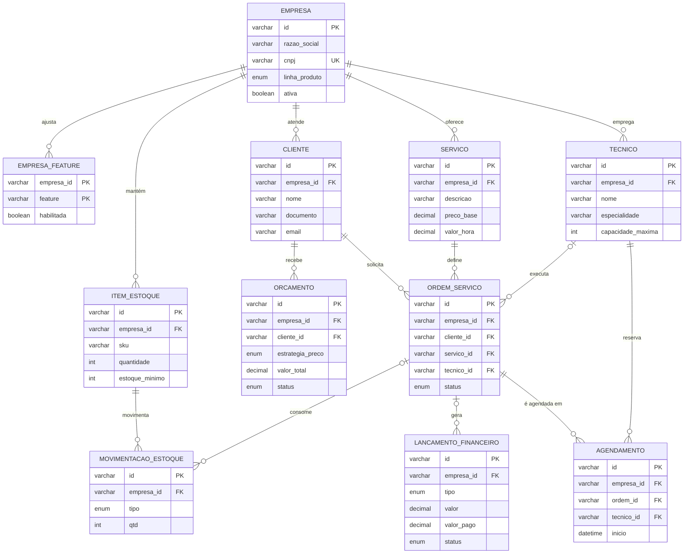

| Aspecto               | Decisão                                                                                                                                     |
| --------------------- | ------------------------------------------------------------------------------------------------------------------------------------------- |
| Identificadores       | Texto no formato `PREFIXO-0001` (`CLI`, `SRV`, `TEC`, `AGD`, `ORC`, `OS`, `ITM`, `LAN`), gerados no servidor                                |
| Unicidade por empresa | `UNIQUE (empresa_id, documento)` em clientes e `UNIQUE (empresa_id, sku)` no estoque: o mesmo documento pode existir em empresas diferentes |
| Faixas de valor       | `CHECK` em preços e quantidades, impedindo valores negativos mesmo em escrita direta no banco                                               |
| Situações             | `ENUM` no banco, espelhando as opções declaradas no módulo                                                                                  |
| Valores monetários    | `DECIMAL(10,2)`, nunca ponto flutuante                                                                                                      |
| Segunda empresa       | EMP-2, com o produto NEXORA Core, existe nos dados de demonstração para evidenciar o multiempresa                                           |

O diagrama entidade-relacionamento completo, com a justificativa de cada escolha de modelagem, está em `banco/MODELO.md`.

## 8.2 Reuso por declaração

O conceito central da NEXORA é que **uma tela é uma declaração de dados, não código** (ADR-02). Cada módulo exporta um objeto `ModuloCrud` com tabela, campos, tipos, validações e regras. O núcleo transforma essa declaração em SQL, rotas REST e interface.

| Ativo reutilizável (_core asset_) | O que entrega para todos os módulos                                                |
| --------------------------------- | ---------------------------------------------------------------------------------- |
| `RepositorioBase`                 | Listar, buscar, criar, editar e excluir, com filtro por empresa                    |
| `ControladorCrud`                 | Cinco rotas REST e a porta de variabilidade                                        |
| `validacao.ts`                    | Validações de obrigatoriedade, tipo, CPF/CNPJ, e-mail, faixas e regras de registro |
| `errosBanco.ts`                   | Tradução de erros do banco em mensagens de usuário                                 |
| `ConexaoBanco`                    | Pool único de conexões                                                             |
| `telaCrud.js`                     | Formulário, busca, tabela, edição e exclusão                                       |

**Para adicionar uma tela:** criar `src/modulos/<nome>/<nome>.modulo.ts`, registrá-lo em `src/modulos/index.ts` e criar a tabela em `banco/schema.sql`. Se a tela for opcional, incluí-la em `FEATURES_OPCIONAIS` e nos produtos que a recebem.

**Limite conhecido:** telas muito diferentes de um CRUD — como o painel do técnico em campo — vão exigir um novo tipo de tela no núcleo, e não exceções dentro do CRUD genérico.

## 8.3 Variabilidade e linha de produtos

A NEXORA é uma linha de produtos: um núcleo obrigatório e pontos de variação combinados em quatro produtos.

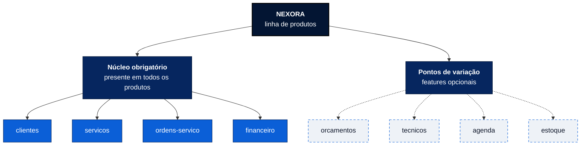

### Produtos derivados

| Produto      | Público                                       | Orçamentos | Técnicos | Agenda | Estoque |
| ------------ | --------------------------------------------- | ---------- | -------- | ------ | ------- |
| NEXORA Core  | Prestador enxuto, sem equipe de campo própria | —          | —        | —      | —       |
| NEXORA Tech  | Assistência técnica com bancada e peças       | ✓          | —        | —      | ✓       |
| NEXORA Maint | Contratos de manutenção preventiva            | —          | ✓        | ✓      | —       |
| NEXORA Field | Operação completa de campo                    | ✓          | ✓        | ✓      | ✓       |

### Níveis de variação

| Nível                             | Onde é declarado               | Quem decide em tempo de execução                       | Exemplo                                                                                |
| --------------------------------- | ------------------------------ | ------------------------------------------------------ | -------------------------------------------------------------------------------------- |
| Módulo inteiro                    | `LinhaProduto.ts`, fonte única | `ResolvedorVariabilidade` e a tabela `empresa_feature` | Estoque existe no Tech e no Field, não no Core                                         |
| Comportamento dentro de um módulo | `RegistroFeatures.ts`          | _Hooks_ do Template Method                             | A finalização registra garantia apenas se a feature `controle-garantia` estiver ligada |
| Algoritmo                         | Classes Strategy               | Configuração do orçamento ou da cobrança               | Preço fixo, por hora ou por visita                                                     |

A ligação (_binding_) acontece **em tempo de execução**: o mesmo build atende os quatro produtos, e trocar o produto de uma empresa não exige recompilar nem reiniciar. Além do produto, cada empresa pode ligar ou desligar features opcionais individualmente; as obrigatórias não podem ser desligadas.

## 8.4 Multiempresa e isolamento de dados

| Camada                    | Mecanismo                                                                                                                        | O que impede                                                 |
| ------------------------- | -------------------------------------------------------------------------------------------------------------------------------- | ------------------------------------------------------------ |
| Configuração da instância | `EMPRESA_ID` define a empresa atendida pelo processo (ADR-07)                                                                    | Que a requisição escolha em nome de qual empresa opera       |
| Núcleo de acesso a dados  | `RepositorioBase` inclui `empresa_id` em toda listagem, e `filtroId` em toda busca, edição e exclusão por identificador (ADR-05) | Que uma empresa leia, altere ou exclua registro de outra     |
| Banco de dados            | `empresa_id` obrigatório com chave estrangeira; unicidade composta por empresa                                                   | Registro sem empresa ou colisão indevida entre empresas      |
| Verificação               | `npm run testar` executa leitura, edição e exclusão cruzadas entre EMP-1 e EMP-2                                                 | Que uma alteração futura reabra a falha sem ninguém perceber |

## 8.5 Persistência e acesso a dados

| Conceito              | Decisão                                                                                                    |
| --------------------- | ---------------------------------------------------------------------------------------------------------- |
| Acesso                | SQL explícito, sem ORM (ADR-06), gerado pelo `RepositorioBase` a partir da declaração do módulo            |
| Parametrização        | Todo valor vai por parâmetro `?`; nomes de tabela e coluna vêm dos módulos, nunca da requisição            |
| Conexões              | Pool `mysql2/promise` único, criado pelo Singleton `ConexaoBanco`                                          |
| Datas                 | Recebidas como texto (`dateStrings`), evitando conversão indevida de fuso horário                          |
| Esquema               | Um único `banco/schema.sql`, executado na primeira subida do contêiner                                     |
| Dados de demonstração | Oito telas populadas e duas empresas; `banco/consultas-demo.sql` traz sete consultas prontas para a defesa |

## 8.6 Validação e tratamento de erros

| Onde           | O que valida                                                                   | Por que ali                                                          |
| -------------- | ------------------------------------------------------------------------------ | -------------------------------------------------------------------- |
| Interface      | Obrigatoriedade e tipo do campo no próprio formulário                          | Retorno imediato, sem ida ao servidor                                |
| `validacao.ts` | Obrigatoriedade, tipo, regra de campo e regra de registro declaradas no módulo | É a validação que não pode ser contornada chamando a API diretamente |
| Banco de dados | Chaves estrangeiras, unicidade e faixas de valor                               | Última linha de defesa contra estado inconsistente                   |

| Situação                                 | Resposta                                                                   |
| ---------------------------------------- | -------------------------------------------------------------------------- |
| Dado inválido                            | 400, com a mensagem da regra violada                                       |
| Módulo fora do produto contratado        | 403                                                                        |
| Registro inexistente ou de outra empresa | 404                                                                        |
| Registro duplicado ou em uso por outro   | 409, com explicação de negócio                                             |
| Referência a registro inexistente        | 400                                                                        |
| Erro inesperado                          | Tratamento central no `servidor.ts`, sem rastreamento de pilha na resposta |

Todo erro segue o envelope `{ "erro": "mensagem" }`. As mensagens são escritas para o usuário: dizem o que aconteceu e o que fazer. Na versão 1, erros do MySQL voltavam como página HTML com o rastreamento de pilha; o `errosBanco.ts` corrigiu isso para as oito telas.

## 8.7 Situações da ordem de serviço

A ordem de serviço tem cinco situações, definidas como `ENUM` no banco e como opções no módulo.

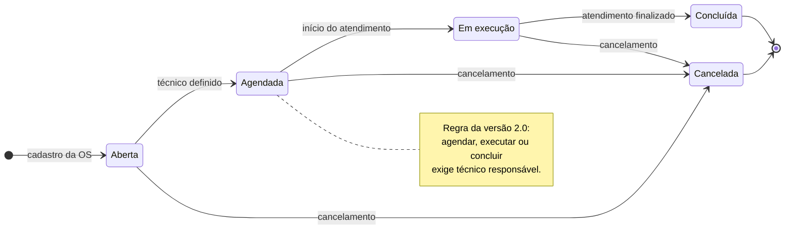

**Situação na versão 2.0.** As cinco situações e a regra do técnico obrigatório estão implementadas. O diagrama representa o fluxo pretendido; o **bloqueio de transições fora dele e o registro do histórico de cada transição** (RF10) ainda não estão implementados — hoje a situação pode ser alterada livremente pela tela, desde que a regra do técnico seja respeitada. Registrado como dívida D-03.

## 8.8 Segurança

| Aspecto                   | Situação na versão 2.0                                                                                                           |
| ------------------------- | -------------------------------------------------------------------------------------------------------------------------------- |
| Injeção de SQL            | Protegida: SQL sempre parametrizado; identificadores vêm das declarações dos módulos                                             |
| Injeção de HTML           | Protegida: a interface escapa todo texto vindo da API antes de exibi-lo (`formato.js`)                                           |
| Isolamento entre empresas | Garantido no núcleo e verificado por teste automatizado (seção 8.4)                                                              |
| Exposição de erros        | Mensagens de usuário, sem detalhe técnico nem rastreamento de pilha                                                              |
| Segredos                  | No arquivo `.env`, fora do controle de versão; na nuvem, no gerenciador de segredos                                              |
| Dependências              | Fixadas; `npm audit` sem vulnerabilidades conhecidas na versão 2.0                                                               |
| **Autenticação e perfis** | **Não implementados.** O ativo Autenticação está definido na linha de produtos, mas ainda não existe no sistema web — risco R-01 |
| Transporte                | HTTP no ambiente local; HTTPS obrigatório na implantação em nuvem                                                                |
| Dados pessoais (LGPD)     | Coleta limitada ao necessário para o serviço; controles de acesso dependem da autenticação prevista                              |

## 8.9 Configuração

A configuração é lida do ambiente ou do arquivo `.env` na inicialização. Não há valor sensível no código.

| Variável      | Finalidade                      | Padrão local       |
| ------------- | ------------------------------- | ------------------ |
| `DB_HOST`     | Endereço do MySQL               | `localhost`        |
| `DB_PORT`     | Porta do MySQL                  | `3306`             |
| `DB_USER`     | Usuário da aplicação            | `nexora`           |
| `DB_PASSWORD` | Senha da aplicação              | definida no `.env` |
| `DB_NAME`     | Nome da base                    | `nexora`           |
| `EMPRESA_ID`  | Empresa atendida pela instância | `EMP-1`            |
| `PORT`        | Porta HTTP da aplicação         | `3000`             |

## 8.10 Padrões de projeto

| Padrão          | Exemplos                                                        | Onde           | Conceito aplicado                                                                                                                                                                 |
| --------------- | --------------------------------------------------------------- | -------------- | --------------------------------------------------------------------------------------------------------------------------------------------------------------------------------- |
| Singleton       | `ConexaoBanco` — pool MySQL real do sistema; `RegistroFeatures` | `src/nucleo/`  | Construtor privado e `getInstance()`; o log "Instância criada" aparece uma única vez por processo                                                                                 |
| Template Method | `FinalizacaoOS`, `GeradorRelatorio`, `ImportadorDados`          | `src/padroes/` | O método template fixa a sequência; o que é opcional é um _hook_ com implementação padrão. Como TypeScript não tem `final`, a imutabilidade do template é protegida por convenção |
| Strategy        | `CalculoPrecoServico`, `DistribuicaoTecnico`, `FormaPagamento`  | `src/padroes/` | Uma variação nova entra como classe nova, sem condicional no contexto                                                                                                             |

Os padrões rodam sem banco em `npm run demo`, e os Singletons são os mesmos usados pela aplicação web.

## 8.11 Interface do usuário

| Conceito              | Decisão                                                                                                           |
| --------------------- | ----------------------------------------------------------------------------------------------------------------- |
| Arquitetura           | Uma tela CRUD genérica montada a partir dos metadados; sem framework, com ES modules nativos                      |
| Identidade visual     | Design System NEXORA: navy `#06265F` na navegação, azul `#0B5FD7` nas ações, tipografia Inter, raios de 8 e 12 px |
| Variabilidade visível | Telas fora do produto aparecem no menu como "não incluído", em vez de simplesmente sumirem                        |
| Estados               | Toda tela tem estado de carregamento, lista vazia, busca sem resultado e erro                                     |
| Acessibilidade        | Foco visível no teclado; cor nunca é a única forma de transmitir informação                                       |
| Responsividade        | Layout adaptável até 360 px de largura                                                                            |

## 8.12 Verificação e diagnóstico

| Verificação   | Comando                | O que garante                                                                                                                   |
| ------------- | ---------------------- | ------------------------------------------------------------------------------------------------------------------------------- |
| Tipos         | `npm run verificar`    | TypeScript em modo `strict` sem erros                                                                                           |
| Fumaça da API | `npm run testar`       | 66 verificações: CRUD das oito telas, regras de negócio, isolamento entre empresas, troca de produto e 403 de feature desligada |
| Padrões       | `npm run demo`         | Singleton, Template Method e Strategy funcionando sem banco                                                                     |
| Saúde         | `GET /api/saude`       | Aplicação e banco respondendo                                                                                                   |
| Dependências  | `npm audit --omit=dev` | Nenhuma vulnerabilidade conhecida                                                                                               |

O diagnóstico em execução é feito pelos logs de console, com prefixo por componente (`[API]`, `[ConexaoBanco]`), e pela rota de saúde.

---

# 9. Decisões de Arquitetura

_(arc42 — Architecture Decisions)_

A numeração é a mesma do documento de arquitetura do repositório (`docs/ARQUITETURA.md`), para que a decisão tenha o mesmo identificador em todos os artefatos do projeto.

## Situação das decisões

| ADR    | Decisão                                                 | Situação                                                | Data     |
| ------ | ------------------------------------------------------- | ------------------------------------------------------- | -------- |
| ADR-01 | Projeto só em TypeScript                                | Aceita                                                  | set/2026 |
| ADR-02 | Uma tela é uma declaração, não código                   | Aceita                                                  | set/2026 |
| ADR-03 | Variabilidade em tempo de execução com fonte única      | Aceita — confirmação pendente com a disciplina de Reúso | set/2026 |
| ADR-04 | MySQL 8 em Docker                                       | Aceita                                                  | set/2026 |
| ADR-05 | Isolamento multiempresa no repositório genérico         | Aceita                                                  | set/2026 |
| ADR-06 | Sem ORM, sem framework de front-end, sem empacotador    | Aceita                                                  | set/2026 |
| ADR-07 | Empresa da instância definida por configuração          | Aceita — temporária, até existir autenticação           | set/2026 |
| ADR-08 | Implantação em nuvem com contêineres e MySQL gerenciado | Proposta                                                | set/2026 |

---

## ADR-01 — Projeto só em TypeScript

**Contexto.** A entrega de padrões de projeto tinha a implementação em TypeScript e uma cópia espelhada em Java. Manter as duas dobrava o trabalho, criava o risco de divergência entre elas e exigia duas cadeias de ferramentas — JDK e Node — na máquina da defesa.

**Decisão.** Remover a versão Java. Os padrões ficam em `src/nucleo/` (Singletons) e `src/padroes/` (Template Method e Strategy), e são os mesmos usados pelo sistema web.

**Consequências.** Uma linguagem, uma cadeia de build e um único lugar para cada padrão. A diferença de sintaxe em relação aos slides da disciplina, escritos em Java, é explicada nos comentários — por exemplo, a ausência de `final` em TypeScript.

---

## ADR-02 — Uma tela é uma declaração, não código

**Contexto.** O enunciado de Reúso exige oito telas CRUD. Escrever controlador, repositório e HTML para cada uma produziria oito cópias quase idênticas — o oposto do que a disciplina avalia.

**Decisão.** Cada módulo exporta um objeto `ModuloCrud`, com tabela, campos, validações e regras. Repositório, controlador e tela são genéricos.

**Alternativas consideradas.**

| Alternativa                                         | Por que foi descartada                                                                              |
| --------------------------------------------------- | --------------------------------------------------------------------------------------------------- |
| Uma classe de controlador e de repositório por tela | Oito cópias do mesmo código; uma correção precisaria ser repetida oito vezes                        |
| Gerador de código a partir de modelo                | Produz código repetido do mesmo jeito, apenas automatizado; o reuso deixa de ser visível na leitura |

**Consequências.** Oito telas com zero código de CRUD repetido, e uma tela nova custa um arquivo. O limite conhecido é que telas muito diferentes de um CRUD — como o painel do técnico em campo — vão exigir um novo tipo de tela no núcleo, e não exceções dentro do genérico.

---

## ADR-03 — Variabilidade em tempo de execução com fonte única

**Contexto.** A NEXORA é uma linha de produtos com quatro produtos derivados. A ligação entre feature e produto pode acontecer em tempo de compilação, gerando um artefato por produto, ou em tempo de execução, com um artefato único. Na versão 1, `RegistroFeatures` e `LinhaProduto.ts` mantinham listas diferentes de features para o mesmo produto — duas fontes da verdade.

**Decisão.** Ligação em tempo de execução. O modelo de features de módulo mora apenas em `LinhaProduto.ts`; a escolha de cada empresa fica nas tabelas `empresa` e `empresa_feature`. `RegistroFeatures` consome esse modelo e acrescenta apenas features de comportamento.

**Alternativas consideradas.**

| Alternativa                                  | Por que foi descartada                                                               |
| -------------------------------------------- | ------------------------------------------------------------------------------------ |
| Compilação condicional, um build por produto | Multiplica builds e testes, e impede trocar o produto de uma empresa sem reimplantar |
| Ramificação de código por produto            | Uma correção precisaria ser replicada em cada ramo                                   |

**Consequências.** O mesmo build atende os quatro produtos, e a troca pode ser demonstrada ao vivo. O código de todos os produtos viaja em todas as instalações.

**Pendente.** Confirmar com a disciplina de Desenvolvimento Orientado a Reúso que a ligação em tempo de execução atende ao que é esperado. Se a exigência for ligação em tempo de compilação, esta decisão é revista.

---

## ADR-04 — MySQL 8 em Docker

**Contexto.** O dossiê de arquitetura inicial recomendava PostgreSQL 16 com _Row Level Security_. A equipe precisava de um banco que os cinco integrantes rodassem de forma idêntica, sem instalação no sistema operacional, e que pudesse voltar ao estado da demonstração rapidamente.

**Decisão.** MySQL 8 em contêiner, definido em `docker-compose.yml` e inicializado pelo `schema.sql` na primeira subida, com Adminer para administração.

**Alternativas consideradas.**

| Alternativa                                  | Por que foi descartada                                                                                                |
| -------------------------------------------- | --------------------------------------------------------------------------------------------------------------------- |
| PostgreSQL 16 com Row Level Security         | Tecnicamente superior para isolamento, mas a equipe já dominava MySQL e o prazo não comportava a curva de aprendizado |
| MySQL instalado em cada máquina ou via XAMPP | Versões e configurações divergentes entre integrantes; mantido apenas como plano B no guia de instalação              |

**Consequências.** Mesma versão e configuração em todas as máquinas, e `npm run banco:resetar` restaura a demonstração em segundos. Como o MySQL não oferece segurança em nível de linha, o isolamento entre empresas passa a ser responsabilidade da aplicação (ADR-05).

---

## ADR-05 — Isolamento multiempresa no repositório genérico

**Contexto.** Na versão 1, a listagem filtrava pela empresa, mas editar, excluir e buscar por identificador não: qualquer pessoa com o id de um registro de outra empresa conseguia alterá-lo pela URL.

**Decisão.** Toda consulta, alteração e exclusão por identificador inclui `empresa_id`, por meio de `RepositorioBase.filtroId`.

**Consequências.** Como a regra está no núcleo, vale para as oito telas de uma vez, e o `npm run testar` a verifica. A garantia depende de todo SQL das telas passar pelo `RepositorioBase`; uma consulta escrita fora dele não herda o filtro (R-03).

---

## ADR-06 — Sem ORM, sem framework de front-end, sem empacotador

**Contexto.** O dossiê de arquitetura recomendava NestJS e React para um cenário de produção. O projeto, porém, é avaliado pela leitura do código e defendido ao vivo por qualquer integrante sorteado.

**Decisão.** Express 5 com SQL explícito no back-end e ES modules nativos no front-end, sem etapa de build na interface.

**Consequências.** Cada passo do caminho entre o clique e o banco é visível no código. A troca por NestJS e React permanece como evolução possível, não como requisito da disciplina.

---

## ADR-07 — Empresa da instância definida por configuração

**Contexto.** O multiempresa precisa saber qual empresa está operando. O caminho natural é obter a empresa da sessão do usuário autenticado, mas a autenticação ainda não existe na versão 2.0.

**Decisão.** Cada processo da aplicação atende uma empresa, definida pela variável `EMPRESA_ID`. `EMPRESA_ID=EMP-2 npm start` sobe a instância da segunda empresa, com outro produto e outros dados.

**Alternativas consideradas.**

| Alternativa                                                 | Por que foi descartada                                                                  |
| ----------------------------------------------------------- | --------------------------------------------------------------------------------------- |
| Empresa enviada pela requisição, por parâmetro ou cabeçalho | Qualquer usuário poderia operar em nome de outra empresa trocando um valor              |
| Adiar o multiempresa até existir autenticação               | Impediria demonstrar isolamento e variabilidade por empresa, centrais para a disciplina |

**Consequências.** O isolamento é demonstrável sem login. Em contrapartida, atender muitas empresas exige muitas instâncias, o que não escala para um produto comercial (R-02). Quando a autenticação for implementada, a empresa passa a vir da sessão e esta decisão é substituída.

---

## ADR-08 — Implantação em nuvem com contêineres e MySQL gerenciado

**Situação:** proposta.

**Contexto.** A disciplina de Arquitetura e Soluções Cloud pede a implantação do sistema em nuvem. A aplicação já é sem estado e configurável por ambiente, mas hoje roda direto no Node da máquina, e apenas o banco está em contêiner.

**Decisão proposta.** Empacotar a API em uma imagem Docker, executá-la em serviço gerenciado de contêineres — uma instância por empresa, conforme ADR-07 — e usar MySQL 8 gerenciado em rede privada, com segredos no gerenciador do provedor.

**Alternativas consideradas.**

| Alternativa                        | Por que foi descartada                                                                          |
| ---------------------------------- | ----------------------------------------------------------------------------------------------- |
| Máquina virtual com Docker Compose | Reproduz o ambiente local, mas deixa atualização, backup e disponibilidade a cargo da equipe    |
| Funções _serverless_               | Exigiria reescrever o servidor Express em funções e lidaria mal com o pool de conexões ao MySQL |
| Cluster Kubernetes gerenciado      | Complexidade e custo desproporcionais a duas instâncias de demonstração                         |

**Consequências.** Mesma imagem para todas as empresas, backup e disponibilidade do banco por conta do provedor, e custo compatível com créditos acadêmicos. Exige criar o `Dockerfile` da API e escolher o provedor. A exposição pública só é aceitável com autenticação implementada ou com acesso restrito no balanceador (R-01).

---

# 10. Requisitos de Qualidade

_(arc42 — Quality Requirements)_

## 10.1 Visão geral dos requisitos de qualidade

A árvore refina as metas da seção 1.2 em características verificáveis. Os ramos em azul correspondem às três metas que direcionam a arquitetura.

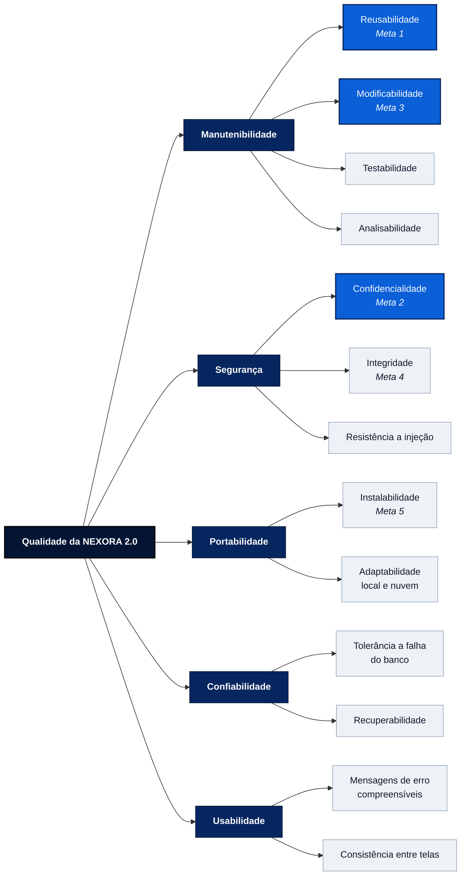

## 10.2 Cenários de qualidade

Cada cenário segue a estrutura estímulo, resposta esperada e medida. Os de **uso** descrevem o sistema em operação; os de **mudança**, o esforço de alterá-lo.

### Cenários de uso

| ID  | Meta              | Estímulo                                                                                    | Resposta esperada                                                | Medida                                                                   |
| --- | ----------------- | ------------------------------------------------------------------------------------------- | ---------------------------------------------------------------- | ------------------------------------------------------------------------ |
| Q01 | 2 — Isolamento    | A instância da EMP-2 tenta buscar, editar e excluir pelo identificador um registro da EMP-1 | 404, sem revelar a existência do registro                        | Nenhuma linha afetada; coberto pelo `npm run testar`                     |
| Q02 | 2 — Isolamento    | A instância da EMP-2 lista clientes                                                         | Apenas clientes da EMP-2                                         | Zero registros de outra empresa na resposta                              |
| Q03 | 3 — Variabilidade | O operador troca o produto de Field para Core                                               | Quatro telas marcadas como não incluídas e 403 em `/api/estoque` | Efeito imediato, sem recompilar nem reiniciar                            |
| Q04 | 3 — Variabilidade | O operador liga apenas a feature estoque no produto Core                                    | A tela Estoque volta ao menu e a API responde 200                | Efeito na próxima requisição                                             |
| Q05 | 3 — Variabilidade | Tentativa de desligar uma feature do núcleo obrigatório                                     | Recusa com 400 e mensagem explicativa                            | Núcleo sempre ativo                                                      |
| Q06 | 4 — Integridade   | Exclusão de um cliente que tem ordem de serviço                                             | 409 com explicação de negócio                                    | Nada excluído; nenhum rastreamento de pilha na resposta                  |
| Q07 | 4 — Integridade   | Cadastro com referência a registro inexistente                                              | 400 com mensagem de usuário                                      | Nenhuma linha gravada                                                    |
| Q08 | Segurança         | Busca contendo aspas e comandos SQL                                                         | Texto tratado como valor, não como comando                       | Todo SQL parametrizado                                                   |
| Q09 | Confiabilidade    | A aplicação sobe com o MySQL desligado                                                      | Mensagem orientando a conferir `DB_*` e encerramento do processo | Nenhuma requisição aceita sem banco                                      |
| Q10 | Confiabilidade    | Na nuvem, uma instância é substituída                                                       | O balanceador só envia tráfego depois que `/api/saude` responde  | Sem perda de dado, porque a aplicação não guarda estado — _cenário alvo_ |

### Cenários de mudança

| ID  | Meta                  | Estímulo                                             | Resposta esperada                                          | Medida                                               |
| --- | --------------------- | ---------------------------------------------------- | ---------------------------------------------------------- | ---------------------------------------------------- |
| Q11 | 1 — Reuso             | Uma tela CRUD nova é solicitada                      | Um arquivo de módulo, uma linha em `index.ts` e uma tabela | Nenhum arquivo de `src/nucleo/` alterado             |
| Q12 | 1 — Reuso             | Uma regra de validação nova vale para todas as telas | Alteração apenas em `validacao.ts`                         | Oito telas passam a aplicá-la                        |
| Q13 | 5 — Reprodutibilidade | Um integrante prepara uma máquina nova               | Ambiente completo seguindo o guia de instalação            | `npm ci`, `npm run banco:subir` e `npm start` bastam |
| Q14 | 5 — Reprodutibilidade | O banco precisa voltar ao estado da demonstração     | `npm run banco:resetar`                                    | Concluído em segundos                                |
| Q15 | Portabilidade         | O MySQL local é trocado pelo gerenciado na nuvem     | Apenas variáveis `DB_*` alteradas                          | Nenhuma linha de código alterada                     |
| Q16 | Testabilidade         | Uma alteração é feita no núcleo                      | `npm run verificar` e `npm run testar` executados          | 66 de 66 verificações aprovadas antes de integrar    |

---

# 11. Riscos e Dívidas Técnicas

_(arc42 — Risks and Technical Debts)_

## 11.1 Riscos

Probabilidade e impacto em três níveis; a lista está ordenada por exposição.

| ID   | Risco                                                                                                                           | Prob. | Impacto | Exposição   | Mitigação                                                                                                     |
| ---- | ------------------------------------------------------------------------------------------------------------------------------- | ----- | ------- | ----------- | ------------------------------------------------------------------------------------------------------------- |
| R-01 | **Ausência de autenticação e perfis.** Publicado na internet, o sistema fica aberto a qualquer pessoa com o endereço            | Alta  | Alto    | **Crítica** | Não expor publicamente sem acesso restrito no balanceador; priorizar o ativo Autenticação na próxima evolução |
| R-02 | Uma instância por empresa (ADR-07) não escala para muitos clientes                                                              | Alta  | Médio   | **Alta**    | Aceitável na demonstração; substituir pela empresa da sessão quando houver autenticação                       |
| R-03 | Consulta escrita fora do `RepositorioBase` não herda o filtro por empresa, e o MySQL não oferece proteção em nível de linha     | Média | Alto    | **Alta**    | Revisão de código; ampliar o teste de isolamento a cada nova rota                                             |
| R-04 | A tela do técnico em campo ainda não existe, e é ela que resolve o elo entre campo e escritório — o problema central do produto | Alta  | Médio   | **Alta**    | Tratar como primeiro item da evolução, como novo tipo de tela no núcleo (ADR-02)                              |
| R-05 | A disciplina de Reúso pode exigir ligação em tempo de compilação                                                                | Média | Alto    | **Alta**    | Confirmar com o docente antes de novas entregas daquela disciplina (ADR-03)                                   |
| R-06 | A API ainda não tem `Dockerfile`, o que bloqueia a implantação em nuvem                                                         | Alta  | Médio   | **Média**   | Criar a imagem a partir de `npm ci` e do build TypeScript, com Node.js 24 LTS                                 |
| R-07 | O Adminer ser implantado por engano em ambiente público                                                                         | Baixa | Alto    | **Média**   | Manter o Adminer apenas no `docker-compose.yml` local; fora da imagem e da topologia de nuvem                 |
| R-08 | Créditos acadêmicos de nuvem se esgotarem antes do fim do semestre                                                              | Média | Baixo   | **Baixa**   | Instâncias mínimas, desligadas fora de uso; topologia neutra permite trocar de provedor                       |

## 11.2 Dívidas técnicas

| ID   | Dívida                                                                                   | O que foi ganho                                      | O que será preciso fazer                                                  |
| ---- | ---------------------------------------------------------------------------------------- | ---------------------------------------------------- | ------------------------------------------------------------------------- |
| D-01 | Esquema em um único `schema.sql`, sem migrações versionadas                              | Simplicidade: um script cria tudo                    | Adotar migrações versionadas antes de haver dados reais a preservar       |
| D-02 | Apenas teste de fumaça da API, sem testes de unidade dos padrões nem integração contínua | Cobertura rápida dos fluxos que a defesa demonstra   | Testes de unidade para Template Method e Strategy, executados em pipeline |
| D-03 | Transições da ordem de serviço não são bloqueadas nem registradas                        | Tela de OS entregue no prazo, com a regra do técnico | Controle de transições e histórico, conforme RF10                         |
| D-04 | Identificador gerado a partir da contagem de registros da tabela                         | Formato legível `PREFIXO-0001`                       | Sequência atômica no banco, para evitar colisão em gravações simultâneas  |
| D-05 | Logs apenas em texto no console                                                          | Nenhuma dependência adicional                        | Logs estruturados com identificador de correlação e de empresa            |
| D-06 | Situações exibidas sem acento na tabela, como "em execucao"                              | Mesmo valor no banco e na tela                       | Rótulo de exibição separado do valor armazenado                           |
| D-07 | Requisitos parcialmente atendidos (seção 1.1)                                            | Oito telas funcionando de ponta a ponta              | Completar RF05, RF07, RF09, RF10, RF11, RF14 e RF15                       |

---

# 12. Glossário

_(arc42 — Glossary)_

| Termo                                    | Definição                                                                                                 |
| ---------------------------------------- | --------------------------------------------------------------------------------------------------------- |
| **Adminer**                              | Ferramenta web de administração de banco de dados, usada apenas no ambiente local                         |
| **arc42**                                | Template para documentação de arquitetura de software, organizado em 12 seções                            |
| **Ativo reutilizável (_core asset_)**    | Componente do núcleo compartilhado por todos os produtos da linha, como `RepositorioBase` e `telaCrud.js` |
| **C4 Model**                             | Notação de diagramas de arquitetura em quatro níveis de zoom: contexto, contêiner, componente e código    |
| **Caixa-branca / caixa-preta**           | Descrição de um bloco mostrando ou ocultando sua estrutura interna                                        |
| **Contêiner (C4)**                       | Unidade executável ou de armazenamento do sistema. Não confundir com contêiner Docker                     |
| **Contêiner (Docker)**                   | Unidade de empacotamento e execução isolada de um processo e suas dependências                            |
| **Docker Compose**                       | Ferramenta que sobe vários contêineres a partir de um arquivo de definição                                |
| **Empresa (_tenant_)**                   | Empresa cliente que opera sobre a instalação compartilhada da NEXORA                                      |
| **Feature**                              | Funcionalidade que pode estar presente ou ausente em um produto da linha                                  |
| **Feature obrigatória**                  | Feature do núcleo, presente em todos os produtos e que não pode ser desligada                             |
| **Feature opcional**                     | Ponto de variação, ligado conforme o produto ou por ajuste individual da empresa                          |
| **Field Service Management**             | Gestão de serviços executados fora da sede, na instalação do cliente                                      |
| **Ligação (_binding_)**                  | Momento em que se decide quais features compõem um produto; na NEXORA, em tempo de execução               |
| **Linha de Produto de Software (LPS)**   | Conjunto de sistemas que compartilham um núcleo comum e se diferenciam por variações planejadas           |
| **Módulo declarado**                     | Arquivo `*.modulo.ts` que descreve uma tela como dado: tabela, campos, validações e regras                |
| **Multiempresa (_multi-tenant_)**        | Modelo em que uma única instalação atende várias empresas, com os dados de cada uma isolados              |
| **Ordem de serviço (OS)**                | Registro de um atendimento a executar, da abertura à conclusão                                            |
| **Pool de conexões**                     | Conjunto de conexões ao banco reutilizadas entre requisições                                              |
| **Porta de variabilidade**               | Verificação no controlador que responde 403 quando a feature do módulo está desligada                     |
| **Produto derivado**                     | Combinação do núcleo com um conjunto de features opcionais: Core, Tech, Maint ou Field                    |
| **Row Level Security**                   | Recurso do PostgreSQL que restringe as linhas visíveis por sessão; ausente no MySQL                       |
| **Singleton, Template Method, Strategy** | Padrões de projeto aplicados na NEXORA — ver seção 8.10                                                   |
| **Twelve-Factor App**                    | Conjunto de princípios para aplicações nativas de nuvem, usado como referência na seção 7.2               |

---

# Pontos a confirmar pela equipe

| Ponto                                           | Onde aparece             | O que confirmar                                                                 |
| ----------------------------------------------- | ------------------------ | ------------------------------------------------------------------------------- |
| Situação dos requisitos marcados como _Parcial_ | Seção 1.1                | Se a descrição de cada requisito parcial corresponde ao que está implementado   |
| Implantação em nuvem                            | Seções 7.2, 7.3 e ADR-08 | Provedor a usar e criação do `Dockerfile` da API                                |
| Ligação em tempo de execução                    | ADR-03                   | Aceite pela disciplina de Desenvolvimento Orientado a Reúso                     |
| Resposta de `/api/saude` com banco indisponível | Seções 5.1 e 6.4         | Formato exato da resposta, para configurar a verificação de saúde da plataforma |

---

# Referências

- HRUSCHKA, Peter; STARKE, Gernot. **arc42 — Template for Architecture Documentation**, versão 9.0, julho de 2025. <https://arc42.org>
- **arc42 — documentação das seções 1 a 12.** <https://docs.arc42.org/home/>
- BROWN, Simon. **The C4 model for visualising software architecture.** <https://c4model.com>
- WIGGINS, Adam. **The Twelve-Factor App.** <https://12factor.net>
- ISO/IEC 25010 — _Systems and software Quality Requirements and Evaluation (SQuaRE)_.
- **Documentação oficial:** Node.js <https://nodejs.org>, Express <https://expressjs.com>, MySQL 8 <https://dev.mysql.com/doc/>, Docker Compose <https://docs.docker.com/compose/>, Mermaid <https://mermaid.js.org>.
- NEXORA — `README.md`, `docs/ARQUITETURA.md`, `docs/GUIA-DE-INSTALACAO.md`, `banco/MODELO.md` e Documento Mestre (artefatos internos do projeto).

---

# 13. Evolução Cloud-Native (NEXORA 3.0) — Microfrontends, API Gateway & BFF, Microservices (MongoDB Atlas + Azure SQL) e Azure Service Bus

## 13.1 Visão Geral da Arquitetura Distribuída na Azure

Na versão **NEXORA 3.0 (Projeto Arquitetura Completa — Cloud)**, a arquitetura evolui para uma topologia distribuída nativa em nuvem hospedada na **Microsoft Azure (`rg-nexora-ca`)**, aplicando rigorosamente:

1. **Microfrontend (SPA)**: Quatro aplicações **React 18** federadas via **Webpack 5 Module Federation** (`host`, `remote`, `host-dashboard`, `remote-dashboard`), que consomem **exclusivamente** o **API Gateway & BFF** (`:8080` / `https://nexora-gateway-api.azurewebsites.net`).
2. **API Gateway & BFF (Backend for Frontend)**: Construído em **PHP 8.3 / Laravel 11**, atua como ponto único de entrada (*Single Point of Entry*), provendo:
   - Agregação em único response (`GET /api/bff/visao-geral`, `GET /api/bff/dashboard`, `GET /api/bff/ordens/{id}`);
   - Proxy reverso de CRUD completo para Ordens de Serviço (`/api/ordens/**`) e Técnicos de Campo (`/api/tecnicos/**`);
   - Roteamento inteligente com fallback resiliente;
   - Segurança e CORS centralizado (`CentralizedCorsMiddleware`, `CorrelationIdMiddleware`, `GatewayObservabilityMiddleware`);
   - Documentação interativa **Swagger OpenAPI 3.0** (`GET /api-docs` e `GET /api/openapi.json`).
3. **Microserviço 1 — Técnicos de Campo (`tecnicos-service` — MongoDB Atlas)**:
   - Banco de dados: **MongoDB Atlas (Free Tier)** via adaptador hexagonal `MongoAdapter` (`src/db/mongo.adapter.ts`) com sanitização contra NoSQL Injection;
   - Responsável pelo domínio de **Técnicos de Campo e Disponibilidade Operacional**;
   - CRUD completo (`GET`, `POST`, `PUT`, `PATCH /disponibilidade`, `DELETE`) e Swagger documentado (`/api-docs`).
4. **Microserviço 2 — Ordens de Serviço (`os-service` — Azure SQL Database)**:
   - Banco de dados: **Azure SQL Database (Free 1 DTU)** via adaptador hexagonal `AzureSqlAdapter` (`src/db/azuresql.adapter.ts`) com queries T-SQL parametrizadas (`@p1..@pn`) e `OUTPUT INSERTED.*`;
   - Responsável pelo domínio de **Ordens de Serviço e Máquina de Estados do Ciclo de Vida**;
   - CRUD completo (`GET`, `POST`, `PUT`, `PATCH /status`, `DELETE`) e Swagger documentado (`/api-docs`).
5. **Troca de Mensagens via Broker (Azure Service Bus)**:
   - Fila/Tópico: `nexora-ordens-eventos`;
   - **Regra de Negócio Distribuída**: Quando uma Ordem de Serviço é criada ou transicionada no `os-service` (Azure SQL Database) com técnico atribuído (`Agendada` ou `Em Execução`), o `ServiceBusPublisher` publica o evento `ORDEM_ALOCADA` / `ORDEM_EM_EXECUCAO` no **Azure Service Bus**. O `ServiceBusConsumer` no `tecnicos-service` consome a mensagem e atualiza o documento do técnico no **MongoDB Atlas** para `"Em Atendimento"`. Quando a OS é `Concluída` ou `Cancelada`, o evento `ORDEM_CONCLUIDA` / `ORDEM_CANCELADA` libera automaticamente o técnico de volta para `"Disponível"`.

## 13.2 Diagrama de Sequência do Fluxo Completo (Arc42 Runtime View — Cloud)

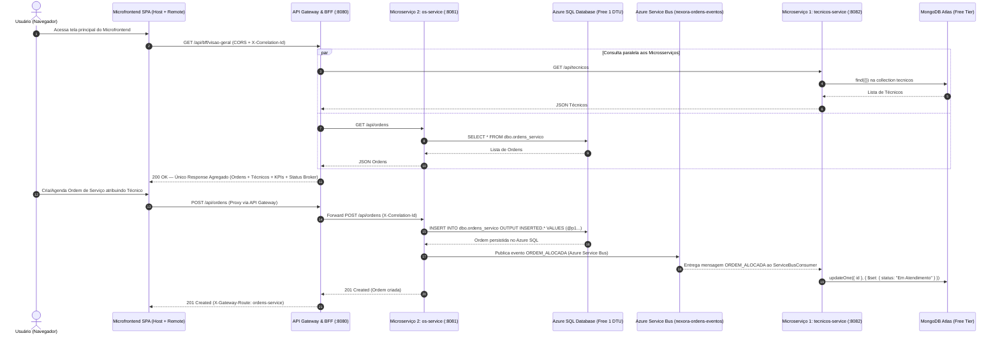

## 13.3 Decisões Arquiteturais Adicionais (ADRs Cloud 3.0)

| ID | Decisão | Justificativa |
| :--- | :--- | :--- |
| **ADR-09** | **Padrão Arquitetural: Clean Architecture + Hexagonal (Ports & Adapters)** | Isola as regras de negócio de frameworks e drivers de banco. No Gateway Laravel, `app/Core/Domain` não possui dependência de `Illuminate/*` (validado por `Pest Arch`). Nos microsserviços TypeScript, `IDatabaseAdapter` desacopla os repositórios do `MongoAdapter`, `AzureSqlAdapter` e `SqliteAdapter` (validado por `dependency-cruiser`). |
| **ADR-10** | **Database-per-Service Poliglota (MongoDB Atlas + Azure SQL Database)** | `tecnicos-service` utiliza modelo orientado a documentos no **MongoDB Atlas (Free Tier)** para flexibilidade de perfil/especialidades/disponibilidade; `os-service` utiliza modelo relacional transacional no **Azure SQL Database (Free 1 DTU)** para integridade estrita de máquina de estados e valores financeiros. |
| **ADR-11** | **Coreografia de Eventos via Azure Service Bus (`nexora-ordens-eventos`)** | Elimina acoplamento síncrono direto entre `os-service` e `tecnicos-service`. Mudanças no ciclo de vida da OS disparam mensagens assíncronas no broker da Azure para atualizar a disponibilidade do técnico no MongoDB Atlas. |
| **ADR-12** | **API Gateway & BFF como Ponto Único de Entrada e Agregação** | Impede que os Microfrontends conheçam endereços ou portas internas dos microsserviços (`:8081`, `:8082`), centraliza CORS, propaga `X-Correlation-Id` e entrega todos os dados necessários à UI em um único response (`GET /api/bff/visao-geral`). |
