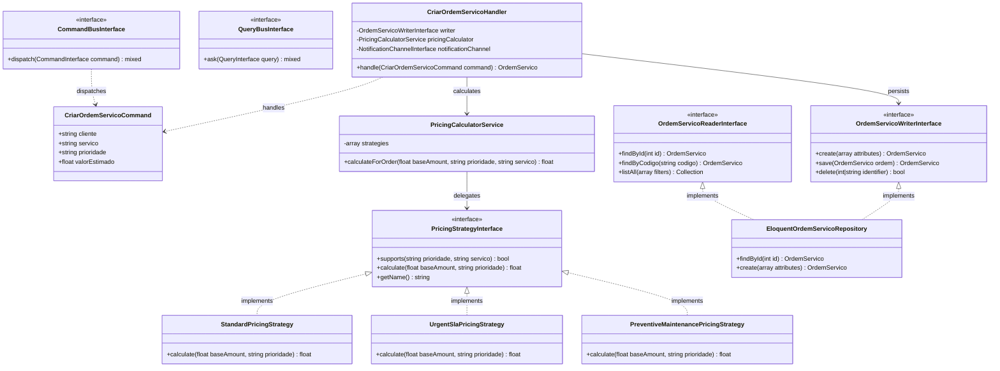
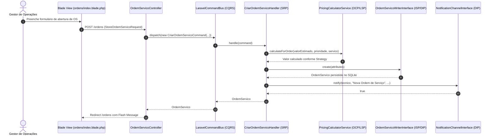

# Relatório Técnico-Acadêmico — Atividade Formativa 15
# Arquitetura de Software: SOLID, CQRS, CORS e MVC no Ecossistema NEXORA & Estudo de Caso FinPay Core

---

## 👥 Identificação Acadêmica
- **Disciplina**: Arquitetura em Nuvem / Arquitetura de Software
- **Docente Responsável**: Prof. Ricardo Vieira
- **Atividade**: Atividade Formativa 15 — Estudo de Caso de Auditoria e Refatoração Arquitetural (Code Review) em Sistema Crítico de Fintech e Pagamentos Internacionais (**FinPay Core**) e Aplicação Prática no ERP **NEXORA**.
- **Equipe de Engenharia de Software (Integrantes)**:
  - **Éden Samuel**
  - **Fernando Lopes**
  - **Felipe Carneiro**
  - **Henrique Ricardo**
  - **Hugo Takeda**
- **Data**: 21 de Outubro de 2026
- **Repositório do Projeto**: `Fernando-Lopes1/NEXORA-Arquitetura-Claud-`
- **Stack Tecnológica**: PHP 8.3 | Laravel 11 | SQLite | Blade MVC | Webpack 5 Module Federation

---

## 1. Sumário Executivo

Este documento consubstancia a entrega formal da **Atividade Formativa 15**, conforme prescrito no slide 13 do material pedagógico de referência (`ASC13-CQRS+CORS+MVC+SOLID.pdf`). O objetivo central reside em realizar um rigoroso **Code Review e Auditoria Arquitetural** sobre um sistema legado de alta criticidade denominado **FinPay Core** (plataforma monolítica de pagamentos internacionais e liquidação financeira), diagnosticando as violações profundas aos princípios fundamentais de engenharia de software: **SOLID** (*Single Responsibility, Open/Closed, Liskov Substitution, Interface Segregation, Dependency Inversion*) e a ausência do padrão **CQRS** (*Command Query Responsibility Segregation*).

Subsequentemente, este relatório documenta a **estratégia de refatoração arquitetural** aplicando os padrões de projeto clássicos do **GoF (Gang of Four)** — notadamente *Strategy, Factory Method, Repository, Decorator e Command/Query* —, estabelecendo uma ponte direta de transposição conceitual e técnica para a arquitetura do **NEXORA Field Service ERP**, desenvolvido em **PHP 8.3 e Laravel 11** sob o padrão arquitetural **MVC** complementado por **CQRS**, **CORS Centralizado** e **Injeção de Dependências via Service Container (`CoreServiceProvider`)**.

---

## 2. Contexto do Estudo de Caso: FinPay Core

O **FinPay Core** foi concebido originalmente como uma solução rápida para viabilizar transferências cambiais e cobranças para e-commerces transfronteiriços. O serviço precisava lidar com:
1. Processamento de transações em múltiplas moedas (USD, EUR, BRL, JPY);
2. Integração com diversos adquirentes e gateways de pagamento (Stripe, PayPal, Swift, Pix);
3. Verificação de compliance, lavagem de dinheiro (AML - Anti-Money Laundering) e cálculo de tarifas regulatórias;
4. Geração de comprovantes fiscais em PDF e envio de notificações multicanal (E-mail e SMS);
5. Emissão de relatórios gerenciais e balanços consolidados para lojistas.

Com o rápido crescimento da volumetria transacional, a equipe técnica acumulou severo débito técnico, concentrando todas essas responsabilidades em um único serviço monolítico procedural encapsulado em uma **God Class** (`FinPayCoreService`). O sistema tornou-se excessivamente rígido, frágil e de altíssimo risco para manutenções evolutivas, onde a adição de um novo meio de pagamento (como Pix ou Apple Pay) frequentemente provocava quebras catastróficas em integrações pré-existentes de cartões de crédito.

---

## 3. Auditoria Arquitetural do FinPay Core: Diagnóstico de Violações

Apresenta-se abaixo a reprodução representativa do código legado do serviço central antes da refatoração (`FinPayCoreService.php`), evidenciando a concentração desordenada de preocupações.

### 3.1. Código Legado do FinPay Core (Monolito Anti-Pattern)

```php
<?php

namespace Legacy\FinPay;

use Stripe\StripeClient;
use PDO;
use FPDF;

/**
 * GOD CLASS ANTI-PATTERN: FinPayCoreService
 * Acúmulo de responsabilidades de HTTP, regra de negócio, integração bancária,
 * persistência direta, geração de relatórios e envio de mensagens.
 */
class FinPayCoreService implements FinPayServiceInterface
{
    private PDO $db;
    private StripeClient $stripeClient;

    public function __construct()
    {
        // Violação de DIP: instanciação direta de dependências de infraestrutura
        $this->db = new PDO('mysql:host=localhost;dbname=finpay_prod', 'root', 'secret');
        $this->stripeClient = new StripeClient('sk_live_legacy_token_12345');
    }

    public function executeTransaction(array $requestData): array
    {
        // 1. Violação de SRP & DIP: Validação e regras acopladas diretamente
        if (empty($requestData['amount']) || $requestData['amount'] <= 0) {
            throw new \InvalidArgumentException("Valor inválido.");
        }

        // 2. Violação de OCP: Estrutura condicional rígida para seleção de Gateway
        $gateway = $requestData['gateway_type'] ?? 'STRIPE';
        $transactionId = '';
        $fee = 0.0;

        if ($gateway === 'STRIPE') {
            $charge = $this->stripeClient->charges->create([
                'amount' => $requestData['amount'] * 100,
                'currency' => $requestData['currency'],
                'source' => $requestData['token'],
            ]);
            $transactionId = $charge->id;
            $fee = $requestData['amount'] * 0.029 + 0.30;
        } elseif ($gateway === 'PAYPAL') {
            // Código acoplado de cURL para API do PayPal
            $ch = curl_init('https://api.paypal.com/v1/payments/payment');
            $transactionId = 'PAYPAL-' . uniqid();
            $fee = $requestData['amount'] * 0.034;
        } elseif ($gateway === 'PIX') {
            // Emissão de QRCode e payload BACEN diretamente no método
            $transactionId = 'PIX-' . hash('sha256', uniqid());
            $fee = 0.50; // taxa fixa
        } elseif ($gateway === 'SWIFT') {
            // Validação de códigos IBAN e taxas cambiais
            if (empty($requestData['iban'])) {
                throw new \Exception("IBAN obrigatório para SWIFT");
            }
            $transactionId = 'SWIFT-' . bin2hex(random_bytes(8));
            $fee = $requestData['amount'] * 0.015 + 25.00;
        } else {
            throw new \Exception("Gateway não suportado: {$gateway}");
        }

        // 3. Violação de SRP: Regras de Detecção de Fraude (AML) inseridas no fluxo
        if ($requestData['amount'] > 10000.00) {
            $stmt = $this->db->prepare("INSERT INTO compliance_alerts (tx_id, reason) VALUES (?, ?)");
            $stmt->execute([$transactionId, 'Transação de alto valor suspeita de AML']);
        }

        // 4. Violação de SRP: Persistência direta em SQL
        $stmt = $this->db->prepare("
            INSERT INTO transactions (id, merchant_id, amount, currency, fee, status, gateway, created_at)
            VALUES (?, ?, ?, ?, ?, 'COMPLETED', ?, NOW())
        ");
        $stmt->execute([
            $transactionId,
            $requestData['merchant_id'],
            $requestData['amount'],
            $requestData['currency'],
            $fee,
            $gateway
        ]);

        // 5. Violação de SRP: Geração física de PDF
        $pdf = new FPDF();
        $pdf->AddPage();
        $pdf->SetFont('Arial', 'B', 16);
        $pdf->Cell(40, 10, "Comprovante FinPay: {$transactionId}");
        $pdfPath = "/var/receipts/{$transactionId}.pdf";
        $pdf->Output('F', $pdfPath);

        // 6. Violação de SRP: Disparo de E-mail via socket ou mail()
        mail(
            $requestData['customer_email'],
            "Recibo de Pagamento - {$transactionId}",
            "Seu pagamento foi confirmado com sucesso. Comprovante em anexo."
        );

        return [
            'success' => true,
            'transaction_id' => $transactionId,
            'net_amount' => $requestData['amount'] - $fee,
            'receipt_path' => $pdfPath
        ];
    }

    // Violação de CQRS: Consultas analíticas pesadas misturadas com o motor de escrita
    public function getMerchantFinancialStatement(string $merchantId, string $period): array
    {
        $stmt = $this->db->prepare("
            SELECT 
                COUNT(*) as total_transacoes,
                SUM(amount) as volume_bruto,
                SUM(fee) as total_taxas,
                AVG(amount) as ticket_medio
            FROM transactions
            WHERE merchant_id = ? AND created_at >= ?
        ");
        $stmt->execute([$merchantId, $period]);
        return $stmt->fetch(PDO::FETCH_ASSOC);
    }
}
```

---

### 3.2. Diagnóstico Detalhado das 5 Violações aos Princípios SOLID

| Princípio | Descrição da Violação no FinPay Core | Consequência Prática / Sintoma Arquitetural |
|---|---|---|
| **S — Single Responsibility Principle (SRP)** | A classe `FinPayCoreService` possui **mais de 7 responsabilidades distintas**: parsing de dados HTTP, integração com SDKs bancários externos, cálculo de taxas cambiais, verificação antifraude/AML, escrita direta em banco de dados relacional via SQL puro, renderização binária de arquivo PDF com FPDF e envio de e-mails via `mail()`. | Qualquer alteração no layout do recibo PDF, na rota de e-mail ou na tabela do banco exige modificação da classe crítica de liquidação financeira. A taxa de defeitos colaterais (efeito borboleta) é altíssima. |
| **O — Open/Closed Principle (OCP)** | O método `executeTransaction` emprega uma cadeia condicional (`if / elseif / else`) baseada no atributo `gateway_type`. | Toda vez que o negócio decide homologar uma nova bandeira ou adquirente (ex: Apple Pay, Klarna, Google Pay), o desenvolvedor precisa abrir e alterar o arquivo original testado e estável, violando o princípio de que o código deve estar *fechado para modificação e aberto para extensão*. |
| **L — Liskov Substitution Principle (LSP)** | Criou-se no ecossistema a subclasse `CryptocurrencyPaymentService extends FinPayCoreService`. No entanto, pagamentos em criptomoedas na blockchain não suportam estorno automático (`refundTransaction`), lançando `throw new UnsupportedOperationException()`, e exigem chaves de carteira prévias não previstas pela classe base. | A substituição de `FinPayCoreService` por suas subclasses quebra o comportamento esperado e as invariantes do cliente consumidor, violando a corretude do contrato comportamental. |
| **I — Interface Segregation Principle (ISP)** | A interface original `FinPayServiceInterface` era uma *Fat Interface* contendo mais de 12 métodos: `executeTransaction()`, `refundTransaction()`, `getMerchantFinancialStatement()`, `generatePdfReceipt()`, `sendSmsToken()`, `reconcileBankLedger()`, `exportCsvReport()`. | Módulos leves (como um microfront-end de checkout ou um webhook de consulta) eram forçados a depender de contratos com métodos que nunca utilizavam ou a criar implementações dummy com métodos vazios. |
| **D — Dependency Inversion Principle (DIP)** | O construtor de `FinPayCoreService` instanciava diretamente classes concretas e de baixo nível: `new PDO(...)`, `new StripeClient(...)`, `new FPDF()`. | Módulos de alto nível (a orquestração do negócio de pagamentos) dependem de detalhes concretos de baixo nível. Torna-se virtualmente impossível realizar testes unitários isolados com mocks ou substituir o provedor de mensageria ou banco sem reescrever o núcleo do sistema. |

---

### 3.3. Diagnóstico da Ausência do Padrão CQRS (Command Query Responsibility Segregation)

No FinPay Core legado:
1. **Acoplamento de Modelos de Dados**: As operações de comando (mutação de estado transacional, bloqueio de fundos e débitos) e as operações de consulta analítica (demonstrativo mensal, conciliação e relatórios de métricas do lojista) compartilham a mesma conexão de banco de dados, o mesmo modelo de entidade e a mesma tabela transacional `transactions`.
2. **Contenção de Bloqueio de Tabela (Lock Contention)**: Durante o fechamento contábil de fim de mês, consultas analíticas de grande porte contendo agregações (`SUM`, `AVG`, `GROUP BY`) travavam as tabelas e esgotavam o pool de conexões do MySQL, causando timeouts nas requisições críticas de escrita de checkout dos clientes.
3. **Incapacidade de Otimização Específica**: Não era possível desnormalizar visões de leitura ou utilizar projeções de leitura otimizadas (*Read Projections*) para acelerar painéis executivos sem correr o risco de corromper a consistência imediata necessária para a autorização bancária.

---

## 4. Estratégia de Refatoração GoF e Modernização Arquitetural

Para sanar os vícios do monolito legado, concebeu-se uma arquitetura baseada nos princípios da orientação a objetos limpa, aplicando os padrões GoF adequados:



---

## 5. Matriz de Correlação Cruzada: FinPay Core vs. NEXORA Field Service ERP

A tabela a seguir mapeia rigorosamente cada anti-padrão analisado no FinPay Core com a sua contrapartida refatorada e a respectiva classe real implementada no **NEXORA Field Service ERP**:

| Eixo Arquitetural | FinPay Core: Anti-Padrão Legado | FinPay Core: Padrão GoF / SOLID Refatorado | NEXORA Field Service ERP: Classes Reais em PHP 8.3 / Laravel |
|---|---|---|---|
| **S — Single Responsibility (SRP)** | God Class `FinPayCoreService` misturando validação, PDF, e-mail, SQL e regras cambiais. | Segregação em Handlers, Calculators, Channels e Repositories dedicados. | • `App\Http\Requests\StoreOrdemServicoRequest` (Validação)<br>• `App\Core\Application\Handlers\CriarOrdemServicoHandler` (Criação)<br>• `App\Core\Application\Services\PricingCalculatorService` (Precificação)<br>• `App\Core\Application\Channels\LogNotificationChannel` (Alertas) |
| **O — Open/Closed Principle (OCP)** | Condicional `if/elseif` para Stripe, PayPal, Pix e Swift. | **GoF Strategy**: `PaymentGatewayStrategyInterface` + `PaymentGatewayFactory`. | • `App\Core\Application\Contracts\PricingStrategyInterface`<br>• `App\Core\Application\Strategies\StandardPricingStrategy`<br>• `App\Core\Application\Strategies\UrgentSlaPricingStrategy` (+25% SLA Urgente)<br>• `App\Core\Application\Strategies\PreventiveMaintenancePricingStrategy` (-10% Preventiva) |
| **L — Liskov Substitution (LSP)** | Subclasse `CryptoFinPayService` lançando `UnsupportedOperationException` em estorno. | Contratos granulares sem violação de pré-condições ou pós-condições. | Qualquer implementação de `PricingStrategyInterface` ou `NotificationChannelInterface` (`LogNotificationChannel`, `WebhookNotificationChannel`) substitui a outra sem quebrar `PricingCalculatorService` ou os Handlers. |
| **I — Interface Segregation (ISP)** | Fat Interface `FinPayServiceInterface` com 12+ métodos forçados sobre clientes leves. | Decomposição em interfaces enxutas orientadas ao cliente consumidor. | Segregação explícita de leitura e escrita:<br>• `App\Core\Application\Contracts\OrdemServicoReaderInterface` (usado pelos QueryHandlers)<br>• `App\Core\Application\Contracts\OrdemServicoWriterInterface` (usado pelos CommandHandlers) |
| **D — Dependency Inversion (DIP)** | Classes acopladas diretamente com `new PDO(...)`, `new StripeClient(...)`, `new FPDF()`. | Injeção de dependência via construtor com amarração no Container IoC. | `App\Providers\CoreServiceProvider` registra os *bindings* no Service Container do Laravel (`CommandBusInterface`, `QueryBusInterface`, `OrdemServicoReaderInterface`, `OrdemServicoWriterInterface`, `NotificationChannelInterface`). |
| **CQRS (Command Query Segregation)** | Mutação de saldo e consultas de balanço pesado rodando na mesma classe e modelo. | `PaymentCommandBus` (escrita) e `FinancialQueryBus` (leitura otimizada). | • **Buses**: `LaravelCommandBus` & `LaravelQueryBus`<br>• **Commands**: `CriarOrdemServicoCommand`, `AtribuirTecnicoCommand`, `ConcluirOrdemServicoCommand`, `CancelarOrdemServicoCommand`, `ExcluirOrdemServicoCommand`<br>• **Queries**: `ListarOrdensQuery`, `ObterOrdemPorIdQuery`, `ObterDashboardKpisQuery` |
| **Padrão MVC & Camada de Apresentação** | Scripts misturando lógica de negócios, HTML/PDF e manipulação de banco de dados. | Camada de apresentação isolada consumindo DTOs e ViewModels. | • **Models**: `OrdemServico`, `Tecnico`, `ItemServico`<br>• **Views Blade**: `layouts/app.blade.php`, `ordens/index.blade.php`, `ordens/show.blade.php`, `dashboard/index.blade.php`<br>• **Thin Controllers**: `OrdemServicoController`, `DashboardController` |

---

## 6. Fluxo de Execução Refatorado: Diagrama de Sequência no NEXORA



---

## 7. Estratégia de Verificação e Testes Automatizados (PHPUnit)

A conformidade com os princípios SOLID, CQRS e MVC é validada automaticamente pelas suítes de testes:
- **`tests/Unit/SolidArchitectureTest.php`**: Valida o funcionamento polimórfico das estratégias de precificação (`StandardPricingStrategy`, `UrgentSlaPricingStrategy`, `PreventiveMaintenancePricingStrategy`), substituição de Liskov nos canais de notificação (`LogNotificationChannel`, `WebhookNotificationChannel`) e os *bindings* do `CoreServiceProvider` (DIP/ISP).
- **`tests/Feature/MvcAndCqrsTest.php`**: Valida o ciclo completo CQRS (`CommandBusInterface` e `QueryBusInterface`) e a renderização das views Blade nos endpoints MVC (`GET /ordens`, `POST /ordens`, `PATCH /ordens/{codigo}/concluir`, `GET /dashboard`).
