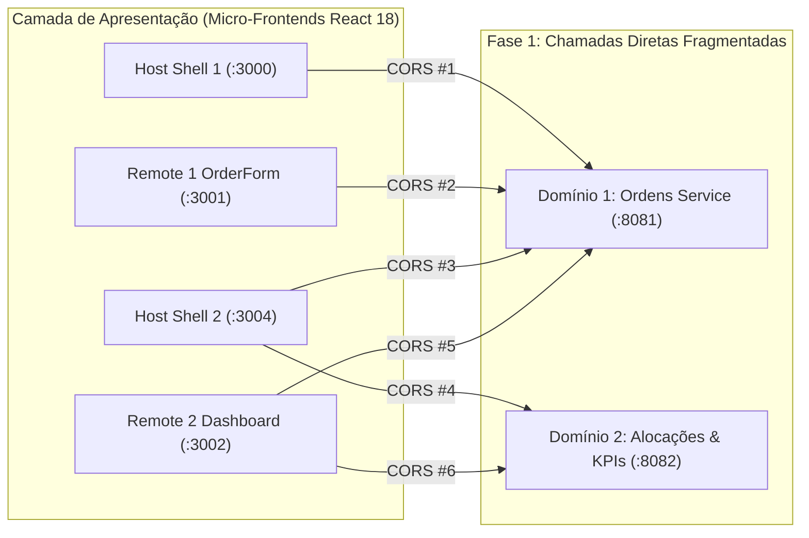
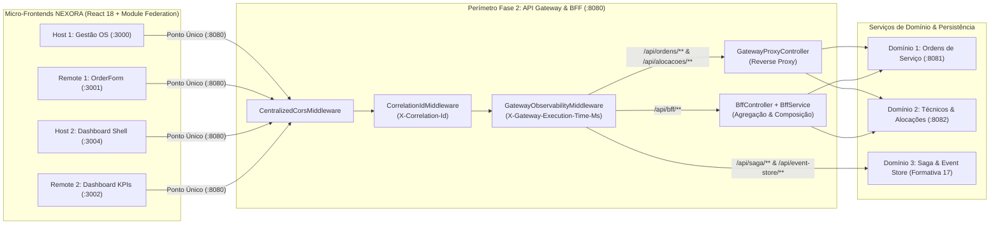

# Atividade Formativa 16 — API Gateway, BFF (Backend for Frontend), CORS Centralizado, Observabilidade & Implantação no Azure

**Projeto**: NEXORA — Field Service ERP (Gestão de Serviços de Campo)  
**Disciplina**: Arquitetura de Soluções em Nuvem  
**Referência Arquitetural**: `AULA_ARQSOL_GATEWAY` (Adaptado para o domínio corporativo NEXORA em PHP 8.3 / Laravel MVC)

---

## 1. Integrantes do Grupo (`GRUPO.md`)

- **Éden Samuel**
- **Fernando Lopes**
- **Felipe Carneiro**
- **Henrique Ricardo**
- **Hugo Takeda**

---

## 2. Evolução Arquitetural: Da Fase 1 (Acesso Direto) para a Fase 2 (API Gateway & BFF Centralizado)

### 2.1 Problema da Fase 1 (Marco Zero — Acesso Direto Ponto a Ponto)
Na **Fase 1**, os Micro-Frontends (Host 1 `:3000`, Remote 1 `:3001`, Remote 2 `:3002`, Host 2 `:3004`) comunicavam-se diretamente com múltiplos serviços de domínio (`ordens-service` na porta `:8081` e `alocacoes-service` na porta `:8082`). Essa topologia gerava quatro problemas críticos de arquitetura distribuída:
1. **Forte Acoplamento de Rede**: Cada Micro-Frontend precisava conhecer endereços físicos, portas e contratos internos de cada microsserviço.
2. **Fragmentação de Políticas de CORS**: Cada serviço de backend precisava manter listas duplicadas de origens permitidas (`Access-Control-Allow-Origin`), aumentando a superfície de erro em produção na nuvem Azure.
3. **Múltiplos Round-Trips HTTP (*Chatty I/O*)**: Para exibir o Dashboard Executivo ou o detalhe completo de uma Ordem de Serviço (`OS-1001`) com dados do técnico alocado e cálculo de SLA, o navegador precisava disparar chamadas paralelas para `:8081` e `:8082` e realizar *joins* em JavaScript no cliente.
4. **Ausência de Rastreabilidade Unificada**: Não havia um ponto único de perímetro para injetar `X-Correlation-Id` ou medir a latência fim a fim (`X-Gateway-Execution-Time-Ms`).



---

### 2.2 Solução da Fase 2 (Ponto Único Centralizado — API Gateway & BFF na Porta `:8080`)
Na **Fase 2**, introduzimos a camada **API Gateway & BFF (`app/Gateway/`)** operando na porta `:8080` como **Ponto Único de Entrada (*Single Point of Entry*)**:
- Todos os Micro-Frontends apontam exclusivamente para `http://localhost:8080` (ou `https://nexora-gateway-api.azurewebsites.net` na nuvem).
- O Gateway atua como **Reverse Proxy Transparente** para operações CRUD de domínio (`/api/ordens/**` e `/api/alocacoes/**`) e hospeda **Endpoints Especializados de BFF** (`/api/bff/status`, `/api/bff/dashboard`, `/api/bff/ordens/{id}`) que agregam e compõem dados no servidor com *fallback* resiliente.



---

## 3. Tabela Comparativa: Fase 1 vs Fase 2

| Dimensão Arquitetural | Fase 1 — Acesso Direto (Marco Zero) | Fase 2 — API Gateway & BFF Centralizado (`:8080`) |
| :--- | :--- | :--- |
| **Ponto de Entrada para os MFEs** | Múltiplas URLs e portas (`:8081`, `:8082`) configuradas em cada MFE | **Ponto Único (`http://localhost:8080`)** para todos os 4 Micro-Frontends |
| **Gerenciamento de CORS** | Descentralizado e duplicado em cada microsserviço | **100% Centralizado** no `CentralizedCorsMiddleware` do Gateway |
| **Renderização do Dashboard** | Múltiplas requisições paralelas pelo navegador + agregação no cliente | **1 única chamada** (`GET /api/bff/dashboard`) pré-agregada no BFF |
| **Detalhamento de Ordem (`OS-1001`)** | Chamada à OS (`:8081`) + chamada ao Técnico (`:8082`) + cálculo no front | **Composição Vertical no BFF** (`GET /api/bff/ordens/OS-1001`) com SLA e financeiro |
| **Tolerância a Falhas (Resiliência)** | Se um serviço falha, a tela do MFE quebra completamente | **Degradação Graciosa (*Fallback*)**: BFF retorna HTTP 200 com dados parciais/resilientes |
| **Rastreabilidade (*Distributed Tracing*)** | Logs isolados sem correlação entre serviços | Injeção e propagação automática de **`X-Correlation-Id` (UUID v4)** |
| **Telemetria e Auditoria de Latência** | Inexistente nos cabeçalhos HTTP | Headers **`X-Gateway-Processed-By`**, **`X-Gateway-Route`** e **`X-Gateway-Execution-Time-Ms`** |

---

## 4. Mapa de Portas, Componentes e Endpoints

### 4.1 Topologia de Portas e Serviços
| Componente | Tecnologia | Porta Local | URL em Produção (Microsoft Azure) | Papel na Arquitetura |
| :--- | :--- | :---: | :--- | :--- |
| **Host Shell 1** (`/host`) | React 18 + Webpack 5 | `:3000` | `https://nexora-host-fernando.azurewebsites.net` | Shell principal do módulo de Ordens de Serviço |
| **Remote MFE 1** (`/remote`) | React 18 + Module Federation | `:3001` | `https://nexora-remote-fernando.azurewebsites.net` | Micro-Frontend autônomo `./OrderForm` |
| **Remote MFE 2** (`/remote-dashboard`) | React 18 + Module Federation | `:3002` | `https://nexora-remote-dashboard-fernando.azurewebsites.net` | Micro-Frontend autônomo `./Dashboard` |
| **Host Shell 2** (`/host-dashboard`) | React 18 + Webpack 5 | `:3004` | `https://nexora-host-dashboard-fernando.azurewebsites.net` | Shell executivo de Business Intelligence & KPIs |
| **API Gateway & BFF** (`app/Gateway`) | PHP 8.3 + Laravel 11 | `:8080` | `https://nexora-gateway-api.azurewebsites.net` | Ponto único de entrada, Reverse Proxy, BFF e CORS |
| **Domínio 1: Ordens Service** | Laravel Domain / `:8081` | `:8081` | Roteado internamente pelo Gateway | Gestão do ciclo de vida de Ordens de Serviço |
| **Domínio 2: Alocações Service** | Laravel Domain / `:8082` | `:8082` | Roteado internamente pelo Gateway | Gestão de Técnicos em campo, agenda e KPIs |

---

### 4.2 Catálogo de Endpoints do API Gateway & BFF

| Método | Rota no Gateway (`:8080`) | Header `X-Gateway-Route` | Tipo de Operação | Descrição Técnica |
| :---: | :--- | :---: | :--- | :--- |
| `GET` | `/api/bff/status` | `bff-service` | **BFF Telemetria** | Retorna status da Fase 2, rotas ativas, origens MFE permitidas, CORS e saúde dos serviços |
| `GET` | `/api/bff/dashboard` | `bff-service` | **BFF Agregação** | Consolida KPIs de OS, volume financeiro R$, distribuição por status/prioridade e carga por técnico |
| `GET` | `/api/bff/ordens/{id}` | `bff-service` | **BFF Composição** | Compõe dados da OS (`OS-1001`), perfil do técnico, itens de serviço, histórico, SLA e valorização |
| `GET` | `/api/ordens` | `ordens-service` | **Reverse Proxy** | Lista todas as Ordens de Serviço com filtros opcionais (`status`, `prioridade`) |
| `GET` | `/api/ordens/{id}` | `ordens-service` | **Reverse Proxy** | Consulta uma Ordem de Serviço por ID numérico ou código (`OS-1001`) |
| `POST` | `/api/ordens` | `ordens-service` | **Reverse Proxy** | Cria nova Ordem de Serviço validada pelo Gateway |
| `PUT` | `/api/ordens/{id}` | `ordens-service` | **Reverse Proxy** | Atualiza dados cadastrais, prioridade, técnico ou valores de uma OS |
| `PATCH` | `/api/ordens/{id}/concluir` | `ordens-service` | **Reverse Proxy** | Conclui a execução de uma Ordem de Serviço e registra data/valor final |
| `DELETE` | `/api/ordens/{id}` | `ordens-service` | **Reverse Proxy** | Remove uma Ordem de Serviço |
| `GET` | `/api/alocacoes` | `alocacoes-service` | **Reverse Proxy** | Lista técnicos ativos e a carga de ordens atribuídas em campo |
| `POST` | `/api/alocacoes/{ordemId}/atribuir` | `alocacoes-service` | **Reverse Proxy** | Atribui um técnico especialista a uma Ordem de Serviço |
| `GET` | `/api/dashboard/kpis` | `alocacoes-service` | **Reverse Proxy** | Retorna indicadores operacionais do Domínio 2 |
| `POST` | `/api/saga/ordens` | `saga-service` | **Saga Orchestrator** | Executa a Saga distribuída de abertura de OS com rollback compensatório (Formativa 17) |
| `GET` | `/api/event-store/{aggregateId}` | `saga-service` | **Event Sourcing** | Reconstrói o estado do agregado a partir da trilha imutável de eventos (Formativa 17) |

---

## 5. Observabilidade, Rastreabilidade e CORS Centralizado

### 5.1 Cabeçalhos Obrigatórios de Observabilidade (`GatewayObservabilityMiddleware` & `CorrelationIdMiddleware`)
Todas as respostas HTTP processadas pelo Gateway incluem automaticamente os 4 cabeçalhos de auditoria:

```http
HTTP/1.1 200 OK
Content-Type: application/json
X-Correlation-Id: 9b1deb4d-3b7d-4bad-9bdd-2b0d7b3dcb6d
X-Gateway-Processed-By: NEXORA-API-Gateway-BFF
X-Gateway-Route: bff-service
X-Gateway-Execution-Time-Ms: 4.18
Access-Control-Allow-Origin: http://localhost:3000
Access-Control-Expose-Headers: X-Correlation-Id, X-Gateway-Processed-By, X-Gateway-Route, X-Gateway-Execution-Time-Ms
```

- **[`CorrelationIdMiddleware.php`](file:///home/fernando/Documentos/Faculdade/Arquitetura%20em%20claud/app/Gateway/Middleware/CorrelationIdMiddleware.php)**: Intercepta a requisição; se o cliente enviar `X-Correlation-Id`, preserva e propaga o valor; caso contrário, gera um UUID v4 criptograficamente seguro.
- **[`GatewayObservabilityMiddleware.php`](file:///home/fernando/Documentos/Faculdade/Arquitetura%20em%20claud/app/Gateway/Middleware/GatewayObservabilityMiddleware.php)**: Cronometra o tempo de execução em milissegundos via `microtime(true)` e injeta `X-Gateway-Processed-By`, `X-Gateway-Route` e `X-Gateway-Execution-Time-Ms`.
- **[`CentralizedCorsMiddleware.php`](file:///home/fernando/Documentos/Faculdade/Arquitetura%20em%20claud/app/Gateway/Middleware/CentralizedCorsMiddleware.php)**: Responde requisições *preflight* `OPTIONS` com HTTP `204 No Content` e autoriza as origens locais (`:3000`, `:3001`, `:3002`, `:3004`, `:8080`) e os domínios Azure (`*.azurewebsites.net`, `*.azurestaticapps.net`).

---

## 6. Guia Passo a Passo de Implantação no Microsoft Azure (`rg-nexora-ca`)

### 6.1 Provisionamento via Azure CLI
```bash
# 1. Autenticar na conta Microsoft Azure
az login

# 2. Garantir o Grupo de Recursos e o App Service Plan compartilhado
az group create --name rg-nexora-ca --location brazilsouth
az appservice plan create --name nexora-plan --resource-group rg-nexora-ca --sku B1 --is-linux

# 3. Criar o Web App do API Gateway & BFF (PHP 8.3 Linux)
az webapp create \
  --resource-group rg-nexora-ca \
  --plan nexora-plan \
  --name nexora-gateway-api \
  --runtime "PHP:8.3"

# 4. Configurar variáveis de ambiente da Fase 2 no Azure App Service
az webapp config appsettings set \
  --resource-group rg-nexora-ca \
  --name nexora-gateway-api \
  --settings \
    APP_ENV=production \
    APP_DEBUG=false \
    DB_CONNECTION=sqlite \
    GATEWAY_PORT=8080 \
    GATEWAY_PROCESSED_BY="NEXORA-API-Gateway-BFF" \
    CORS_ALLOWED_ORIGINS="http://localhost:3000,http://localhost:3001,http://localhost:3002,http://localhost:3004,https://nexora-host-fernando.azurewebsites.net,https://nexora-remote-fernando.azurewebsites.net,https://nexora-host-dashboard-fernando.azurewebsites.net,https://nexora-remote-dashboard-fernando.azurewebsites.net"
```

### 6.2 Pipeline CI/CD Automatizado (`.github/workflows/azure-gateway.yml`)
O arquivo [`.github/workflows/azure-gateway.yml`](file:///home/fernando/Documentos/Faculdade/Arquitetura%20em%20claud/.github/workflows/azure-gateway.yml) executa duas etapas automatizadas a cada *push* na branch `main`:
1. **Job `build-and-test` (CI)**:
   - Provisiona PHP 8.3 com extensões `pdo_sqlite`, `mbstring`, `bcmath`.
   - Instala dependências via `composer install`.
   - Cria o banco SQLite, executa `php artisan migrate:fresh --seed --force`.
   - Executa a suíte completa de testes automatizados (`php artisan test`).
   - Empacota o artefato `nexora-gateway-release.zip`.
2. **Job `deploy-to-azure` (CD)**:
   - Autentica no Azure via *OpenID Connect (OIDC)* (`azure/login@v2`).
   - Publica o pacote no Azure Web App `nexora-gateway-api` via `azure/webapps-deploy@v3`.

---

## 7. Plano de Verificação e Segurança (OWASP & SecureCoder)

1. **Validação Estrita de Entrada**: Todos os payloads de escrita em `GatewayProxyController` utilizam regras de validação explícitas do Laravel (`$request->validate(...)`) com limites de tamanho e listas de valores permitidos (`in:Baixa,Média,Alta,Urgente`).
2. **Prevenção contra SQL Injection**: Consultas ao banco utilizam exclusivamente Eloquent ORM e *Query Builder* parametrizado (`where('codigo', $idOrCodigo)`).
3. **Cabeçalhos de Segurança HTTP**: O `GatewayObservabilityMiddleware` injeta `X-Content-Type-Options: nosniff` e `X-Frame-Options: SAMEORIGIN`, além de políticas estritas de CORS no `CentralizedCorsMiddleware`.
4. **Verificação Automatizada**: Testado integralmente por `tests/Feature/ApiGatewayAndBffTest.php` via `php artisan test`.
