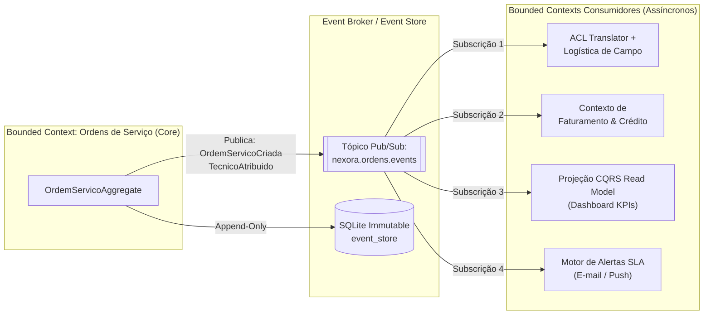
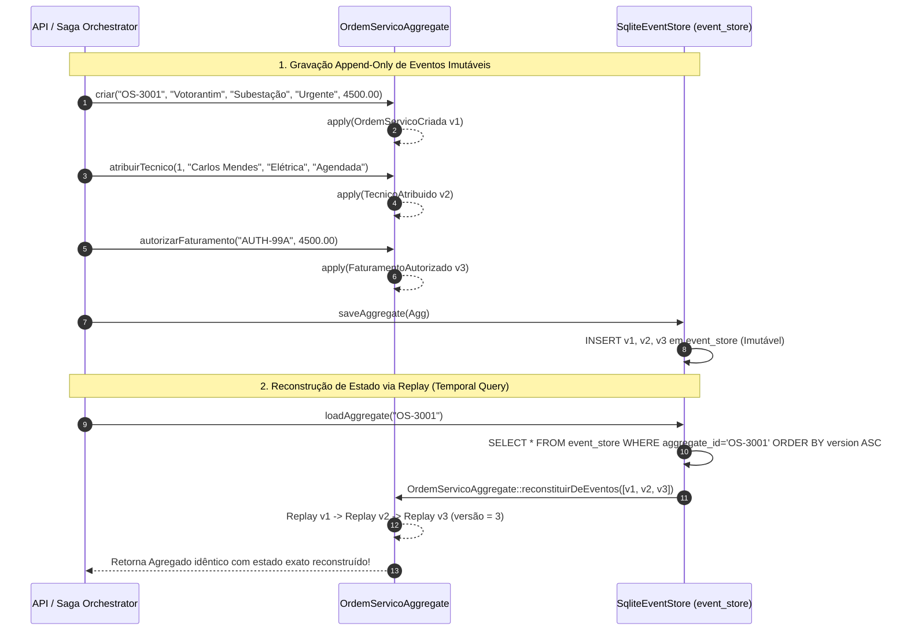
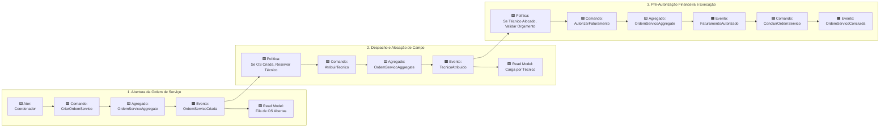
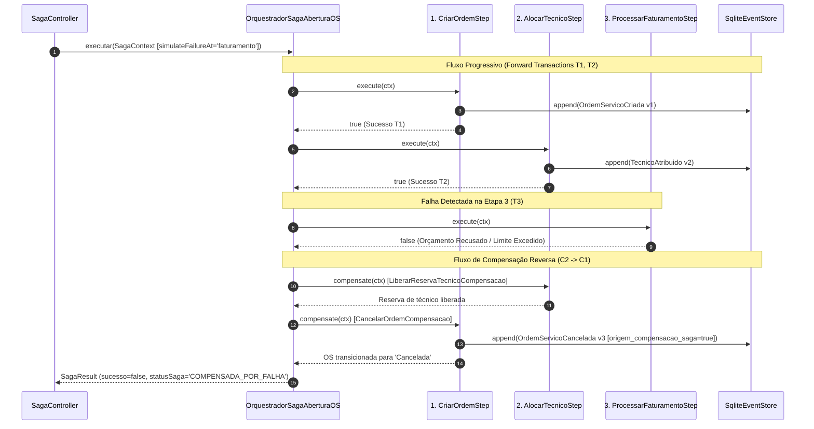
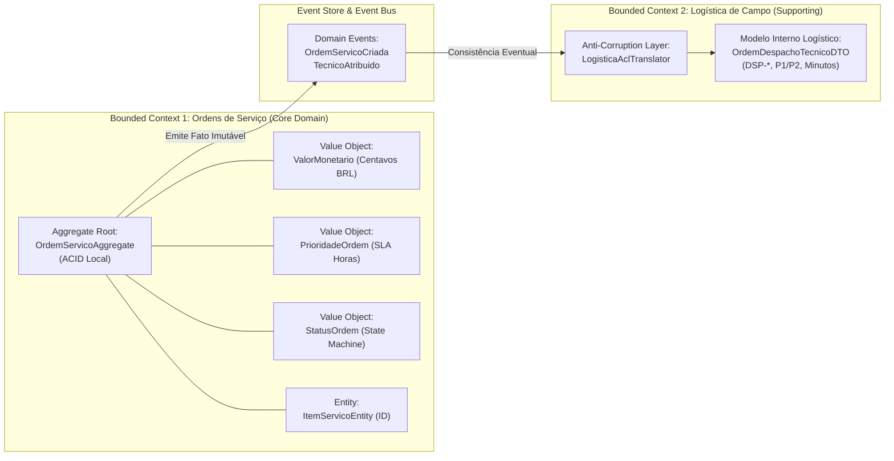

# Atividade Formativa 17 — Event-Driven Architecture (EDA), Event Sourcing, Event Catalog, Event Storming, Saga Pattern & Domain-Driven Design (DDD)

**Disciplina:** Arquitetura de Soluções em Cloud / Engenharia de Software  
**Professor:** Ricardo Vieira (`ASC14-Implementação API_GATEWAY+EVA+DDD+Saga.pdf`)  
**Projeto:** Ecossistema **NEXORA** — Sistema Integrado de Gestão de Ordens de Serviço e Operações de Campo (Field Service ERP)  
**Stack Tecnológica:** PHP 8.3 · Laravel 11 · SQLite Immutable Event Store · REST / JSON · Event-Driven Domain Core  

---

## Sumário Executivo

Este documento consolida a entrega técnica e acadêmica da **Atividade Formativa 17** do ecossistema **NEXORA**, fundamentada integralmente nos conceitos lecionados pelo Prof. Ricardo Vieira nos slides **24 a 46** do material `ASC14-Implementação API_GATEWAY+EVA+DDD+Saga.pdf`.

O objetivo desta etapa é evoluir o núcleo do NEXORA — anteriormente estruturado com MVC, SOLID, CQRS (Formativa 15) e perímetro unificado via API Gateway & BFF (Formativa 16) — para uma arquitetura distribuída orientada a eventos (**EDA**), dotada de persistência imutável e auditável via **Event Sourcing**, catálogo formal de contratos (**Event Catalog**), modelagem colaborativa de domínio (**Event Storming**), coordenação de transações distribuídas com compensação lógica (**Saga Pattern**) e separação estratégica/tática rigorosa via **Domain-Driven Design (DDD)**.

---

## 1. Arquitetura Orientada a Eventos (Event-Driven Architecture — EDA)

### 1.1 Conceito e Anatomia da EDA (Slides 24–25 do `ASC14`)

A **Arquitetura Orientada a Eventos (EDA)** é um paradigma arquitetural de software em que a comunicação entre componentes, módulos ou microsserviços ocorre de forma **assíncrona** por meio da produção, detecção, roteamento e consumo de **eventos de domínio** (fatos imutáveis que aconteceram no negócio).

Diferentemente do modelo tradicional de chamadas síncronas *Request/Response* (bloqueantes e fortemente acopladas no tempo), na EDA o produtor não conhece quem são seus consumidores nem aguarda o processamento downstream para concluir sua operação local.

Os quatro elementos fundamentais da topologia EDA no NEXORA são:

1. **Event Producers (Produtores de Eventos):** Componentes de domínio ou serviços que detectam uma mudança de estado relevante e emitem um evento imutável (ex.: o Agregado `OrdemServicoAggregate` ao emitir `OrdemServicoCriada` ou `TecnicoAtribuido`).
2. **Event Broker / Event Bus (Mediador de Eventos):** Infraestrutura intermediária responsável por receber, persistir temporariamente, filtrar e distribuir os eventos aos assinantes interessados com garantias de entrega (*At-least-once* ou *Exactly-once*).
3. **Event Consumers (Consumidores de Eventos):** Serviços independentes que assinam tópicos/filas específicos e reagem de forma autônoma ao evento recebido (ex.: Serviço de Logística de Campo, Serviço de Faturamento, Serviço de Notificações SLA e Projeções de Read Model do Dashboard).
4. **Modelo Publish/Subscribe (Pub/Sub):** Padrão de distribuição *1-para-N* onde um único evento publicado no tópico `nexora.ordens.eventos` dispara reações paralelas e independentes em múltiplos contextos delimitados sem exigir qualquer alteração no código do serviço emissor.

### 1.2 Prós e Contras da Arquitetura Orientada a Eventos (Slides 26–27 do `ASC14`)

| Dimensão | Prós (Vantagens Arquiteturais) | Contras (Desafios e Trade-offs) |
| :--- | :--- | :--- |
| **Acoplamento** | **Desacoplamento Espacial e Temporal:** Produtores e consumidores evoluem em ciclos independentes; o produtor não falha se um consumidor secundário estiver em manutenção. | **Complexidade de Orquestração:** Fluxos de negócio longos distribuídos em múltiplos eventos tornam-se difíceis de visualizar sem um coordenador explícito. |
| **Escalabilidade** | **Escalabilidade Horizontal Elástica:** Consumidores sob alta carga (ex.: processamento de telemetria de técnicos em campo) podem escalar instâncias independentemente do serviço de abertura de OS. | **Dificuldade de Debug e Rastreamento (Tracing):** Rastrear uma requisição assíncrona exige propagação disciplinada de `X-Correlation-Id` e `causation_id` nos metadados dos eventos. |
| **Tempo de Resposta** | **Reatividade em Tempo Real:** O cliente recebe confirmação imediata da intenção enquanto tarefas pesadas (faturamento, notificações, atualização de relatórios) ocorrem em background. | **Consistência Eventual:** Os modelos de leitura (*Read Models*) podem apresentar um atraso de milissegundos/segundos em relação ao modelo de escrita (*Write Model*). |
| **Extensibilidade** | **Open/Closed Arquitetural:** Novos serviços (ex.: módulo de Auditoria Fiscal ou IA preditiva de manutenção) podem ser plugados apenas assinando o tópico existente. | **Tratamento de Duplicidade (Idempotência):** Como brokers geralmente operam em *At-least-once delivery*, consumidores precisam ser estritamente idempotentes. |
| **Resiliência** | **Tolerância a Falhas (Buffer):** Se o serviço de Faturamento cair temporariamente, as mensagens permanecem retidas na fila/broker e são processadas assim que o nó se recupera (*Dead-Letter Queues*). | **Governança de Contratos (Schema Evolution):** Alterações incompatíveis no payload JSON de um evento podem quebrar consumidores legados se não houver versionamento (`schema_version`). |

### 1.3 Stack Tecnológico de Referência para EDA em Cloud (Slides 28–29 do `ASC14`)

Em alinhamento com os slides 28 e 29 do Prof. Ricardo Vieira, a arquitetura de referência do NEXORA para ambientes corporativos de nuvem contempla:

- **Mensageria e Event Streaming:**
  - **Apache Kafka:** Plataforma distribuída de *event streaming* de altíssimo throughput baseada em logs particionados imutáveis, ideal para retenção longa e *replay* de eventos corporativos.
  - **RabbitMQ:** Message Broker AMQP versátil com roteamento avançado (*Exchanges Direct, Topic, Fanout*) e suporte nativo a *Dead-Letter Queues (DLQ)* para filas de comandos e tarefas.
  - **Azure Service Bus / Azure Event Grid:** Serviços gerenciados PaaS na nuvem Microsoft Azure (integrados ao Resource Group `rg-nexora-ca` da Formativa 16), oferecendo tópicos Pub/Sub corporativos, sessões transacionais e integração nativa com Azure App Service.
- **Processamento de Fluxos (Stream Processing):**
  - **Apache Flink:** Motor de processamento contínuo *stateful* sobre fluxos de eventos para cálculo de janelas de SLA em tempo real e detecção de anomalias operacionais.
- **Observabilidade e Telemetria Assíncrona:**
  - **Prometheus & Grafana:** Coleta de métricas de *consumer lag*, taxa de publicação de eventos por segundo, latência de execução de Sagas e painéis visuais de saúde operacional.
  - **OpenTelemetry / Distributed Tracing:** Correlação ponta a ponta através do identificador `X-Correlation-Id` injetado desde o API Gateway até o metadado do `event_store`.

---

## 2. Event Sourcing: Persistência Imutável e Reconstrução de Estado

### 2.1 Fundamentos do Event Sourcing (Slides 30–31 do `ASC14`)

Nos sistemas CRUD tradicionais (*State-Oriented Persistence*), o banco de dados armazena apenas a **fotografia do estado atual** de um registro (sobrescrevendo valores anteriores com `UPDATE ordens_servico SET situacao = 'Concluída'`). Essa abordagem destrói o histórico de transição: perde-se o contexto de *quando* um técnico foi trocado, *quantas* tentativas de autorização financeira ocorreram ou *qual* motivo exato levou a uma compensação de falha.

O padrão **Event Sourcing** (Slides 30 e 31) inverte essa lógica:
- **A fonte da verdade (*Single Source of Truth*) não é a linha mutável da tabela, mas sim a sequência ordenada e imutável de Eventos de Domínio gravados em um Log Append-Only (`Event Store`).**
- Nunca se executa `UPDATE` ou `DELETE` sobre um fato ocorrido. Se uma Ordem de Serviço precisa ser desfeita, grava-se um novo evento subsequente (`OrdemServicoCancelada`).
- **Reconstrução de Estado (*State Replay*):** O estado atual de qualquer `OrdemServicoAggregate` é obtido carregando todos os seus eventos desde a versão `1` até a versão `N` e reaplicando-os sequencialmente em memória (`reconstituirDeEventos()`).

### 2.2 Implementação Real no NEXORA (`SqliteEventStore` & `OrdemServicoAggregate`)

No NEXORA, a tabela `event_store` (definida na migration [`2026_10_21_000004_create_event_store_table.php`](file:///home/fernando/Documentos/Faculdade/Arquitetura%20em%20claud/database/migrations/2026_10_21_000004_create_event_store_table.php)) possui restrição de unicidade composta `UNIQUE(aggregate_type, aggregate_id, version)`, garantindo **Controle de Concorrência Otimista** e ordenação estrita:

| Coluna | Tipo | Papel Arquitetural no Event Store |
| :--- | :--- | :--- |
| `id` | `INTEGER PK` | Sequencial global de inserção no log de eventos. |
| `event_id` | `VARCHAR(100) UNIQUE` | UUID v4 único globalmente do evento para garantia de idempotência nos consumidores. |
| `aggregate_type` | `VARCHAR(100)` | Tipo do Agregado raiz (`OrdemServicoAggregate`). |
| `aggregate_id` | `VARCHAR(100)` | Identificador de negócio da OS (ex.: `OS-1001`, `OS-5001`). |
| `event_type` | `VARCHAR(100)` | Classe semântica do fato ocorrido (`OrdemServicoCriada`, `TecnicoAtribuido`, etc.). |
| `version` | `UNSIGNED INT` | Versão incremental do agregado (`1, 2, 3...`), impedindo escrita concorrente conflitante. |
| `payload` | `JSON` | Dados imutáveis do fato de negócio serializados em JSON. |
| `metadata` | `JSON` | Contexto de auditoria (`saga_id`, `source`, `schema_version`, `compensating_action`). |
| `created_at` | `TIMESTAMP` | Carimbo de tempo exato da ocorrência do fato. |

A reconstituição determinística implementada em [`OrdemServicoAggregate.php`](file:///home/fernando/Documentos/Faculdade/Arquitetura%20em%20claud/app/Core/Domain/Aggregates/OrdemServicoAggregate.php) (`OrdemServicoAggregate::reconstituirDeEventos()`) percorre o fluxo de eventos retornado por [`SqliteEventStore.php`](file:///home/fernando/Documentos/Faculdade/Arquitetura%20em%20claud/app/Core/Infrastructure/EventStore/SqliteEventStore.php) e invoca os métodos internos `applyOrdemServicoCriada()`, `applyTecnicoAtribuido()`, `applyFaturamentoAutorizado()`, `applyOrdemServicoConcluida()` e `applyOrdemServicoCancelada()`.

### 2.3 Estratégia de Snapshots e Prós vs Contras (Slides 32–33 do `ASC14`)

- **O Problema de Fluxos Longos:** Quando um agregado acumula milhares de eventos ao longo de anos, reconstruir seu estado desde a versão `1` a cada requisição pode introduzir latência de leitura.
- **Solução — Snapshots (Slide 32):** Periodicamente (ex.: a cada `N = 50` versões), o sistema grava uma fotografia consolidada (*Snapshot*) do estado na versão `50`. Na próxima leitura, o `EventStore` carrega o *Snapshot v50* e aplica o *Replay* apenas dos eventos incrementais `v51, v52...`, mantendo complexidade $O(1)$ amortizada.
- **Prós do Event Sourcing:**
  1. **Trilha de Auditoria 100% Fiel (Compliance Nativo):** O próprio log de eventos é a auditoria; impossível adulterar histórico sem deixar rastro.
  2. **Viagem no Tempo (*Time Travel Debugging*):** Permite reconstruir o estado exato de uma Ordem de Serviço em qualquer instante do passado para diagnosticar incidentes.
  3. **Projeções Retroativas:** Permite criar novos dashboards e relatórios analíticos hoje populando-os com o replay de eventos gravados meses atrás.
- **Contras do Event Sourcing:**
  1. **Crescimento Contínuo de Armazenamento:** Exige políticas de particionamento e snapshots.
  2. **Evolução de Esquema (*Upcasting*):** Eventos antigos permanecem no store; novas versões de código precisam de *Upcasters* para ler formatos legados.
  3. **Consultas Ad-Hoc Complexas:** Não é possível fazer `SELECT WHERE situacao = 'Aberta'` diretamente no JSON do Event Store com eficiência — por isso o Event Sourcing é quase sempre combinado com **CQRS** (mantendo tabelas de leitura projetadas).

---

## 3. Event Catalog & Event Storming do Ecossistema NEXORA

### 3.1 Event Catalog Oficial (Slide 34 do `ASC14`)

Seguindo a disciplina de documentação viva de eventos (*Event Catalog* — Slide 34), a tabela abaixo documenta formalmente todos os eventos de domínio do NEXORA, seus produtores, consumidores, gatilhos e schemas JSON:

| Evento (`event_type`) | Versão Schema | Bounded Context Produtor | Bounded Contexts Consumidores | Gatilho de Negócio | Payload JSON (Atributos Chave) |
| :--- | :---: | :--- | :--- | :--- | :--- |
| **`OrdemServicoCriada`** | `1.0` | **Ordens de Serviço** *(Core Domain)* | 1. Logística de Campo (via ACL) 2. Projeção CQRS Read Model 3. Notificações SLA | Comando `CriarOrdemServico` ou Etapa 1 da Saga (`CriarOrdemStep`) | `codigo`, `cliente`, `servico`, `prioridade`, `situacao: "Aberta"`, `valor_estimado_reais`, `valor_estimado_centavos`, `sla_horas`, `observacoes` |
| **`TecnicoAtribuido`** | `1.0` | **Ordens de Serviço / Logística** | 1. Logística de Campo (Agenda) 2. Projeção Dashboard KPIs 3. App Mobile do Técnico | Comando `AtribuirTecnico` ou Etapa 2/4 da Saga (`AlocarTecnicoStep`) | `codigo`, `tecnico_id`, `tecnico_nome`, `especialidade`, `situacao: "Agendada" \| "Em execução"` |
| **`FaturamentoAutorizado`** | `1.0` | **Faturamento & Crédito** *(Supporting)* | 1. Ordens de Serviço (Liberação) 2. Contas a Receber / ERP Fiscal | Etapa 3 da Saga (`ProcessarFaturamentoStep`) após validação de limite | `codigo`, `codigo_autorizacao`, `valor_autorizado_reais`, `valor_autorizado_centavos`, `faturamento_autorizado: true` |
| **`OrdemServicoConcluida`** | `1.0` | **Ordens de Serviço** *(Core Domain)* | 1. Faturamento (Emissão NF-e) 2. Dashboard Executivo KPIs 3. Pesquisa NPS Cliente | Comando `ConcluirOrdemServico` após laudo técnico de campo | `codigo`, `situacao: "Concluída"`, `valor_final_reais`, `valor_final_centavos`, `laudo_tecnico` |
| **`OrdemServicoCancelada`** | `1.0` | **Ordens de Serviço / Saga Orchestrator** | 1. Logística (Libera agenda) 2. Faturamento (Estorna reserva) 3. Auditoria Operacional | Cancelamento manual ou Compensação de Saga (`CancelarOrdemCompensacao`) | `codigo`, `situacao: "Cancelada"`, `motivo_cancelamento`, `origem_compensacao_saga: bool` |

### 3.2 Mapeamento de Event Storming (Slides 35–36 do `ASC14`)

O **Event Storming** (criado por Alberto Brandolini e abordado nos slides 35 e 36) é um workshop colaborativo que reúne *Domain Experts* (especialistas de negócio em operações de campo) e arquitetos de software para mapear cronologicamente o comportamento do sistema usando a notação semântica de post-its coloridos:

- 🟨 **Amarelo (Actor / Ator):** Quem inicia a ação (*Coordenador de Operações*, *Engenheiro de Campo*, *Orquestrador de Saga*).
- 🟦 **Azul (Command / Comando):** Intenção imperativa de mudança de estado (*CriarOrdemServico*, *AlocarTecnico*, *AutorizarFaturamento*, *ConcluirOrdemServico*, *CancelarOrdemServico*).
- 🟨 **Amarelo Largo (Aggregate / Agregado):** Guardião das invariantes que processa o comando (`OrdemServicoAggregate`).
- 🟧 **Laranja (Domain Event / Evento de Domínio):** Fato no verbo no passado que aconteceu como consequência (`OrdemServicoCriada`, `TecnicoAtribuido`, `FaturamentoAutorizado`, `OrdemServicoConcluida`, `OrdemServicoCancelada`).
- 🟪 **Lilás (Policy / Política Reativa):** Regra automatizada *"Sempre que [Evento X] ocorrer, então dispare [Comando Y]"* (ex.: *Política de Despacho Automático*, *Política de Compensação de Saga*).
- 🟩 **Verde (Read Model / Modelo de Leitura):** Visão otimizada para tomada de decisão (*Painel de KPIs de SLA*, *Agenda de Carga por Técnico*).

---

## 4. Saga Pattern: Transações Distribuídas e Compensação Lógica

### 4.1 Por que não usar Two-Phase Commit (2PC) em Microsserviços? (Slides 37–38 do `ASC14`)

Em arquiteturas distribuídas onde cada contexto delimitado (*Ordens*, *Logística de Técnicos*, *Faturamento*) possui sua própria base de dados ou serviço isolado, transações ACID distribuídas baseadas em protocolo **Two-Phase Commit (2PC / XA)** são inviáveis porque:
1. Mantêm bloqueios pessimistas (*locks*) em múltiplos bancos de dados simultaneamente, degradando drasticamente a vazão (*throughput*).
2. Criam acoplamento de disponibilidade (se o nó de Faturamento oscilar por 5 segundos, o banco de Ordens fica travado).

O **Saga Pattern** (proposto originalmente por Hector Garcia-Molina & Kenneth Salem e detalhado nos slides 37 a 41) resolve esse problema substituindo uma transação global bloqueante por uma **sequência de transações locais $(T_1, T_2, \dots, T_n)$**, onde cada transação local $T_i$ possui uma **Transação de Compensação correspondente $(C_i)$** capaz de desfazer semanticamente (*Rollback Lógico*) os efeitos de $T_i$ caso uma etapa posterior $T_k$ ($k > i$) falhe.

### 4.2 Saga Coreografada vs Saga Orquestrada (Slides 39–40 do `ASC14`)

| Critério Comparativo | Saga Coreografada (*Choreography*) | Saga Orquestrada (*Orchestration* — Adotada no NEXORA) |
| :--- | :--- | :--- |
| **Coordenação** | Descentralizada: cada serviço escuta eventos do anterior e emite o próximo evento. | Centralizada: uma classe/serviço Orquestrador (`OrquestradorSagaAberturaOS`) comanda cada passo. |
| **Acoplamento Cíclico** | Risco elevado de dependências cíclicas entre serviços quando há mais de 3 etapas. | Baixo acoplamento entre participantes: os serviços não conhecem uns aos outros, apenas o orquestrador. |
| **Visibilidade do Estado** | Difícil saber em qual etapa uma transação travou sem inspecionar múltiplos logs. | **Visibilidade Total:** O `SagaContext` e `SagaResult` informam exatamente quais etapas e compensações rodaram. |
| **Controle de Rollback** | Complexo: cada serviço precisa saber quais eventos de erro alheios exigem sua compensação. | **Determinístico:** O orquestrador empilha as etapas bem-sucedidas e executa `compensate()` em ordem reversa exata ($C_{k-1} \to \dots \to C_1$). |

### 4.3 Implementação no NEXORA: `OrquestradorSagaAberturaOS` (Slide 41 do `ASC14`)

Seguindo exatamente o diagrama de fluxo progressivo e compensatório do **Slide 41 do `ASC14`**, o NEXORA implementa a abertura completa de uma Ordem de Serviço corporativa em [`OrquestradorSagaAberturaOS.php`](file:///home/fernando/Documentos/Faculdade/Arquitetura%20em%20claud/app/Core/Saga/OrquestradorSagaAberturaOS.php) composta por **4 etapas sequenciais**:

1. **`CriarOrdemStep`** ([`CriarOrdemStep.php`](file:///home/fernando/Documentos/Faculdade/Arquitetura%20em%20claud/app/Core/Saga/Steps/CriarOrdemStep.php)):
   - *Ação Progressiva ($T_1$):* Instancia o `OrdemServicoAggregate` no estado `Aberta`, grava o evento `OrdemServicoCriada` (v1) no `SqliteEventStore` e persiste o registro inicial.
   - *Compensação ($C_1$ — `CancelarOrdemCompensacao`):* Invoca `$aggregate->cancelar($motivo, origemCompensacaoSaga: true)`, emite o evento imutável `OrdemServicoCancelada` no `SqliteEventStore` e atualiza a situação para `Cancelada`.
2. **`AlocarTecnicoStep`** ([`AlocarTecnicoStep.php`](file:///home/fernando/Documentos/Faculdade/Arquitetura%20em%20claud/app/Core/Saga/Steps/AlocarTecnicoStep.php)):
   - *Ação Progressiva ($T_2$):* Reserva o especialista no contexto de Logística de Campo, transiciona a OS para `Agendada` e grava o evento `TecnicoAtribuido` (v2) no `SqliteEventStore`. Falha caso o técnico esteja indisponível ou `$ctx->simulateFailureAt === 'alocacao'`.
   - *Compensação ($C_2$ — `LiberarReservaTecnicoCompensacao`):* Libera a agenda do técnico reservado e registra o estorno de alocação nos metadados de auditoria da Saga.
3. **`ProcessarFaturamentoStep`** ([`ProcessarFaturamentoStep.php`](file:///home/fernando/Documentos/Faculdade/Arquitetura%20em%20claud/app/Core/Saga/Steps/ProcessarFaturamentoStep.php)):
   - *Ação Progressiva ($T_3$):* Valida o orçamento estimado no contexto de Faturamento (limite automático de `R$ 50.000,00`), gera o código `AUTH-FIN-*` e grava `FaturamentoAutorizado` (v3) no `SqliteEventStore`. Falha se `$valorEstimado > 50000` ou `$ctx->simulateFailureAt === 'faturamento'`.
   - *Compensação ($C_3$ — `EstornarPreAutorizacaoFaturamentoCompensacao`):* Invalida a pré-autorização financeira caso uma etapa subsequente falhe.
4. **`ConfirmarOrdemStep`** ([`ConfirmarOrdemStep.php`](file:///home/fernando/Documentos/Faculdade/Arquitetura%20em%20claud/app/Core/Saga/Steps/ConfirmarOrdemStep.php)):
   - *Ação Progressiva ($T_4$):* Confirma o despacho operacional, transicionando a Ordem de Serviço para `Em execução` e gravando o evento correspondente (v4) no Event Store.

---

## 5. Domain-Driven Design (DDD): Design Estratégico e Design Tático

### 5.1 Os Dois Pilares do DDD (Slides 42–44 do `ASC14`)

Criado por **Eric Evans** (*Domain-Driven Design: Tackling Complexity in the Heart of Software*, 2003) e sintetizado nos slides 42 a 46 do Prof. Ricardo Vieira, o DDD combate a degradação arquitetural conhecida como *Big Ball of Mud* e a desconexão semântica entre especialistas de negócio e desenvolvedores (*Lost in Translation*).

A tabela abaixo relaciona os dois pilares do DDD (conforme Slide 44 do `ASC14`) com sua materialização direta no código do NEXORA:

| Pilar do DDD | Conceito / Padrão | Definição (Slide 44 `ASC14`) | Implementação Concreta no NEXORA |
| :--- | :--- | :--- | :--- |
| **DDD Estratégico** *(Visão Macro / Fronteiras)* | **Bounded Contexts** *(Contextos Delimitados)* | Fronteiras explícitas dentro das quais um modelo de domínio específico e sua linguagem são válidos sem ambiguidade. | 1. **Ordens de Serviço** *(Core Domain)* 2. **Logística de Campo & Alocação** *(Supporting Domain)* 3. **Faturamento & Crédito** *(Supporting Domain)* |
| **DDD Estratégico** | **Ubiquitous Language** *(Linguagem Ubíqua)* | Vocabulário comum compartilhado entre especialistas de negócio e código-fonte (classes, métodos e eventos em português de negócio). | No Core: `OrdemServicoAggregate`, `PrioridadeOrdem`, `StatusOrdem`, `atribuirTecnico()`. Na Logística: `OrdemDespachoTecnicoDTO`, `janelaAtendimentoMinutos`. |
| **DDD Estratégico** | **Context Mapping & ACL** *(Anti-Corruption Layer)* | Camada de tradução defensiva que impede que o modelo de um contexto externo contamine o modelo interno de outro contexto (Slide 45). | [`LogisticaAclTranslator.php`](file:///home/fernando/Documentos/Faculdade/Arquitetura%20em%20claud/app/Core/Domain/ACL/LogisticaAclTranslator.php) traduz `OrdemServicoCriada` + `TecnicoAtribuido` em [`OrdemDespachoTecnicoDTO.php`](file:///home/fernando/Documentos/Faculdade/Arquitetura%20em%20claud/app/Core/Domain/ACL/OrdemDespachoTecnicoDTO.php). |
| **DDD Tático** *(Visão Micro / Blocos)* | **Aggregate Root** *(Raiz de Agregado)* | Cluster de objetos de domínio tratados como uma unidade transacional ACID local; toda mutação passa obrigatoriamente pela raiz. | [`OrdemServicoAggregate.php`](file:///home/fernando/Documentos/Faculdade/Arquitetura%20em%20claud/app/Core/Domain/Aggregates/OrdemServicoAggregate.php) protege todas as invariantes de transição de status e versão. |
| **DDD Tático** | **Entity** *(Entidade)* | Objeto definido por sua identidade contínua ao longo do tempo (`id`), e não apenas por seus atributos. | [`ItemServicoEntity.php`](file:///home/fernando/Documentos/Faculdade/Arquitetura%20em%20claud/app/Core/Domain/Entities/ItemServicoEntity.php) (identificado por `id`, contendo descrição, quantidade e subtotal). |
| **DDD Tático** | **Value Objects** *(Objetos de Valor)* | Objetos imutáveis (`readonly`), sem identidade de tabela, definidos exclusivamente pelos seus atributos e regras de validação intrínsecas. | [`ValorMonetario.php`](file:///home/fernando/Documentos/Faculdade/Arquitetura%20em%20claud/app/Core/Domain/ValueObjects/ValorMonetario.php), [`PrioridadeOrdem.php`](file:///home/fernando/Documentos/Faculdade/Arquitetura%20em%20claud/app/Core/Domain/ValueObjects/PrioridadeOrdem.php) e [`StatusOrdem.php`](file:///home/fernando/Documentos/Faculdade/Arquitetura%20em%20claud/app/Core/Domain/ValueObjects/StatusOrdem.php). |
| **DDD Tático** | **Domain Events** *(Eventos de Domínio)* | Objetos imutáveis que capturam fatos de negócio ocorridos no agregado. | [`OrdemServicoCriada.php`](file:///home/fernando/Documentos/Faculdade/Arquitetura%20em%20claud/app/Core/Domain/Events/OrdemServicoCriada.php), [`TecnicoAtribuido.php`](file:///home/fernando/Documentos/Faculdade/Arquitetura%20em%20claud/app/Core/Domain/Events/TecnicoAtribuido.php), [`FaturamentoAutorizado.php`](file:///home/fernando/Documentos/Faculdade/Arquitetura%20em%20claud/app/Core/Domain/Events/FaturamentoAutorizado.php), [`OrdemServicoConcluida.php`](file:///home/fernando/Documentos/Faculdade/Arquitetura%20em%20claud/app/Core/Domain/Events/OrdemServicoConcluida.php), [`OrdemServicoCancelada.php`](file:///home/fernando/Documentos/Faculdade/Arquitetura%20em%20claud/app/Core/Domain/Events/OrdemServicoCancelada.php). |

### 5.2 Context Map & Anti-Corruption Layer (ACL) — Slide 45 do `ASC14`

O **Slide 45 do `ASC14`** ilustra como um **Bounded Context Core** se comunica com um **Bounded Context Supporting** através de um **Event Broker** e de uma **Anti-Corruption Layer (ACL)**.

No NEXORA:
1. No **Bounded Context de Ordens de Serviço (Core Domain)**, uma prioridade é modelada pelo Value Object `PrioridadeOrdem` (`Baixa`, `Média`, `Alta`, `Urgente`) com SLA expresso em horas (`72h`, `24h`, `8h`, `2h`).
2. No **Bounded Context de Logística de Campo (Supporting Domain)**, o motor de roteirização de equipes trabalha com **Níveis de Criticidade Logística** (`CRITICA_IMEDIATA_P1`, `ALTA_PRIORIDADE_P2`, `NORMAL_PROGRAMADA_P3`, `ROTINA_BAIXA_P4`), **Janelas de Atendimento em Minutos** (`120 min`, `480 min`, `1440 min`) e códigos de despacho prefixados com `DSP-`.
3. Para que o modelo de Logística não fique acoplado às classes internas do Core Domain, o tradutor [`LogisticaAclTranslator.php`](file:///home/fernando/Documentos/Faculdade/Arquitetura%20em%20claud/app/Core/Domain/ACL/LogisticaAclTranslator.php) intercepta os eventos `OrdemServicoCriada` e `TecnicoAtribuido` e produz um [`OrdemDespachoTecnicoDTO.php`](file:///home/fernando/Documentos/Faculdade/Arquitetura%20em%20claud/app/Core/Domain/ACL/OrdemDespachoTecnicoDTO.php) totalmente isolado e fiel ao vocabulário logístico.

---

## 6. Endpoints de Demonstração e Verificação Prática

A implementação da Formativa 17 expõe endpoints REST dedicados no controlador [`SagaAndEventSourcingController.php`](file:///home/fernando/Documentos/Faculdade/Arquitetura%20em%20claud/app/Http/Controllers/Api/SagaAndEventSourcingController.php) para inspeção ao vivo da Saga e do Event Store:

1. **`POST /api/saga/ordens` (`executarSaga`):**
   - Executa o `OrquestradorSagaAberturaOS`.
   - Aceita o parâmetro opcional `simulate_failure_at: "alocacao" | "faturamento"` para demonstrar em tempo real o acionamento automático das transações de compensação reversas (`LiberarReservaTecnicoCompensacao` $\to$ `CancelarOrdemCompensacao`).
2. **`GET /api/event-store/{aggregateId}` (`historicoEventos`):**
   - Consulta a tabela imutável `event_store`, retorna a trilha cronológica de eventos (`v1, v2, v3...`), reconstrói o estado atual de `OrdemServicoAggregate` exclusivamente via *Event Replay* (`reconstituirDeEventos()`) e demonstra a tradução da camada **ACL** (`traducaoAclLogisticaCampo`).

---

## 7. Rastreabilidade de Arquivos Implementados na Formativa 17

- **Value Objects (DDD Tático):**
  - [`app/Core/Domain/ValueObjects/ValorMonetario.php`](file:///home/fernando/Documentos/Faculdade/Arquitetura%20em%20claud/app/Core/Domain/ValueObjects/ValorMonetario.php)
  - [`app/Core/Domain/ValueObjects/PrioridadeOrdem.php`](file:///home/fernando/Documentos/Faculdade/Arquitetura%20em%20claud/app/Core/Domain/ValueObjects/PrioridadeOrdem.php)
  - [`app/Core/Domain/ValueObjects/StatusOrdem.php`](file:///home/fernando/Documentos/Faculdade/Arquitetura%20em%20claud/app/Core/Domain/ValueObjects/StatusOrdem.php)
- **Domain Events:**
  - [`app/Core/Domain/Events/DomainEventInterface.php`](file:///home/fernando/Documentos/Faculdade/Arquitetura%20em%20claud/app/Core/Domain/Events/DomainEventInterface.php)
  - [`app/Core/Domain/Events/AbstractDomainEvent.php`](file:///home/fernando/Documentos/Faculdade/Arquitetura%20em%20claud/app/Core/Domain/Events/AbstractDomainEvent.php)
  - [`app/Core/Domain/Events/OrdemServicoCriada.php`](file:///home/fernando/Documentos/Faculdade/Arquitetura%20em%20claud/app/Core/Domain/Events/OrdemServicoCriada.php)
  - [`app/Core/Domain/Events/TecnicoAtribuido.php`](file:///home/fernando/Documentos/Faculdade/Arquitetura%20em%20claud/app/Core/Domain/Events/TecnicoAtribuido.php)
  - [`app/Core/Domain/Events/FaturamentoAutorizado.php`](file:///home/fernando/Documentos/Faculdade/Arquitetura%20em%20claud/app/Core/Domain/Events/FaturamentoAutorizado.php)
  - [`app/Core/Domain/Events/OrdemServicoConcluida.php`](file:///home/fernando/Documentos/Faculdade/Arquitetura%20em%20claud/app/Core/Domain/Events/OrdemServicoConcluida.php)
  - [`app/Core/Domain/Events/OrdemServicoCancelada.php`](file:///home/fernando/Documentos/Faculdade/Arquitetura%20em%20claud/app/Core/Domain/Events/OrdemServicoCancelada.php)
- **Entities, Aggregate Root & Anti-Corruption Layer (ACL):**
  - [`app/Core/Domain/Entities/ItemServicoEntity.php`](file:///home/fernando/Documentos/Faculdade/Arquitetura%20em%20claud/app/Core/Domain/Entities/ItemServicoEntity.php)
  - [`app/Core/Domain/Aggregates/OrdemServicoAggregate.php`](file:///home/fernando/Documentos/Faculdade/Arquitetura%20em%20claud/app/Core/Domain/Aggregates/OrdemServicoAggregate.php)
  - [`app/Core/Domain/ACL/OrdemDespachoTecnicoDTO.php`](file:///home/fernando/Documentos/Faculdade/Arquitetura%20em%20claud/app/Core/Domain/ACL/OrdemDespachoTecnicoDTO.php)
  - [`app/Core/Domain/ACL/LogisticaAclTranslator.php`](file:///home/fernando/Documentos/Faculdade/Arquitetura%20em%20claud/app/Core/Domain/ACL/LogisticaAclTranslator.php)
- **Event Store & Event Sourcing Infrastructure:**
  - [`app/Core/Infrastructure/EventStore/EventStoreInterface.php`](file:///home/fernando/Documentos/Faculdade/Arquitetura%20em%20claud/app/Core/Infrastructure/EventStore/EventStoreInterface.php)
  - [`app/Core/Infrastructure/EventStore/SqliteEventStore.php`](file:///home/fernando/Documentos/Faculdade/Arquitetura%20em%20claud/app/Core/Infrastructure/EventStore/SqliteEventStore.php)
- **Saga Pattern Orchestrator & Compensating Steps:**
  - [`app/Core/Saga/SagaContext.php`](file:///home/fernando/Documentos/Faculdade/Arquitetura%20em%20claud/app/Core/Saga/SagaContext.php)
  - [`app/Core/Saga/SagaResult.php`](file:///home/fernando/Documentos/Faculdade/Arquitetura%20em%20claud/app/Core/Saga/SagaResult.php)
  - [`app/Core/Saga/SagaStepInterface.php`](file:///home/fernando/Documentos/Faculdade/Arquitetura%20em%20claud/app/Core/Saga/SagaStepInterface.php)
  - [`app/Core/Saga/OrquestradorSagaAberturaOS.php`](file:///home/fernando/Documentos/Faculdade/Arquitetura%20em%20claud/app/Core/Saga/OrquestradorSagaAberturaOS.php)
  - [`app/Core/Saga/Steps/CriarOrdemStep.php`](file:///home/fernando/Documentos/Faculdade/Arquitetura%20em%20claud/app/Core/Saga/Steps/CriarOrdemStep.php)
  - [`app/Core/Saga/Steps/AlocarTecnicoStep.php`](file:///home/fernando/Documentos/Faculdade/Arquitetura%20em%20claud/app/Core/Saga/Steps/AlocarTecnicoStep.php)
  - [`app/Core/Saga/Steps/ProcessarFaturamentoStep.php`](file:///home/fernando/Documentos/Faculdade/Arquitetura%20em%20claud/app/Core/Saga/Steps/ProcessarFaturamentoStep.php)
  - [`app/Core/Saga/Steps/ConfirmarOrdemStep.php`](file:///home/fernando/Documentos/Faculdade/Arquitetura%20em%20claud/app/Core/Saga/Steps/ConfirmarOrdemStep.php)
- **Testes Automatizados (Unitários & Feature):**
  - [`tests/Unit/DddAndEventSourcingTest.php`](file:///home/fernando/Documentos/Faculdade/Arquitetura%20em%20claud/tests/Unit/DddAndEventSourcingTest.php)
  - [`tests/Feature/SagaPatternTest.php`](file:///home/fernando/Documentos/Faculdade/Arquitetura%20em%20claud/tests/Feature/SagaPatternTest.php)
