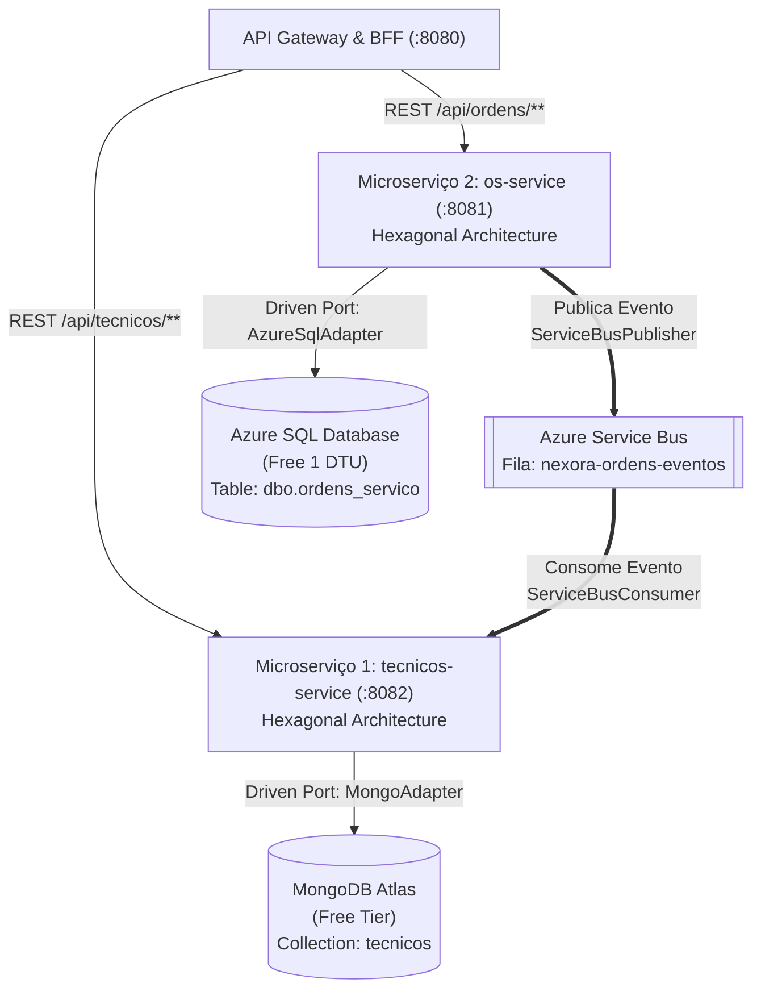

# ARC42 — Documentação Completa de Arquitetura: Microsserviços Backend NEXORA (`tecnicos-service` MongoDB Atlas + `os-service` Azure SQL + Azure Service Bus)

**Projeto:** Repositório 3 — Backend Microservices (`tecnicos-service` & `os-service`)  
**Arquitetura:** Arquitetura Hexagonal (Ports & Adapters) + Database-per-Service + Event-Driven Messaging (Azure Service Bus) + SOLID  
**Integrantes:** Éden Samuel, Fernando Lopes, Felipe Carneiro, Henrique Ricardo, Hugo Takeda

---

## 1. Introdução e Objetivos
O **Backend NEXORA** é composto por dois microsserviços autônomos e desacoplados que implementam o padrão **Database-per-Service** na nuvem **Microsoft Azure**:
- **Microserviço 1 (`tecnicos-service`)**: Gerencia o domínio de **Técnicos de Campo** persistindo documentos no **MongoDB Atlas (Free Tier)**.
- **Microserviço 2 (`os-service`)**: Gerencia o domínio de **Ordens de Serviço** persistindo registros relacionais no **Azure SQL Database (Free 1 DTU)**.
- **Comunicação Assíncrona**: Os dois microsserviços trocam eventos de domínio através do **Azure Service Bus** (fila `nexora-ordens-eventos`).

---

## 2. Restrições de Arquitetura
- **RT-01**: Escritos em **TypeScript 5** sobre **Node.js / Express** com contratos OpenAPI 3.0 (Swagger UI em `/api-docs`).
- **RT-02**: Estrito isolamento **Database-per-Service** — `os-service` nunca acessa o banco do `tecnicos-service` e vice-versa (auditado por `dependency-cruiser` e testes de isolamento físico).
- **RT-03**: Queries 100% parametrizadas no Azure SQL (`@p1, @p2...`) e filtros sanitizados contra operadores `$` no MongoDB Atlas.

---

## 3. Contexto e Escopo (C4 Nível 2)



---

## 4. Estratégia de Solução (Arquitetura Hexagonal & SOLID)
Cada microsserviço é estruturado em quatro camadas unidirecionais (`routes -> controllers -> services/db -> models`):
1. **Driving Adapters (`routes/` e `controllers/`)**: Recebem requisições HTTP do API Gateway & BFF.
2. **Domain & Application Services (`models/` e `services/`)**: Aplicam invariantes de negócio (`LifecycleValidator` para transições de status da OS) e coordenam mensageria (`ServiceBusPublisher` e `ServiceBusConsumer`).
3. **Repositories (`db/*.repository.ts`)**: Orquestram operações de persistência dependendo exclusivamente da abstração `IDatabaseAdapter` (**DIP — Dependency Inversion Principle**).
4. **Driven Adapters (`db/mongo.adapter.ts`, `db/azuresql.adapter.ts`, `db/sqlite.adapter.ts`)**: Implementações concretas da porta `IDatabaseAdapter` (**OCP & LSP**).

---

## 5. Visão de Blocos de Construção (Building Block View)
```text
backend/
├── tecnicos-service/                 # Microserviço 1 — MongoDB Atlas (:8082)
│   ├── src/
│   │   ├── config/env.ts             # MONGODB_URI, MONGODB_DB_NAME, AZURE_SERVICE_BUS_CONNECTION_STRING
│   │   ├── models/Tecnico.ts         # Entidade, DTOs e especialidades válidas
│   │   ├── db/
│   │   │   ├── adapter.interface.ts  # Porta secundária IDatabaseAdapter
│   │   │   ├── mongo.adapter.ts      # Adaptador oficial MongoDB Atlas (Free Tier)
│   │   │   ├── sqlite.adapter.ts     # Fallback local autônomo
│   │   │   ├── factory.ts            # Seleção automática MongoDB Atlas -> Fallback
│   │   │   └── tecnico.repository.ts # Repositório desacoplado do driver
│   │   ├── services/
│   │   │   └── serviceBus.consumer.ts# Consumidor Azure Service Bus (nexora-ordens-eventos)
│   │   ├── controllers/tecnico.controller.ts
│   │   ├── routes/tecnico.routes.ts
│   │   └── swagger/swagger.spec.ts   # Especificação OpenAPI 3.0 (/api-docs)
│   └── tests/                        # Testes Unitários, CRUD e Adversariais
│
└── os-service/                       # Microserviço 2 — Azure SQL Database (:8081)
    ├── src/
    │   ├── config/env.ts             # AZURE_SQL_CONNECTION_STRING, AZURE_SERVICE_BUS_CONNECTION_STRING
    │   ├── models/OrdemServico.ts    # Entidade, DTOs e prioridades/status
    │   ├── db/
    │   │   ├── adapter.interface.ts  # Porta secundária IDatabaseAdapter
    │   │   ├── azuresql.adapter.ts   # Adaptador oficial Azure SQL Database (Free 1 DTU)
    │   │   ├── sqlite.adapter.ts     # Fallback local autônomo
    │   │   ├── factory.ts            # Seleção automática Azure SQL -> Fallback
    │   │   └── ordem.repository.ts   # Repositório desacoplado do driver
    │   ├── services/
    │   │   ├── lifecycle.validator.ts# Máquina de estados (Aberta -> Agendada -> Em Execução -> Concluída)
    │   │   └── serviceBus.publisher.ts# Publicador Azure Service Bus (nexora-ordens-eventos)
    │   ├── controllers/ordem.controller.ts
    │   ├── routes/ordem.routes.ts
    │   └── swagger/swagger.spec.ts   # Especificação OpenAPI 3.0 (/api-docs)
    └── tests/                        # Testes Unitários, CRUD e Adversariais
```

---

## 6. Visão de Tempo de Execução (Runtime View — Troca de Mensagens no Broker)
1. O `os-service` recebe `POST /api/ordens` ou `PATCH /api/ordens/:id/status` com um técnico atribuído (ex: `"Fernando Lopes"`, status `"Em Execução"`).
2. `OrdemRepository` persiste a alteração no **Azure SQL Database** (`AzureSqlAdapter`).
3. `ServiceBusPublisher` publica a mensagem `ORDEM_EM_EXECUCAO` na fila `nexora-ordens-eventos` do **Azure Service Bus** (com `correlationId`).
4. `ServiceBusConsumer` no `tecnicos-service` recebe a mensagem, localiza o técnico no **MongoDB Atlas** (`MongoAdapter`) e atualiza seu status para `"Em Atendimento"`.
5. Quando a OS é marcada como `"Concluída"` ou `"Cancelada"`, um novo evento `ORDEM_CONCLUIDA` / `ORDEM_CANCELADA` é publicado e o `tecnicos-service` altera o status do técnico para `"Disponível"`.

---

## 7. Visão de Implantação (Deployment View)
- **Microserviço 1 (`tecnicos-service`)**: Azure App Service conectado ao cluster **MongoDB Atlas (Free Tier M0)** e ao namespace **Azure Service Bus**.
- **Microserviço 2 (`os-service`)**: Azure App Service conectado ao **Azure SQL Database (Free 1 DTU)** e ao namespace **Azure Service Bus**.

---

## 8. Conceitos Transversais
- **Prevenção de SQL Injection e NoSQL Injection**: `AzureSqlAdapter` utiliza `request.input('p1', val)` com placeholders `@p1`; `MongoAdapter` rejeita objetos operadores (`$ne`, `$gt`, etc.) nos parâmetros.
- **Documentação Viva**: Ambos expõem `/api-docs` (Swagger UI) e `/api-docs.json` (OpenAPI 3.0).
- **Observabilidade**: Endpoints `/health`, `/api/ordens/mensageria/status` e `/api/tecnicos/mensageria/status`.

---

## 9. Decisões de Arquitetura (ADRs)
- **ADR-BE-01**: Uso da interface `IDatabaseAdapter` (Ports & Adapters) para permitir execução idêntica em nuvem (MongoDB Atlas / Azure SQL) e em testes locais determinísticos.
- **ADR-BE-02**: Sincronização eventual de disponibilidade de técnicos via **Azure Service Bus** para manter zero acoplamento direto de banco de dados entre `os-service` e `tecnicos-service`.

---

## 10. Requisitos de Qualidade e Testes
- **Testes Unitários e CRUD (`crud.test.ts`)**: 29 testes no `os-service` + 35 testes no `tecnicos-service` (incluindo testes unitários dedicados para `AzureSqlAdapter`, `MongoAdapter`, `ServiceBusPublisher` e `ServiceBusConsumer`).
- **Testes Adversariais (`adversarial.test.ts`)**: Mais de 160 testes de fronteira, fuzzing, concorrência e isolamento físico de tabelas/coleções.
- **Testes de Arquitetura (`dependency-cruiser`)**: 53 módulos e 92 dependências verificadas com 0 violações.

---

## 11. Riscos e Dívidas Técnicas
- **Indisponibilidade temporária do Broker**: Mitigado com dupla entrega (SDK `@azure/service-bus` + HTTP Broker Bridge assíncrono com correlation ID).

---

## 12. Glossário
- **Ports & Adapters (Hexagonal)**: Arquitetura que separa o núcleo da aplicação dos adaptadores de entrada (HTTP/Consumer) e saída (MongoDB/Azure SQL/Publisher).
- **Database-per-Service**: Padrão onde cada microsserviço é dono exclusivo do seu banco de dados.
- **Azure Service Bus**: Broker de mensageria corporativo gerenciado na nuvem Microsoft Azure.
