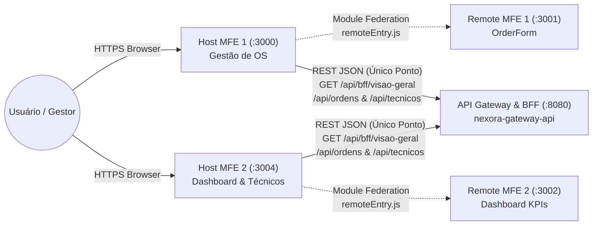

# ARC42 — Documentação Completa de Arquitetura: Microfrontend NEXORA (SPA)

**Projeto:** Repositório 1 — Microfrontend SPA (`host`, `remote`, `host-dashboard`, `remote-dashboard`)  
**Arquitetura:** Microfrontends (Webpack 5 Module Federation) + Clean Frontend Architecture (BFF-First)  
**Integrantes:** Éden Samuel, Fernando Lopes, Felipe Carneiro, Henrique Ricardo, Hugo Takeda

---

## 1. Introdução e Objetivos
O **Microfrontend NEXORA** é a camada de apresentação SPA (*Single Page Application*) do ecossistema distribuído de Gestão de Serviços de Campo (*Field Service Management*). Seu objetivo principal é oferecer interfaces modulares independentes para abertura/gestão de Ordens de Serviço e visualização de KPIs/Técnicos de Campo, consumindo **exclusivamente** o **API Gateway & BFF** sem acoplamento direto aos microsserviços de backend.

### 1.1 Metas de Qualidade (ISO/IEC 25010)
| Meta | Atributo | Tática Arquitetural |
| :--- | :--- | :--- |
| **Desacoplamento de Backend** | Manutenibilidade | Consumo exclusivo do API Gateway & BFF (`:8080` / `nexora-gateway-api`). Proibição arquitetural de chamadas às portas `:8081` e `:8082`. |
| **Deploy Independente** | Modularidade | Composição em tempo de execução via Webpack 5 `ModuleFederationPlugin` (`remoteEntry.js`). |
| **Tolerância a Falhas** | Confiabilidade | `React.Suspense` + `ErrorBoundary` ao carregar componentes remotos e fallback visual resiliente. |

---

## 2. Restrições de Arquitetura
- **RT-01**: Aplicação SPA escrita em **React 18** com empacotamento **Webpack 5**.
- **RT-02**: Proibido acessar microsserviços (`os-service` ou `tecnicos-service`) diretamente pelo navegador; todo tráfego passa pelo **API Gateway & BFF**.
- **RT-03**: Compartilhamento de `react` e `react-dom` configurado como `singleton: true` no Module Federation.

---

## 3. Contexto e Escopo (C4 Nível 1 & 2)



---

## 4. Estratégia de Solução
- **Padrão Arquitetural**: Microfrontends via **Webpack 5 Module Federation** com **Clean Separation of Concerns** (camada de entrada assíncrona `index.js`, inicialização `bootstrap.jsx`, container orquestrador `App.jsx` no Host e componentes de domínio puros nos Remotes).
- **Consumo de Único Response**: Na inicialização, os Hosts consultam `GET /api/bff/visao-geral` no BFF, recebendo em uma única resposta JSON a lista de Ordens de Serviço (vindas do Azure SQL), a lista de Técnicos (vindos do MongoDB Atlas), os KPIs consolidados e o status do broker Azure Service Bus.

---

## 5. Visão de Blocos de Construção (Building Block View)
```text
frontend/
├── host/                       # Shell 1 (Porta 3000) — Orquestração de Ordens de Serviço
│   ├── src/index.js            # Fronteira assíncrona import('./bootstrap')
│   ├── src/bootstrap.jsx       # Montagem do React 18 createRoot
│   ├── src/App.jsx             # Consumo do BFF (/api/bff/visao-geral e /api/ordens) + ErrorBoundary
│   └── webpack.config.js       # Consome remote@.../remoteEntry.js
├── remote/                     # Remote 1 (Porta 3001) — Formulário de Ordem de Serviço
│   ├── src/components/OrderForm.jsx
│   └── webpack.config.js       # Expõe ./OrderForm e ./RemoteApp
├── host-dashboard/             # Shell 2 (Porta 3004) — Orquestração de BI e CRUD de Técnicos
│   ├── src/App.jsx             # Consumo do BFF (/api/bff/visao-geral e /api/tecnicos)
│   └── webpack.config.js       # Consome remoteDashboard@.../remoteEntry.js
└── remote-dashboard/           # Remote 2 (Porta 3002) — Painel Analítico de KPIs
    ├── src/components/Dashboard.jsx
    └── webpack.config.js       # Expõe ./Dashboard e ./RemoteDashboardApp
```

---

## 6. Visão de Tempo de Execução (Runtime View)
1. O navegador carrega `host/src/index.js`, que importa dinamicamente `bootstrap.jsx` e negocia a instância singleton do React com `remoteEntry.js`.
2. `host/src/App.jsx` dispara `GET /api/bff/visao-geral` para o **API Gateway & BFF**.
3. O usuário preenche o `<OrderForm />` federado do `remote` e submete a nova OS.
4. O Host envia `POST /api/ordens` ao **API Gateway & BFF**, que roteia ao `os-service` (Azure SQL), dispara evento no **Azure Service Bus** para o `tecnicos-service` (MongoDB Atlas) e devolve o resultado atualizado.

---

## 7. Visão de Implantação (Deployment View — Microsoft Azure)
Cada Microfrontend possui pipeline CI/CD dedicado em `.github/workflows/` publicando em **Azure App Service** no Resource Group `rg-nexora-ca`:
- `nexora-host-fernando.azurewebsites.net`
- `nexora-remote-fernando.azurewebsites.net`
- `nexora-host-dashboard-fernando.azurewebsites.net`
- `nexora-remote-dashboard-fernando.azurewebsites.net`

---

## 8. Conceitos Transversais (Cross-cutting Concepts)
- **Segurança & Sanitização**: Renderização declarativa JSX sem uso de `innerHTML`, `dangerouslySetInnerHTML`, `eval()`, `alert()` ou `confirm()`.
- **CORS**: As origens dos 4 Microfrontends são autorizadas centralizadamente pelo `CentralizedCorsMiddleware` do API Gateway & BFF.
- **Resiliência**: `ErrorBoundary` captura indisponibilidade de Remotes sem derrubar o Shell principal.

---

## 9. Decisões de Arquitetura (ADRs)
- **ADR-FE-01**: Uso de Webpack 5 Module Federation para integração em runtime entre Host e Remote.
- **ADR-FE-02**: Proibição estrita de chamadas diretas aos microsserviços (`:8081` e `:8082`), forçando 100% do tráfego pelo API Gateway & BFF (`:8080`).

---

## 10. Requisitos de Qualidade e Testes de Arquitetura
Verificados automaticamente via `dependency-cruiser` (`TDE4-Testes-Arquitetura/frontend/.dependency-cruiser.cjs`) e `scripts/test-frontend-architecture-and-unit.mjs`:
- Zero dependências circulares;
- Hosts nunca importam arquivos internos dos Remotes por caminho de arquivo (apenas via Module Federation);
- Nenhuma referência direta a portas ou hosts dos microsserviços.

---

## 11. Riscos e Dívidas Técnicas
- **Indisponibilidade de Remote em Runtime**: Mitigado com `React.Suspense` e `ErrorBoundary` customizado.
- **Latência de Cold Start no Azure Free Tier**: Mitigado com estado inicial otimista e sincronização assíncrona com o BFF.

---

## 12. Glossário
- **MFE (Microfrontend)**: Unidade de frontend desenvolvida e implantada de forma independente.
- **Host (Shell)**: Aplicação container que carrega módulos remotos em tempo de execução.
- **Remote**: Aplicação que expõe componentes via `remoteEntry.js`.
- **BFF (Backend for Frontend)**: Camada que agrega dados de múltiplos microsserviços em um único response adaptado à interface.
