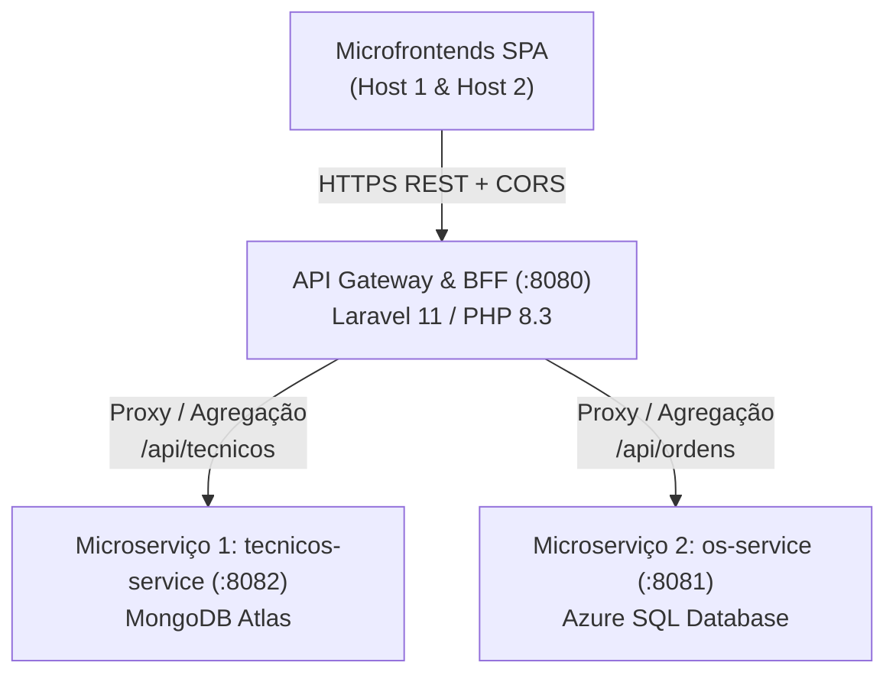

# ARC42 — Documentação Completa de Arquitetura: API Gateway & BFF NEXORA

**Projeto:** Repositório 2 — API Gateway & BFF (`nexora-gateway-api`)  
**Arquitetura:** Clean Architecture + DDD + CQRS + SOLID + BFF Pattern + API Gateway Pattern  
**Integrantes:** Éden Samuel, Fernando Lopes, Felipe Carneiro, Henrique Ricardo, Hugo Takeda

---

## 1. Introdução e Objetivos
O **API Gateway & BFF NEXORA** centraliza todas as requisições oriundas dos Microfrontends SPA, atuando como fachada de segurança, roteador reverso de CRUD e agregador de respostas para a interface.

### 1.1 Responsabilidades Essenciais
1. **Centralização de Entrada**: Ponto único na porta `:8080` (`https://nexora-gateway-api.azurewebsites.net`).
2. **Agregação de Dados em Único Response**: Consulta simultaneamente o **Microserviço 1 (`tecnicos-service` — MongoDB Atlas)** e o **Microserviço 2 (`os-service` — Azure SQL Database)** e devolve tudo consolidado em `GET /api/bff/visao-geral` e `GET /api/bff/dashboard`.
3. **Proxy de Requisições (CRUD Completo)**: Encaminha operações `GET`, `POST`, `PUT`, `PATCH` e `DELETE` de `/api/ordens/**` e `/api/tecnicos/**` aos respectivos microsserviços com propagação de `X-Correlation-Id`.
4. **Roteamento, Segurança e CORS**: Aplica `CentralizedCorsMiddleware`, `CorrelationIdMiddleware` e `GatewayObservabilityMiddleware`.
5. **Swagger Documentado**: Publica especificação OpenAPI 3.0 em `/api/openapi.json` e interface interativa em `/api-docs`.

---

## 2. Restrições de Arquitetura
- **RT-01**: Desenvolvido em **PHP 8.3 / Laravel 11** com `declare(strict_types=1)` em todo o núcleo (`app/Core/`).
- **RT-02**: A camada `app/Core/Domain` não pode depender de `Illuminate/*` ou de `app/Core/Infrastructure` (regra da dependência da Clean Architecture validada por `Pest Arch`).
- **RT-03**: Controllers não podem acessar `Illuminate\Support\Facades\DB` diretamente.

---

## 3. Contexto e Escopo (C4 Nível 2)



---

## 4. Estratégia de Solução
- **Clean Architecture + DDD**: Regras de negócio encapsuladas em `app/Core/Domain` (Agregados, Value Objects, Eventos de Domínio e ACL).
- **CQRS**: Separação estrita entre comandos de escrita (`CommandBus`) e consultas de leitura (`QueryBus`) em `app/Core/Application`.
- **SOLID**:
  - **SRP**: Handlers e Controllers com responsabilidade única.
  - **OCP & LSP**: Estratégias de precificação intercambiáveis implementando `PricingStrategyInterface`.
  - **ISP & DIP**: Interfaces segregadas em `app/Core/Application/Contracts` injetadas via IoC Container.

---

## 5. Visão de Blocos de Construção (Building Block View)
```text
gateway/
├── app/
│   ├── Gateway/
│   │   ├── Controllers/
│   │   │   ├── BffController.php            # /api/bff/status, /api/bff/visao-geral, /api/bff/dashboard, /api/bff/ordens/{id}
│   │   │   ├── GatewayProxyController.php   # Proxy CRUD completo /api/ordens/** e /api/tecnicos/**
│   │   │   └── GatewaySwaggerController.php # Swagger UI (/api-docs) e OpenAPI 3.0 (/api/openapi.json)
│   │   ├── Middleware/
│   │   │   ├── CentralizedCorsMiddleware.php
│   │   │   ├── CorrelationIdMiddleware.php
│   │   │   └── GatewayObservabilityMiddleware.php
│   │   └── Services/
│   │       └── BffService.php               # Agregação multi-serviço com fallback resiliente
│   └── Core/
│       ├── Domain/                          # Value Objects, Aggregates, Domain Events, ACL
│       ├── Application/                     # CQRS CommandBus, QueryBus, Contracts, Pricing Strategies
│       ├── Infrastructure/                  # Repositories & Event Store
│       └── Saga/                            # OrquestradorSagaAberturaOS
├── routes/api.php
└── TDE4-Testes-Arquitetura/gateway/GatewayArchTest.php
```

---

## 6. Visão de Tempo de Execução (Runtime View)
1. Requisição chega ao Gateway passando por `CentralizedCorsMiddleware` e `CorrelationIdMiddleware`.
2. Para `GET /api/bff/visao-geral`, o `BffService` consulta `tecnicos-service` (MongoDB Atlas) e `os-service` (Azure SQL Database), agrega os dados com KPIs e status da fila `nexora-ordens-eventos` do **Azure Service Bus** e retorna um único payload JSON.
3. `GatewayObservabilityMiddleware` adiciona `X-Gateway-Processed-By: NEXORA-API-Gateway-BFF`, `X-Gateway-Route` e `X-Gateway-Execution-Time-Ms`.

---

## 7. Visão de Implantação (Deployment View)
Implantado no **Azure App Service** (`https://nexora-gateway-api.azurewebsites.net`) via GitHub Actions (`.github/workflows/azure-gateway.yml`).

---

## 8. Conceitos Transversais
- **Rastreabilidade Distribuída**: Propagação de `X-Correlation-Id` em todas as chamadas upstream.
- **CORS Centralizado**: Validação de origens permitidas (`localhost:3000..3004` e `*.azurewebsites.net`).
- **Resiliência (Graceful Degradation)**: Caso um microsserviço upstream sofra timeout em ambiente Free Tier, o Gateway mantém disponibilidade através de fallback local sincronizado.

---

## 9. Decisões de Arquitetura (ADRs)
- **ADR-GW-01**: Adoção do padrão BFF para eliminar *Chatty I/O* no navegador e retornar dados consolidados em uma única resposta (`GET /api/bff/visao-geral`).
- **ADR-GW-02**: Verificação automatizada das regras de Clean Architecture, CQRS e SOLID com `Pest Arch`.

---

## 10. Requisitos de Qualidade e Testes
- **40 testes automatizados (354 asserções)** executados via `./vendor/bin/pest`:
  - 15 testes de arquitetura (`GatewayArchTest.php`);
  - 11 testes de integração do API Gateway, BFF, Proxy CRUD e Swagger (`ApiGatewayAndBffTest.php`);
  - 14 testes unitários e de integração de DDD, SOLID, CQRS, Event Sourcing e Saga.

---

## 11. Riscos e Dívidas Técnicas
- **Ponto Único de Entrada**: Mitigado com health checks (`/api/bff/status`) e timeouts curtos de upstream (`config/gateway.php`).

---

## 12. Glossário
- **API Gateway**: Ponto único de entrada que gerencia roteamento, proxy, segurança e observabilidade.
- **BFF (Backend for Frontend)**: Serviço que agrega e adapta dados de múltiplos microsserviços para uma interface específica.
- **Correlation ID**: Identificador único propagado entre serviços para rastreamento de requisições.
